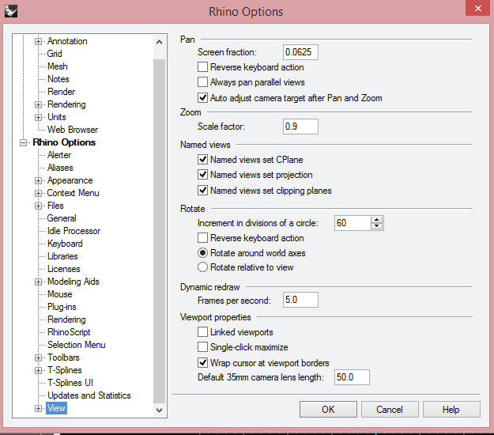
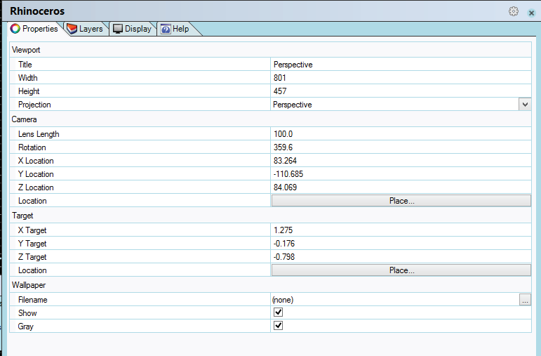

# Rhino Options

- Source PDF: Matrix 8 Instruction Manual Book 1 (matrix8_book_1.pdf)
- Page range: 35-35
- Section title: Rhino Options
- Section id: m8book1-009-rhino-options
- Note: boundary page(s) are shared with a neighbouring section (two-column layout); text/images may include neighbour content.

---
<!-- section m8book1-009-rhino-options | Rhino Options | m8book1 pages 35-35 -->

<!-- page 35 -->

Steps:
## Rhino Options
‘Options’
This is the Rhino Options menu that houses all of
the settings for the Rhino document. This includes
all displays, plug-ins, updates, appearance, units,
video card settings, keyboard shortcuts scripting
and more.
• Select Rhino Options from the Info and Settings
Menu.
• The Interface opens, displaying the Rhino Options
settings.
A complete listing on how to manage Rhino
options can be found in the Rhinoceros Help
menu (F1) listed as “Manage Rhino Options.”
## Object Properties
Where is this Command:
Access this command from Info & Settings
Menu>Rhino Options
‘Properties’
Manage the object properties for the selected
objects. This command opens an interface that
has all the settings for an objects’ display, render
mesh, edge softening, texture mapping and more.
Where is this Command:
Access this command from Info &
Settings>Object Properties
Or, select an object and press Ctrl+T.
Why does the Rhino Options button
appear in Matrix?
Matrix installs a scheme in Rhino for viewport
display settings along with all your video card
settings upon install. Advanced knowledge of
how these settings, along with others, impact
use in Matrix and is needed when making setting
adjustments. Making any of these changes
should be done with great care as they can
cause an adverse effect in Matrix. We added this
quick shortcut button to help those following
instructions from Matrix support or aid those with
advanced knowledge of Rhino Options. From
scripting keyboard shortcuts to changing units
(mm, inches or feet), Rhino Options is a powerful
tool that helps users make setting changes so
Matrix runs at its optimal performance.
Why does Rhino’s Object Properties
button appear in Matrix?
Since adding buttons in Matrix’s main
user interface for Edge Softening, Apply
Displacement along with Texture mapping ability
in VRay and more, having a quick, easy access
to Object Properties makes sense. Turn on or
off Displacement, or select a different texture
map for your object. A complete description of
Object Properties can be found in Rhino Help (F1)
under Properties command or Manage Object
Properties.

---

## Images

-  page 35 (shared page)
-  page 35 (shared page)
