# The Main Menu

- Source PDF: Matrix 8 Instruction Manual Book 1 (matrix8_book_1.pdf)
- Page range: 14-18
- Section title: The Main Menu
- Section id: m8book1-003-the-main-menu

---
<!-- section m8book1-003-the-main-menu | The Main Menu | m8book1 pages 14-18 -->

<!-- page 14 -->

# CHAPTER 2
# The Main Menu
### Located in the upper left-hand corner, the Matrix Main Menus are where you’ll find
### every modeling tool in the program.
The Reset Button
Scroll Button
shows hidden
items, turns
on any layers
that are off, ends any command that is currently
running, and discards any background bitmap. We
used to call this the “Panic” button, because it is a
good thing to click on when you’re not sure what
else to do. It restores program settings back to
the defaults they had when the program was first
started up.
File, View, Utilities, & Measure
Using the Main Menus
Click on a menu title, and its contents - icons
representing each command available in that
menu - will open in the gray space
below the menus. You can only open
one menu at a time. To scroll down
throughout the menu to find the
command you need, use the scroll
buttons on the far right-hand side of
the open menu. Click the scroll button to access
the next rows of menus: two at a time. Click one of
the commands found in the Main Menus to start
up that command. To determine which command
is which, move the mouse over that command
and its Quick Tip will appear in the space beside
“Main Menu” on the gray title bar. If you hover the
mouse over a command, its Quick Tip will appear
beside the button. As you select a command, its
icon will appear in the Icon History portion of your
screen. Icons representing the last 9 commands
ran will appear here, so you can quickly return to
them if necessary.
Undo/Redo
Each of these menus will be covered more in
depth in their individual section beginning with
the File Menu; you will start here to perform the
familiar File > New, Open, and Save features
customary for Windows programs. You may also
import and export models, save notes, print, and
save with different options to maximize file size.
The View menu is where you will import and
control bitmap images you may wish to have
in the viewports to assist you while you work.
Change the “zoom” on the model and find other
viewport view control tools here. Utilities are
commands that are used once your model is
made. They range from basic to advanced and
will all be covered later. The Measure Menu allows
you to measure models on-screen, in mm, with a
few easy mouse-clicks, and display measurement
values right in the viewports beside your model to
aid in production.
Undo/Redo & Reset Tools
As you work, click “Undo” to undo the
last command you ran. In the case
of builders, which send a number of
commands to Rhino automatically, it is best to
use the “Undo” found in the Builder menu, where
applicable.
“Redo” will redo this command. As when working
in Windows, “Ctrl + Z” keys on your keyboard run
Undo and “Ctrl + Y” run Redo. The Reset Tools
button, found after the “Custom” menu on the far
right-hand side under the Main Menu gray title bar,
resets the viewports to restore the default view
of your work (if it is panned or zoomed), returns
to Wireframe Shade, unlocks any locked items,

<!-- page 15 -->

Builder Menu Matrix
Other tools help you work on your models,
including a tool to create an inset surface (Surface
Inset and Surface Pullback), cut out or add
shapes (Boolean Builder), apply a mesh model to
add a design element or texture (Mesh Mapper),
Resize your ring once it’s built (Ring Resizer),
check your objects (Object Checker), weigh your
final design (Metal Weights), place objects on a
curve, and cap the end of a shape (Profile End
Cap). Trace images using high contrast images
(Image Trace), repair models and prepare them for
growing using tools and mesh repair (3D Printing
and Mesh Repair)
This menu is also home to the Smart Target
commands. These allow you to create complex
networks of blended curves that can be
manipulated by modifying the position and
direction of the Smart Targets.
Gems Menu
Builders create whole rings (Signet, Eternity, &
Raised Band styles) or design elements (Award
Ring tops, Celtic Knots, Jump Rings, Patterns, and
Nautilus curves) that you control with a Builder
Menu interface. This interface opens in the lower
left-hand corner of the screen, with the icon and
Builder Name in the gray title bar. Close a builder
by clicking the X beside its name. Builder controls
will be explained in greater detail later, but notice
that the Mill Version of the software also contains
the Toolpath Builders for preparing models to
be milled (only appears in your software if you’ve
purchased the Revo Mill), as well as the Mill Large
Fixture Area button, which places a curve in the
viewports representing the size of the largest
fixture on the Revo Mill. For
more information on using
these tools, consult your Revo
manual, as this manual will not
cover these topics.
Tools Menu
While building your first ring in Chapter 1, use the
most basic gem tool, Gem Loader, to place a gem
of any size, shape, and cut in the viewports. This
gem can be manipulated with Gem Positioner
(MSR) - also found in this menu - with the ease
of Viewport Control Handles. Every dimension
of Emeralds and Baguettes can be controlled
with these interactive tools.
Save Styles and Match
Attributes are the helpful
tools that make gems active
with
History. After learning to create
curves
in the Curve Menu, use gem tools that incorporate
curves, such as Gem on a Curve (Advanced),
Cluster Builder, Tapered Baguette Channel,
Baguette Between Two Curves, Gems Between
Two Curves, and Custom Gem - which creates
a gem from any shape curve you input. Gem
Control and Gem Report reports size, weight, and
apply helpful cues to gems. Advanced gem tools
This menu is where you will find the most basic
tools you will use when modeling and some of
the most advanced. These tools form the building
blocks of your models, and include the tool
to place your basic ring size (Ring Rail), apply
a cross-section shape or shapes to it (Profile
Placer), add control via “Rails” (Outer Rail, Curve
Transform Tool, Custom Rail, Advanced Custom
Rail), and control the “Profiles” or cross section
shapes you’ll be building (Profile Merge, Profile).

<!-- page 16 -->

include the Pavé builder tools: Auto Pavé,  Pavé,
Pavé Azure, Pavé Prong, Gem Springs, Gem
Flow, Gem Splop, and Pavé Sphere.
Settings Menu
(scalloped settings on a row of gems), and Bright
Cut Channel with its cousin Bright Cutter (for a
single gem). Other tools allow you
to cut away material that intrudes
on the finger rail (Cut to Finger
Rail), Boolean Builder, and cut a
model in half or in quadrants for
modeling symmetrical pieces
(Plane and Cube Cutters & Quad
Flip).
Render Menu
This is where you’ll find the Settings tools that
build material around gems (as opposed to those
that cut material away from gems, which are
known to the program as “Cutters”).
All the tools you need for creating photo-realistic
renders with a few clicks of the mouse are found
in this menu. Our V-Ray Styles render builder,
together with a range of light objects and props to
enhance renders, animation tools to create mini-
movies or animations of renders are all found here.
This menu also contains new render tools such as
Batch Render (great for creating online catalogs
showing a design in multiple views and materials),
Layout Tools, 4 View Capture and Render Editor
makes it easy to watermark or modify a render
after it is completed.
Those that work with single gems include Head
Builder, Bezel Builder (creates underbezels and
gallery rails as well), Scallop Bezel to create
scalloped bezels, T-Spline Bezel and T-Spline
Under Bezel. Pull Object to Rail morphs the
settings. For a gem line that
you’ve laid out with the help of
curves, Prong Builder, Prong
Editor, Metal Piece (adds a metal
border around a row of gems),
Channel Border (places curves
around gems for adding further details with other
tools), and Bead on Curve (Milgrain Builder) are
all great setting tools. Bead on a Surface and
Prong on a Surface supplement these tools, or
may be used in conjunction with Pavé’ tools in the
program.
Cutters Menu
Matrix Art
Advanced Heightfield from bitmap modeling is
available in this menu. Totally different from other
Many of these tools work with gems on curves,
including Gem Cutters, Gem Cutter Library (with
an array of cutting tools you can scale to fit the
gems), Channel Builder, Micro Prong Cutter
modeling in Matrix, you can raise up bitmap
images to instantly create design elements or
texture in the form of “Mesh Objects” in Matrix.

<!-- page 17 -->

Join, Split, Trim, and Ring Rail.
Matrix Art opens in a totally different part of the
program: “docked” on the far right-hand side of
the screen.
Custom Menu
Any program icon can be loaded into a Custom
menu that you design. To create this menu, right-
click on “Custom”. The gray slots are where the
icons will appear when you left-click “Custom” to
open this menu. Scroll left and right through all
the program icons, and “click and drag” the ones
you use most often to place them in the menu.
“Save” different versions of this menu to “Load”
later based on the job you’re doing. Or, just close
the window to create your Custom menu.
Curve, Surface, Solid, and Transform
These menus contain Rhino and Matrix tools for
modeling curves, surfaces, and solids - the three
main types of objects used to build models - as
well as tools to edit each type of object. The
Transform menu commands can be used to
transform any of these objects with commands
like Scale, Array, Bend, Taper, etc. The same
general rules apply that you’re familiar with from
high school geometry: a curve object is only one
point object thick, and so has no dimension other
than length. However, curves can be used along
with tools from the Surface and Solid menus to
create Surfaces and Solids. Surfaces are still only
one point object thick if they have openings in
them. These are known as “open surfaces”, and
they must be closed in almost all circumstances
before a model can be produced by a mill or
growing machine. Closed surfaces are called
Solids, and these are produced with Solid menu
tools alone or by using Solid and Surface menu
tools with curves.
The Top 11 Buttons
From top to bottom: Curve menu, Surface menu and
Solid menu.
These commands are not found in any of the
Matrix Main Menus, but rather reside just above
the Snaps menu and just below the area on-
screen where the Main Menus open. They are
in fact Rhino functions, but are so fundamental
to modeling in the viewports that they are the
most commonly-used tools in the program,
which is why they get their own menu and are
permanently “left out” for your use. These buttons
are, from left to right: Duplicate, Edit Points On,
Control Points On, Mirror, Move, Rotate, Explode,

<!-- page 18 -->

Scroll Button
Using these Menus
Where there are more than 1 row of buttons, as in
each of these menus, you will see
“scroll buttons” to the right-hand
side of the icons. Click the top,
middle, or lower (where present)
button to advance 2 rows of
buttons at a time.

---

## Images

- 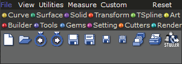 page 14
- 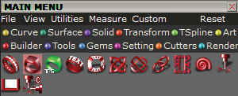 page 15
- 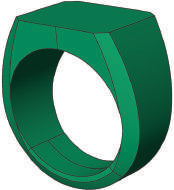 page 15
- 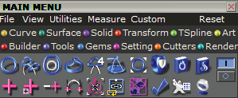 page 15
- 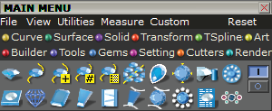 page 15
- 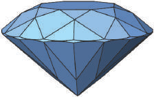 page 15
- 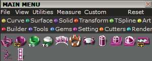 page 16
- 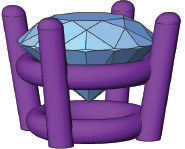 page 16
- 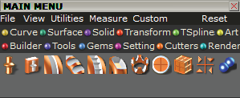 page 16
- 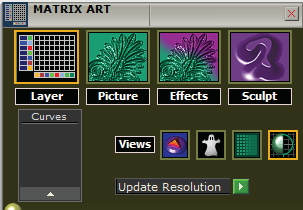 page 16
- 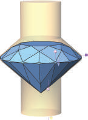 page 16
- 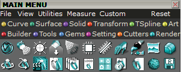 page 16
- 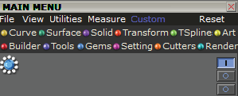 page 17
- 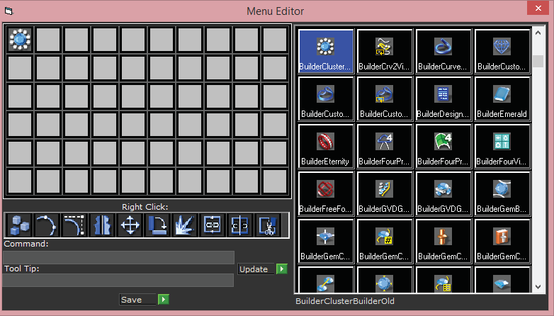 page 17
- 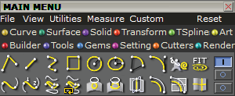 page 17
- 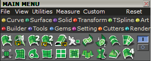 page 17
- 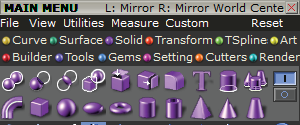 page 17
