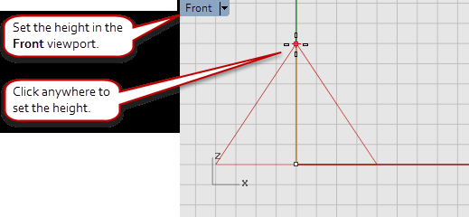
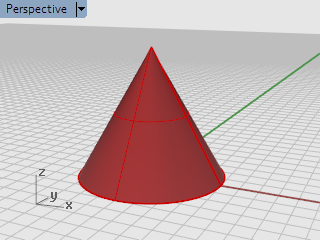
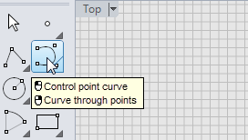
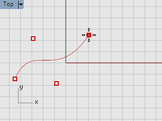
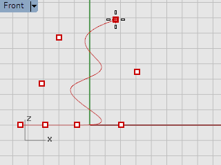
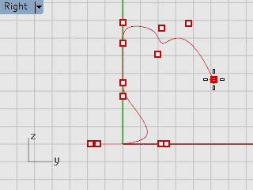
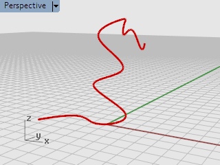

# Start from a toolbar icon

- Source PDF: Rhinoceros 5 User's Guide (rhino5.pdf)
- Page range: 14-18
- Section title: Start from a toolbar icon
- Section id: rhino5-006-start-from-a-toolbar-icon
- Note: boundary page(s) are shared with a neighbouring section (two-column layout); text/images may include neighbour content.

---
<!-- section rhino5-006-start-from-a-toolbar-icon | Start from a toolbar icon | rhino5 pages 14-18 -->

<!-- page 14 -->

Introduction
3. At the End of cone prompt, in the Front viewport, drag the mouse and click to draw the cone’s
point.
4. Watch what happens in the Perspective viewport.
### Start from a toolbar icon
Toolbars provide a graphical interface to the commands.
To display a button tooltip, hover your mouse over the icon
4
The command names that are activated with the left and right mouse clicks display.

<!-- page 15 -->

Introduction
Start the Curve command
4
On the toolbar docked on the left side of the Rhino window, click the icon for Control point curve.

<!-- page 16 -->

Introduction
Draw the curve

<!-- page 17 -->

Introduction
1. At the Start of curve… prompt, in the Top viewport, click the mouse to start the curve.
2. At the Next point... prompts, click a few more points in the Top viewport.
3. At the Next point... prompts, move the mouse into the Front viewport and click a few more points.
4. At the Next point... prompts, move the mouse into the Right viewport and click a few more points.
5. Right-click, press Enter or press the spacebar to complete the curve.

<!-- page 18 -->

Introduction
6. Check out the Perspective viewport.
Admire your work
4
Drag with the right mouse button to rotate the Perspective view.
### Start from the command line
You can start a command by typing the command name.
Start the Sphere command by typing
4
Click at the command prompt, and type Sphere.

---

## Images

-  page 14 (shared page)
-  page 14 (shared page)
-  page 14 (shared page)
-  page 14 (shared page)
-  page 14 (shared page)
-  page 17
-  page 17
-  page 17
-  page 18 (shared page)
