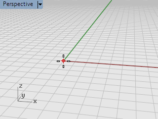
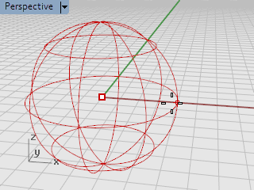
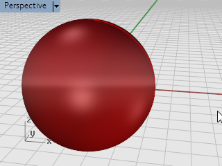

# Start from the command line

- Source PDF: Rhinoceros 5 User's Guide (rhino5.pdf)
- Page range: 18-20
- Section title: Start from the command line
- Section id: rhino5-007-start-from-the-command-line
- Note: boundary page(s) are shared with a neighbouring section (two-column layout); text/images may include neighbour content.

---
<!-- section rhino5-007-start-from-the-command-line | Start from the command line | rhino5 pages 18-20 -->

<!-- page 18 -->

Introduction
6. Check out the Perspective viewport.
Admire your work
4
Drag with the right mouse button to rotate the Perspective view.
### Start from the command line
You can start a command by typing the command name.
Start the Sphere command by typing
4
Click at the command prompt, and type Sphere.

<!-- page 19 -->

Introduction
Draw the sphere

<!-- page 20 -->

Introduction
1. At the Center of sphere… prompt, in the Perspective viewport, click the mouse to pick the center
point for the sphere.
2. At the Radius… prompt, in the Perspective viewport, move the mouse away from the center point,
and click the mouse to draw the sphere and click.
3. In the Perspective viewport, click the down-arrow on the viewport title, and on the menu, click
Shaded.

---

## Images

-  page 18 (shared page)
-  page 20
-  page 20
-  page 20
