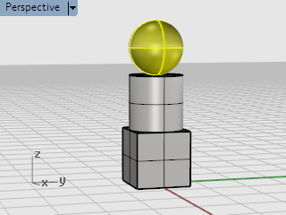
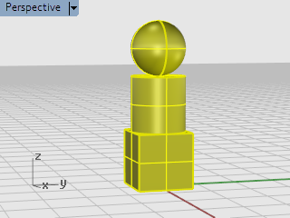
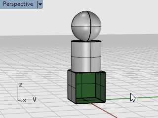
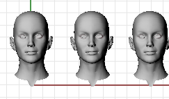
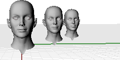

# Sub-object selection

- Source PDF: Rhinoceros 5 User's Guide (rhino5.pdf)
- Page range: 37-39
- Section title: Sub-object selection
- Section id: rhino5-024-sub-object-selection
- Note: boundary page(s) are shared with a neighbouring section (two-column layout); text/images may include neighbour content.

---
<!-- section rhino5-024-sub-object-selection | Sub-object selection | rhino5 pages 37-39 -->

<!-- page 37 -->

Selecting Objects
3. Type SelSrf.
This selects all surfaces. In this case, only the sphere is a surface.
4. Type SelPolysurface.
This adds all polysurfaces to the selection. In this case, the cylinder and box are polysurfaces.
5. Press the Esc key.
This also clears the selection.
### Sub-object selection
You can select sub-parts of objects for use in commands, for example, select a surface edge to use as input for a
Loft or ExtrudeCrv operation. The available parts include polysurface faces; surface and polysurface edge
curves; control points; mesh vertices, faces, boundaries, and edges; and objects within a group. Review the
help topic for Sub-object selection.
To select parts of objects for use with other commands
4
Press and hold both the Ctrl and Shift keys at the same time and click an object part.

<!-- page 38 -->

Selecting Objects
Practice sub-object selection
1. In the Perspective viewport, press the Ctrl and Shift keys and click a face of the box.
2. Press the Delete key.
The face of the box is separated from the box solid and deleted.

<!-- page 39 -->

## Navigating Viewports
The viewport title has some special functions for manipulating the viewport.
4
Click the title to make the viewport active without disturbing the view.
4
Drag the viewport title to move the viewport.
4
Double-click the viewport title to maximize the viewport. Double-click again to restore the size to normal.
### Viewport projection
Viewports can have one of three projections: parallel, perspective or two-point perspective.
Right mouse navigation works differently in the two viewport styles. In parallel views, right mouse dragging
pans the view. In perspective views, right-mouse dragging rotates the view. In the usual four-viewport layout,
there are three parallel viewports and one perspective viewport.
Parallel
Parallel views are also called orthogonal views in some systems. In a parallel view, all the grid lines are
parallel to each other, and identical objects look the same size, regardless of where they are in space.
Perspective
In a perspective view, grid lines converge to a vanishing point. This provides the illusion of depth in the
viewport. Perspective projection makes objects farther away look smaller.
### Viewport navigation
Rhino’s easy navigation helps you to visualize your model.
The simplest way to change the view is to drag the mouse with right button held down. This pans the view in
parallel views and rotates the view in perspective views.
You can change your view in the middle of a command to see precisely where you want to select an object or
choose a point.
To zoom in and out
4
Hold down the Ctrl key and drag up and down with the right mouse button held down.
Tip: If you have a mouse with a wheel, use the wheel to zoom in and out.

---

## Images

-  page 37 (shared page)
-  page 37 (shared page)
-  page 38
-  page 39 (shared page)
-  page 39 (shared page)
