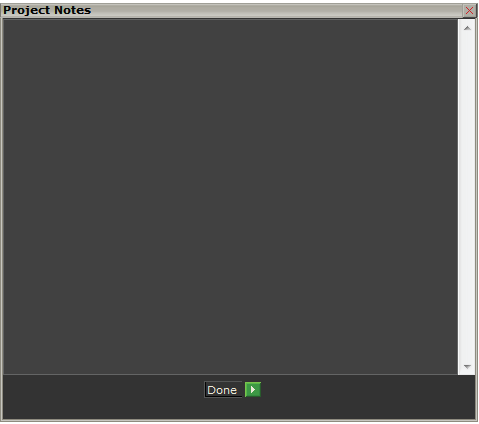
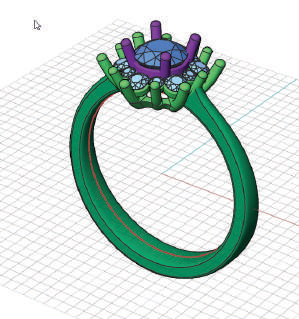
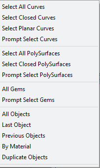
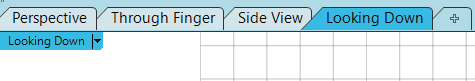

# Super Select

- Source PDF: Matrix 8 Instruction Manual Book 1 (matrix8_book_1.pdf)
- Page range: 37-37
- Section title: Super Select
- Section id: m8book1-015-super-select
- Note: boundary page(s) are shared with a neighbouring section (two-column layout); text/images may include neighbour content.

---
<!-- section m8book1-015-super-select | Super Select | m8book1 pages 37-37 -->

<!-- page 37 -->

## Project Notes
Where is this Command:
Access this command from Info and
Settings>Super Select
Steps:
Add notes for your project to keep in the Saved
file. Click “Done” to keep them, and open them
again in the future when needed. Remember to
do a File > Save As, or place the file into a Master
Job Bag, in order to save the notes with the file.
• Select Super Select from the Info & Settings Menu.
• From the menu select the objects you would like
highlighted.
Where is this Command:
Access this command from Info and
Settings>Project Notes
Steps:
• Select Project Notes from the Info & Settings
Menu.
• Click in the project notes field and begin typing
your notes.
• Press done when complete.
Note: The Super Select menu will only display the
classes of objects that are in the viewport. When
an object class is selected from the Super Select
menu, it selects all objects that meet that criteria.
## Viewport Tabs Toggle
‘ViewportTabs’
Matrix has added Viewport Tabs which make it
easier to switch between the viewports when one
view is maximized. The Viewport Tabs toggle will
hide these tabs, if desired.
## Super Select
Where is this Command:
Access this command from Info and
Settings>Viewport Tab Toggle
Steps:
• Select Viewport Tabs Toggle from the Info &
Settings Menu to hide or show the Viewport tabs.
Super Select can determine what types of objects
you have on-screen and displays in a menu only
those types of object. It’s a quick way to check if
you have any open curves, open surfaces, invalid
surfaces, or duplicate objects. If you do have
these problematic objects, or if you simply wish to,
for instance, select all curves and hide/ job bag/
delete them, etc., you can do so here. To use this
tool, simply make the selection from the list that
appears and it will be highlighted in the viewports
for further modeling operations.

---

## Images

-  page 37 (shared page)
-  page 37 (shared page)
-  page 37 (shared page)
-  page 37 (shared page)
