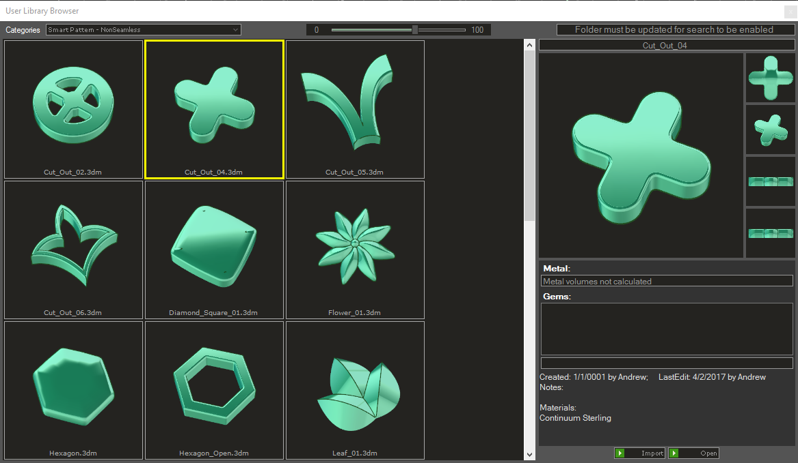
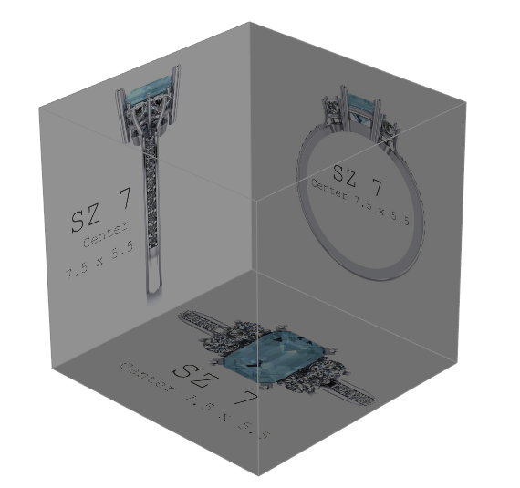
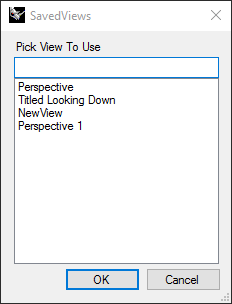
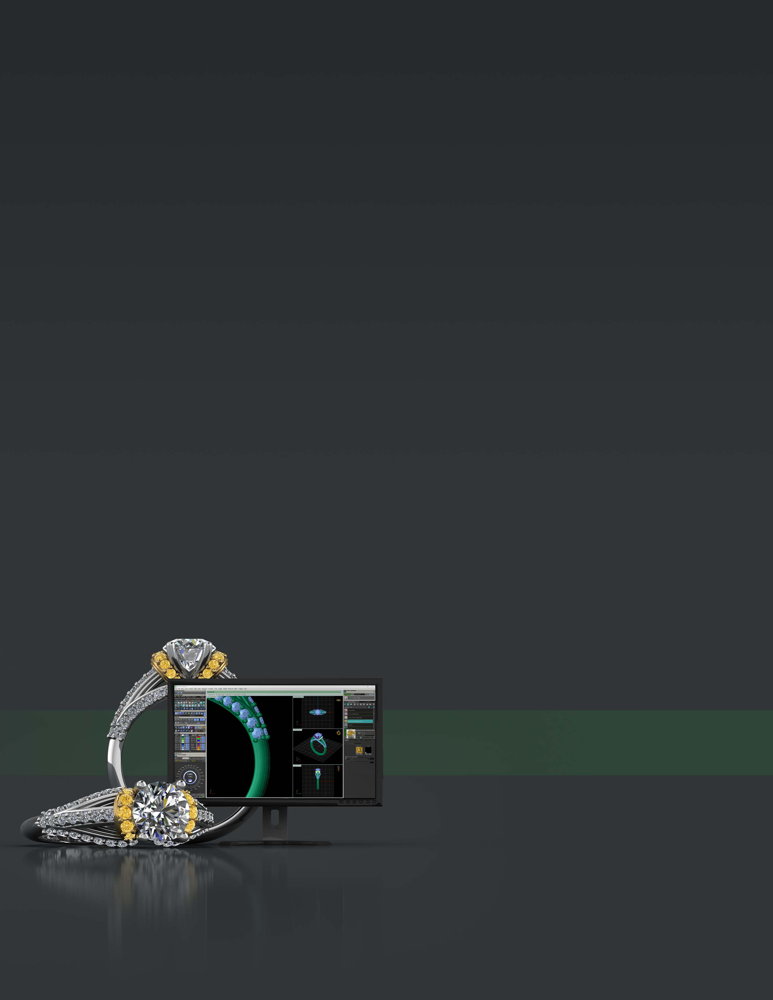

# View Manager

- Source PDF: Matrix 9 User Manual Addendum (matrix9.0_addendum.pdf)
- Page range: 92-94
- Section title: View Manager
- Section id: m9addendum-089-view-manager
- Note: boundary page(s) are shared with a neighbouring section (two-column layout); text/images may include neighbour content.

---
<!-- section m9addendum-089-view-manager | View Manager | m9addendum pages 92-94 -->

<!-- page 92 -->

### Options:
Categories: Select from the sub-folders
that exist in the User library folder. Any
folders added to the User Library folder
will appear here as a Category.
### Options:
Size Slider: Controls the display size of
the models in the library.
Top: Loads an image in the 'Looking
Down' portion of the box.
Gem Filter: Filters the category by teh
gem information found in the model.
Front: Loads an image in the 'Through fin-
ger' portion of the box.
Import: This will import the selected
model into the current document.
Side: Loads an image in the 'Side View'
portion of the box.
Open: This will close the current document
and open the selected design.
Back: Loads an image in the 'Back' portion
of the box.
Delete: Removes any loaded image from
the associated view. Click on the red X to
delete.
### Blueprint
'ClayBluePrint'
When the parameters of the surface are
set as needed click 'OK' to add the geo-
metry to the viewport, or 'Cancel' to cancel
the command.
Create a box with images to be used as ref-
erence when modeling.
Where is this Command:
### View Manager
Access this command from:
'gvViewManager'
View > Blueprint
Steps:
Saves views (camera position and zoom)
so that it can be recalled later.
Where is this Command:
Select Blueprint from the view menu.
Import images into the builder
View > View Manager
Save View Steps:
Select View Manager from the View
menu
Adjust the camera position as
desired.
Click 'AddCurrentView' in the com-
mand line.
Load View Steps:
- 86 -

<!-- page 93 -->

Select View Manager from the View
menu
Click 'LoadView' in the command
View
Select a saved view from the View
Manager
Click OK to load view.
### Options:
AddCurrentView: Saves the current view
(camera position and zoom) to the View
Manager.
DeleteView: Deletes a saved view from the
View Manager
LoadView: Loads a saved view from the
View Manager.
- 87 -

<!-- page 94 -->

TECHNICAL SUPPORT
PHONE 888-357-6272
EMAIL matrix@gemvision.com

---

## Images

-  page 92 (shared page)
-  page 92 (shared page)
-  page 93
-  page 94
