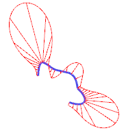

# Curvature

- Source PDF: Rhinoceros 5 User's Guide (rhino5.pdf)
- Page range: 94-94
- Section title: Curvature
- Section id: rhino5-058-curvature
- Note: boundary page(s) are shared with a neighbouring section (two-column layout); text/images may include neighbour content.

---
<!-- section rhino5-058-curvature | Curvature | rhino5 pages 94-94 -->

<!-- page 94 -->

Curve and Surface Analysis
### Curvature
Curve analysis tools let you turn on a graph showing the direction perpendicular to the curve at a point and the
amount of curvature, display a curvature circle, test the continuity between two curves and the intervals of
overlap between the two curves.
The CurvatureGraph command displays a curvature graph on curves and surfaces. The lines on the graph
represent a direction perpendicular to the curve at that point. The length of the line indicates the curvature.
### Visual surface analysis
Visual surface analysis commands let you examine surfaces to determine smoothness as determined by its
curvature, tangency, or other surface properties. These commands use NURBS surface evaluation and
rendering techniques to help you visually analyze surface smoothness with false color or reflection maps so you
can see the curvature and breaks in the surface.
### Environment map
The EMap command displays a bitmap on the object so it looks like a scene is being reflected by a highly
polished metal. This tool helps you find surface defects and validate your design intent.
The fluorescent tube environment map simulates tube lights shining on a reflective metal surface.

---

## Images

-  page 94 (shared page)
-  page 94 (shared page)
