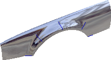
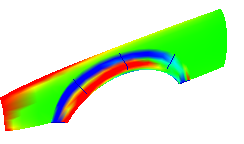
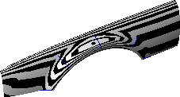
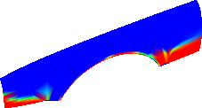
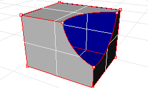

# Visual surface analysis

- Source PDF: Rhinoceros 5 User's Guide (rhino5.pdf)
- Page range: 94-96
- Section title: Visual surface analysis
- Section id: rhino5-059-visual-surface-analysis
- Note: boundary page(s) are shared with a neighbouring section (two-column layout); text/images may include neighbour content.

---
<!-- section rhino5-059-visual-surface-analysis | Visual surface analysis | rhino5 pages 94-96 -->

<!-- page 94 -->

Curve and Surface Analysis
### Curvature
Curve analysis tools let you turn on a graph showing the direction perpendicular to the curve at a point and the
amount of curvature, display a curvature circle, test the continuity between two curves and the intervals of
overlap between the two curves.
The CurvatureGraph command displays a curvature graph on curves and surfaces. The lines on the graph
represent a direction perpendicular to the curve at that point. The length of the line indicates the curvature.
### Visual surface analysis
Visual surface analysis commands let you examine surfaces to determine smoothness as determined by its
curvature, tangency, or other surface properties. These commands use NURBS surface evaluation and
rendering techniques to help you visually analyze surface smoothness with false color or reflection maps so you
can see the curvature and breaks in the surface.
### Environment map
The EMap command displays a bitmap on the object so it looks like a scene is being reflected by a highly
polished metal. This tool helps you find surface defects and validate your design intent.
The fluorescent tube environment map simulates tube lights shining on a reflective metal surface.

<!-- page 95 -->

Curve and Surface Analysis
### Curvature analysis
The CurvatureAnalysis command analyzes surface curvature using false-color mapping. It analyzes
Gaussian curvature, mean curvature, minimum radius of curvature, and maximum radius of curvature.
The Zebra command displays surfaces with reflected stripes. This is a way to visually check for surface
defects and for tangency and curvature continuity conditions between surfaces.
### Draft angle analysis
The DraftAngleAnalysis command displays by false-color mapping the draft angle relative to the
construction plane that is active when you start the command.
The pull direction for the DraftAngleAnalysis command is the z-axis of the construction plane.

<!-- page 96 -->

Curve and Surface Analysis
### Edge evaluation
Geometry problems such as Boolean or join failures can be caused by edges on surfaces that have become
broken or edges between surfaces that have been moved through point editing so they create holes. An edge is
a separate object that is part of the surface’s boundary representation.
The ShowEdges command highlights all the edges of the surface.
A polysurface may look closed, but the Properties command may tell you that it is open. Some operations and
export features require closed polysurfaces, and a model using closed polysurfaces is generally higher quality
than one with small cracks and slivers.
Rhino provides a tool for finding the unjoined or “naked” edges. When a surface is not joined to another
surface, it has naked edges. Use Properties command to examine the object details. A polysurface that has
naked edges lists as an open polysurface. Use the ShowEdges command to display the unjoined edges.
Other edge tools let you split an edge, merge edges that meet end-to-end, or force surfaces with naked edges
to join. You can rebuild edges based on internal tolerances. Other edge tools include:
●
SplitEdge splits an edge at a point.
●
MergeEdge merges edges that meet end to end.
●
JoinEdge forces unjoined (naked) edges to join nearby surfaces.
●
RebuildEdges redistributes edge control points based on internal tolerances.
### Diagnostics
Diagnostic tools report on an object’s internal data structure and select objects that may need repair. The
output from the List, Check, SelBadObjects, and Audit3dmFile commands is normally most useful to a
Rhino programmer to diagnose problems with surfaces that are causing errors.

---

## Images

-  page 94 (shared page)
-  page 94 (shared page)
-  page 95
-  page 95
-  page 95
-  page 96 (shared page)
