# Mechanical Part - Blocks

- Source PDF: Rhinoceros 5 User's Guide (rhino5.pdf)
- Page range: 269-280
- Section title: Mechanical Part - Blocks
- Section id: rhino5-085-mechanical-part-blocks

---
<!-- section rhino5-085-mechanical-part-blocks | Mechanical Part - Blocks | rhino5 pages 269-280 -->

<!-- page 269 -->

## Mechanical Part - Blocks
This example shows how to use Rhino to model a simple mechanical part.
You will learn to
●
Create extrusion objects.
●
Boolean difference shapes.
●
Drill holes.
●
Create a 2-D line drawing from the 3-D shapes.
●
Dimension the 2-D line drawing and modify dimension text.
Open the tutorial model
4
Open the tutorial model file Toolblock.3dm and then click Open.
Download the tutorial models.
### Create solid shapes
Start by creating two basic solid shapes from the profile curves on layers Profile-01 and Profile-02.
Set up the layers
4
In the Layers panel, confirm that the Profile-01 layer is current.
Extrude the profile curve
1. On the Solid menu, click Extrude Planar Curve > Straight.
2. Turn on the End object snap.

<!-- page 270 -->

Mechanical Part - Blocks
3. At the Select curves to Extrude prompt, select the blue profile curve, and press Enter.
4. At the Extrusion distance prompt, set the command-line Solid and the DeleteInput options to
Yes.
5. Click the end of the magenta construction line.
The extruded shape is a solid because it forms a closed volume in space.
Hide the solid
4
Select the solid, on the Edit menu click Visibility > Hide.
Set up the layers
4
In the Layers panel, make layer Profile-02 current.

<!-- page 271 -->

Mechanical Part - Blocks
Extrude the profile curve
1. Select the red profile curve.
2. On the Solid menu, click Extrude Planar Curve > Straight.
3. At the Select curves to Extrude prompt, set the command-line Solid and the DeleteInput
options to Yes.
4. At the Extrusion distance prompt, in the Front viewport, drag the extrusion above the height of
the blue curve and click.
The solid appears on the current red layer Profile-02.

<!-- page 272 -->

Mechanical Part - Blocks
Show the solid
4
On the Edit menu click Visibility > Show.
Boolean the two solids
1. On the Solid menu, click Difference.
2. At the Select surfaces or polysurfaces to subtract from prompt, select the blue solid, and press
Enter.
3. At the Select surfaces or polysurfaces to subtract with prompt, set the command-line
DeleteInput option to Yes.
4. Select the red solid, and press Enter.
The result will be a new solid or polysurface. A polysurface is a collection of surfaces that can be closed
or open. A solid is a collection of surfaces that is closed.

<!-- page 273 -->

Mechanical Part - Blocks
### Drill the holes
A construction circle is already in place for creating the first hole.
Make holes in the solid
1. Select the green circle as shown.
2. On the Solid menu click Solid Edit Tools > Holes > Make Hole.
3. At the Select a surface or polysurface prompt, select the blue polysurface.

<!-- page 274 -->

Mechanical Part - Blocks
4. At the Cut depth point prompt, drag the hole through the upper portion of the object.
5. Pick a point in Front view.

<!-- page 275 -->

Mechanical Part - Blocks
### Copy the holes
After one hole is drilled, you can copy the others.
Copy the holes
Copy the three remaining holes that are aligned with the previous hole with this command.
1. In the Osnap control, turn on the Point object snap.
2. On the Solid menu, click Solid Edit Tools > Holes > Copy Holes.
Note: Copy Holes is actually the MoveHole command with the command-line
Copy option set to Yes.
3. At the Select holes in one planar surface prompt, select the first hole, and press Enter.
4. At the Point to copy from prompt, pick the point object in the center of the first circle.

<!-- page 276 -->

Mechanical Part - Blocks
5. At the Point to copy to ( Copy=Yes ): prompt, pick the point that makes the center of the next
hole.
6. Repeat this for the two holes that are on the other side of the part.
Note: Do not use the point in the center of the part.
Create the round hole
The center hole is different in that it does not pass entirely through the upper part of the blue solid. There is
no reference circle to start from.
1. On the Solid menu, click Solid Edit Tools > Holes > Round Hole.
2. At the Select target surface prompt, select the top surface of the blue solid.

<!-- page 277 -->

Mechanical Part - Blocks
3. At the Center point prompt, set the command-line options as follows:
Depth=0.5
Diameter=0.312
DrillPointAngle=180
Through=No
Direction=CPlaneNormal
4. Click the point object in the middle of the blue solid to finish creating the hole.
Test the solid
The resulting polysurface is a closed solid. A solid defines a closed volume in space. The Properties
command will report if this part is a closed solid. The Properties command will give you information about
the open/closed status of the object.
1. Select the part.
2. On the Edit menu, click Object Properties (F3).
3. In the Properties panel, click Details.
In the Object Description window, you will find the listing to confirm that the object is valid and
closed.
Geometry:
Valid polysurface.
Closed solid polysurface with 23 surfaces.

<!-- page 278 -->

Mechanical Part - Blocks
### Make a 2-D drawing
The Make2D command generates 2-D lines from the 3-D solid.
Create a 2-D line drawing
1. Select the part.
2. On the Dimension menu, click Make 2D.
3. In the 2-D Drawing Options dialog box, under Drawing layout click 4 view (USA).
Under Options, check the Show tangent edges and Show hidden lines boxes.
4. Click OK.
### Dimension the 2-D drawing
Using the 2-D drawing, add dimensions for the part.
Set up the layers
1. In the Layers panel, make Dimensions layer current.
2. Turn off all layers except Dimensions and the Make2D layers.
3. In the Linetype column for the Make2D > hidden > lines layer, click Continuous.
4. In the Select Linetype window, select Dashed.
Set up the viewport
4
Double-click the viewport title to maximize the Top viewport.
Dimension the part
1. On the Dimension menu, click Linear Dimension.
2. In the Osnap control, turn on the End object snap; turn off the Point object snap.
3. At the First dimension point prompt, pick the upper left corner of the part.
4. At the Second dimension point prompt, pick the upper right corner of the part.
5. At the Dimension location prompt, pick a location for the dimension line.

<!-- page 279 -->

Mechanical Part - Blocks
6. Repeat to generate a vertical dimension on the right side of the part.
Chain dimension the part horizontally
1. On the Dimension click Linear Dimension.
2. At the First dimension point set the command-line Continue option to Yes.
This will generate a chain of dimensions.
3. At the First dimension point prompt, pick the lower left corner of the part.
4. At the Second dimension point, prompt turn on the Center object snap and pick the center of the
first circle.
5. At the Dimension location prompt, pick below the part.
6. At the next Dimension location prompts, continue picking the centers of the circles.
7. Finish by picking the lower right corner of the part, press Enter.

<!-- page 280 -->

Mechanical Part - Blocks
Chain dimension the holes vertically
4
Repeat the chain dimensions to create vertical dimensions.
Add radial dimensions
1. On the Dimension menu, click Radial Dimension.
2. At the Select curve for radius dimension prompt, select the hole on the far right.
3. At the Dimension location prompt, pick above the part.
4. Double click the radial dimension text, and in the text edit box, add the text Typ. 5 Places.

---

## Images

- 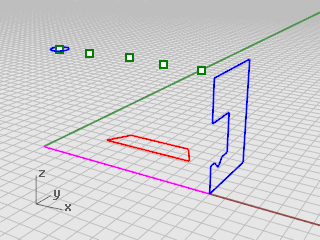 page 269
- 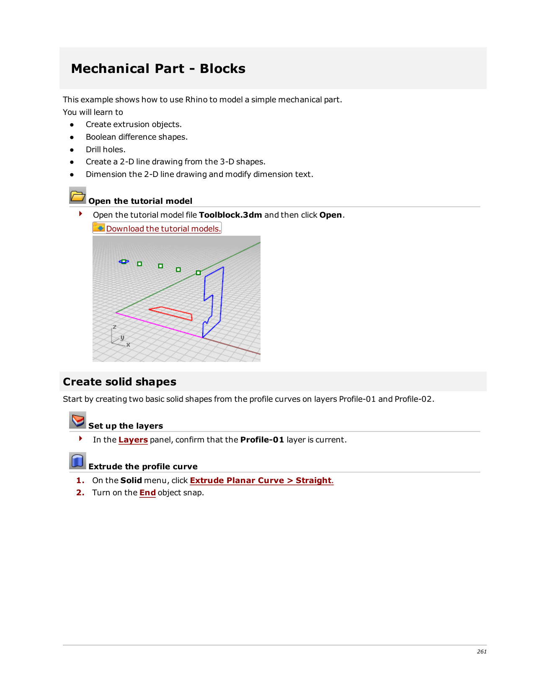 page 269
- 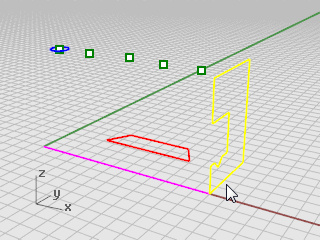 page 270
- 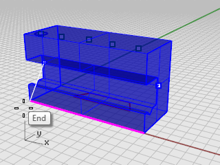 page 270
- 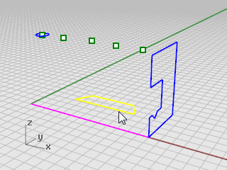 page 271
- 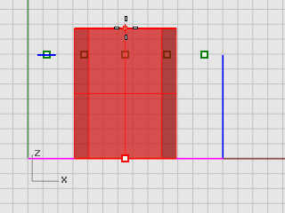 page 271
- 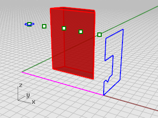 page 271
- 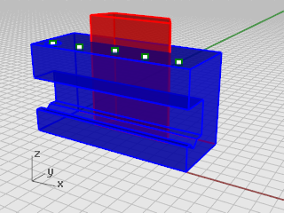 page 272
- 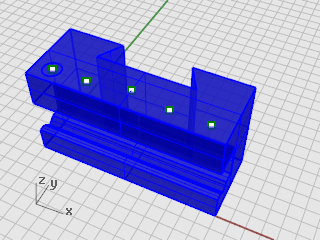 page 272
- 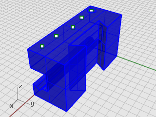 page 272
- 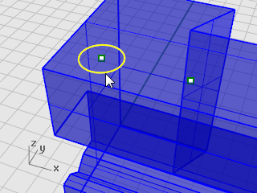 page 273
- 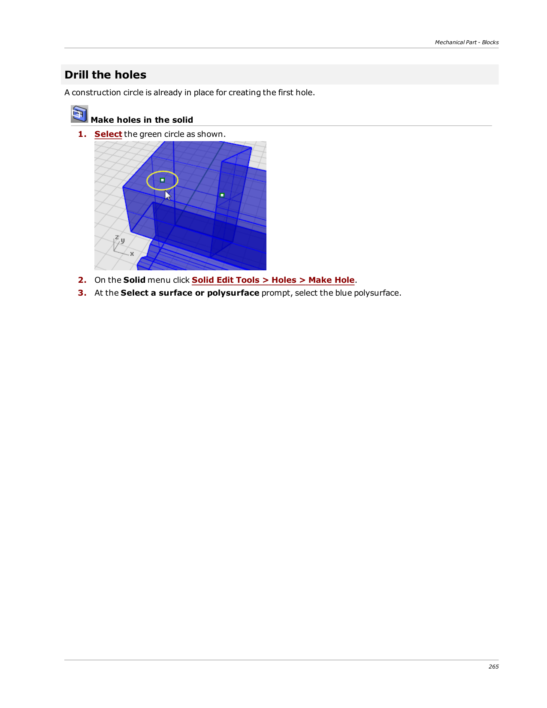 page 273
-  page 274
- 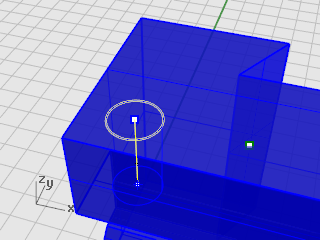 page 274
- 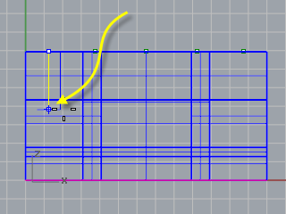 page 274
- 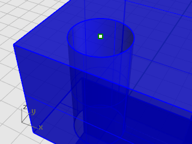 page 274
- 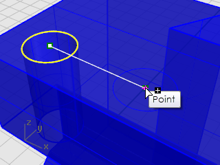 page 275
- 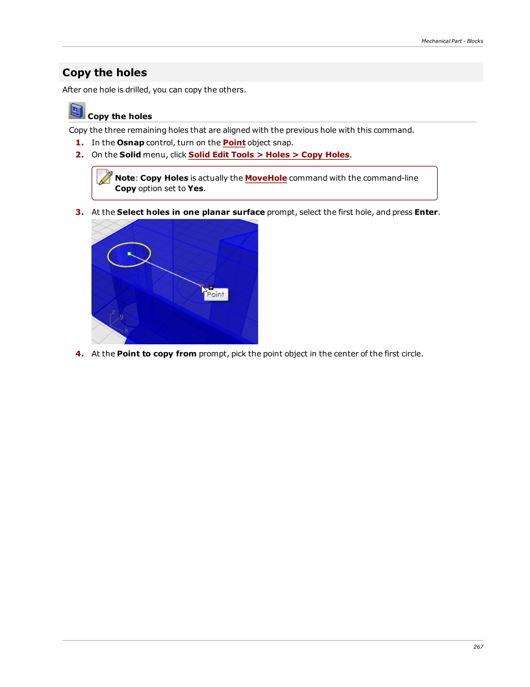 page 275
- 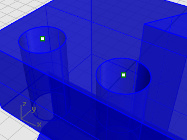 page 276
-  page 276
- 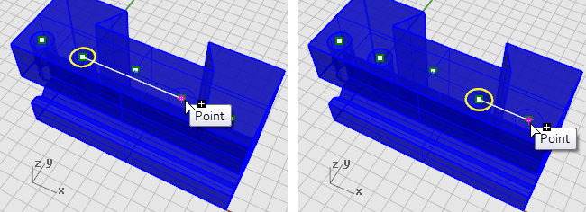 page 276
- 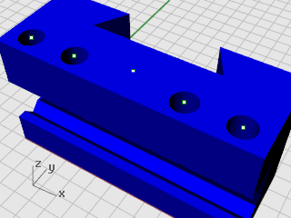 page 276
- 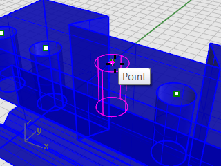 page 277
- 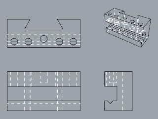 page 278
- 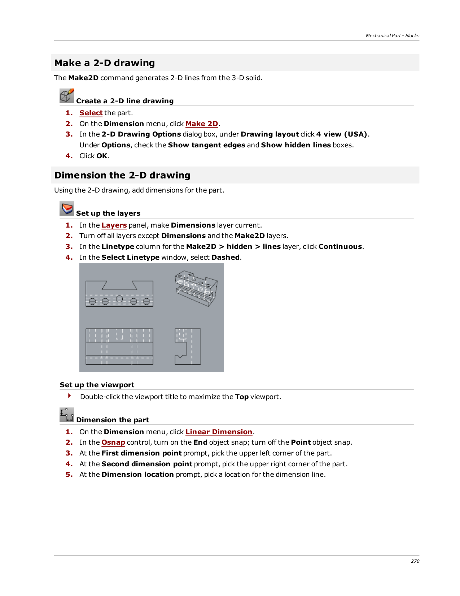 page 278
- 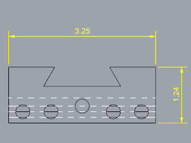 page 279
- 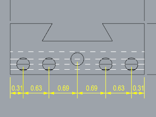 page 279
- 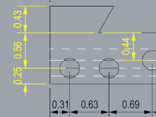 page 280
- 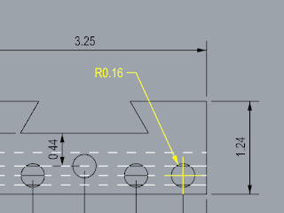 page 280
- 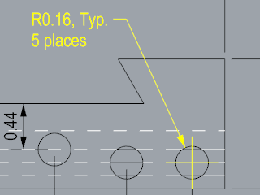 page 280
