# Material Editor

- Source PDF: Matrix 8 Instruction Manual Book 2 (matrix_8_book_2.pdf)
- Page range: 297-313
- Section title: Material Editor
- Section id: m8book2-251-material-editor
- Note: boundary page(s) are shared with a neighbouring section (two-column layout); text/images may include neighbour content.

---
<!-- section m8book2-251-material-editor | Material Editor | m8book2 pages 297-313 -->

<!-- page 297 -->

White Room (Slow)
Lights Camera Action
(Slow)
Note: Fast/Slow indicates the time required to render
that particular Style.
Plastic Render (Fast)
## Material Editor
Select from the Material Editor tab the types of
materials to apply: Metals, Gem, Pearl, Colored
Ground,Planes, Image Ground Plane, Architectural,
Material, Glass, Plastic, or Emitter.
Satin Blur (Fast)
Sunroom (Slow)
To apply the material to an object.
Steps:
Toon Outline (Fast)
• From the Material Editor,
select the icon for the type of
material to apply, for example
metal).
• Select the desired material
from the material library that
populates below, for example Platinum. (Materials
can also be applied to an object from the F6
menu).
• Select the object on-screen to which you want it
applied, and click the green arrow. The object will
flash in the viewports, indicating that the material
was applied.

<!-- page 298 -->

Forced Reflection: Ignores all reflections of
surrounding items.
### Filter the Materials  List in the Material
### Editor:
### Background Options:
Show the default materials list (GV on) and your
custom, save materials list (User on) by turning on
or off the GV/User toggles shown by the library
name.
Alpha: Toggle Alpha ‘ON’ to turn the Alpha
channel on. Alpha allows for a transparent
background and to separate this material from its
background.
### Working with Materials
Default Ground Plane: Toggle Default Ground
Plane ‘ON’ or ‘OFF’. This can be used to assign a
new ground plane and essentially override the
ground plane in any of the existing styles.
Save, Save As: Click on Save As to save any
amended material. Complete the material name to
customize. The material is only applicable to the
Style under which it was created.
Default Ground Plane Steps:
Save
Save As
Material Export, Material Import: Click on
Material Export to save the amended material
as a .gvVisMat file. This saved file can also be
imported back by using the Material Import
option.
• Load a Style from the Style library.
• Load the Ground Plane you would like to use in
that particular Style.
• Use the Style Save feature (located within the
Scene Editor).
The next time you load this Style, it will render with
the new ground plane.
### Metal Materials:
Material
Export
Material
Import
Materials Reset: Click on Reset to reset any
edited material back to its original state. Reflection
The Metals library can be accessed by clicking on
the ring icon in Material Editor. This displays the
list of available Metals. Alter the metal using the
adjustment controls located in the tabs below.
These tabs include; Color, Properties, Texture,
Scene, Toon and Light.
Reset
### Metal - Color Tab:
### Reflexion Options:
These determines how the objects within the
scene reflect other objects.
Normal Reflection: Allows reflections of all
overlapping objects.
Metal Quality:
Select an exact metal
quality by using the
drop down selection
box. The applied
metal quality will be
used in the Design
Report feature within
Matrix. Metal quality
effects not only rendering but specific gravity for
reporting.
Complex Reflection: Ignores overlapping
surfaces, but still allows these objects to reflect
one another.

<!-- page 299 -->

You can add additional alloys and specific gravity
to user Materials (Not GV Materials). The  easiest
way to do this is to do a Save As on the particular
material (this essentially copies all of the settings
for an existing material so you can add and edit as
opposed to starting from scratch). Once you have
created a User material a toggle appears next to
the Metal Quality drop down. When that toggle
is ‘ON’ you can add your own alloys and specific
gravity in the window below.
Color Picker: To make more changes to the
color of a material click on the rainbow, ball icon
below the Color preview box and the Color Picker
menu will appear. Change the location of the
circular color picker in the color field to pick a new
hue. Alongside the menu is a slider that controls
the tint or shade (amount of black and white)
added to the particular hue. Exact RGB color
settings can also be added to the bottom of the
menu. The small “x” resets the color preview to
pure white.
### Metal- Properties:
Reflection Amount: The Reflection Amount
slider ranges from Flat (0) to Metallic (1).
Increase or decrease the amount of reflection in
the metal by adjusting the slider. Increased
Reflection makes the object more reflective and
shiny. Decreased reflection dulls the objects.
Reflection=0 Flat
Reflection=1 Metallic
Color Grid: Color
Cubes allow you
to easily alter
the undertone
of the metal as
well as the tint or
shade. Vertically,
each metal’s grid
has two main
colors that are
on either end
of the spectrum. For example, sterling silver is
gray and pink and white gold is gray and yellow.
Horizontally, the grid spans from highlights to
shadows, capturing the undertones of each
specific metal alloy. To alter the selected color,
choose any of the individual squares along the
grid. As soon as you do so, the Update text will
appear below the thumbnail image. If desired, click
inside the thumbnail to update the preview to
reflect the newly-created color. Or, click the green
icon to apply the color to any item that is selected
within the viewports.

<!-- page 300 -->

Polish Level: The Polish Level slider ranges from
Matte (0) to Glossy (1). Adjust this slider to
increase or decrease the amount of Matte or
Glossy on the object. Polish controls the overall
shine of the metal. Glossy is very shiny while Matte
appears beadblasted.
or Presentation in order to view the texture
on the object. Re-apply the metal material if
switching between these display modes. The
object’s surface UV directions play a role in the
appearance of the texture on the surface of the
object. If necessary, extract a surface and change
the surface UV.
Steps:
• Choose a Preset Texture from the drop down
menu.
• When set, the texture map will appear in the
preview box. Use the rainbow, ball icon to make a
color change, if needed.
Polish=0 Matte
Polish=1 Glossy
Reflection Quality: Move the slider from
Low quality to High Reflection quality.
Reflection quality creates more imperfections
in the reflections to make the item appear more
photorealistic. The High setting makes the
reflection quality appear more crisp while the Low
setting gives the reflections a more natural, blurry
effect.
Bump Height: Increase the Height or intensity of
the pattern by increasing the value of
the slider. Or, click in the value box to type a
specific amount.
Reflection Quality=6 High
Reflection Quality=1 Low
Bump Height=1
Bump Height=0
Anisotropy: The Anisotropy slider becomes
available when the Polish Level is set to anything
but glossy. This slider helps in creating a brushed
metal effect. Anisotropy creates deviation in the
reflections and causes the highlights to scatter.
It creates unequal reflection properties along
different axis.
### Metal - Texture:
Map Rotation: Adjust the angle of the map by
moving the slider to the degree desired. If
a texture has defined lines you may want to
change the map’s rotation for a different look.
When applying a texture (hammered, bead
blast, brushed, etc) to an object in the viewports,
set the viewport Display Mode to Rendered

<!-- page 301 -->

# Texture Presets
Pyramid Knurl Small
Rough Matte Large
Bead Blast
Brushed Matte Large (Fast)
Rough Matte Small
Sandblast Fine
Brushed Matte Large (Slow)
Brushed Shiny
Sandblast Heavy
Satin
Florentine
Glass Blast
Stone Wheel
Hammer Matte
Hammer Shine
Ice
Pyramid Knurl Large

<!-- page 302 -->

Adjust the Brightness or Map Rotation of the map
image you added using the sliders below.
Map Tiling, U & V: Smaller texture bitmaps
or larger objects in the viewports may require
repeating the map in both directions. Map tiling
arrays the map or multiplies it to extend the
boundaries. Choose to tile the map in each
direction: U or V.
### Metal - Scene:
Scene allows you to place an object onto an
object within its own unique environment.
The environment overrides the main Scene Editor
settings in the master controls. In other words, an
object can have a scene applied to it even within
another environment.
### Metal - Toon:
So, a particular object would reflect the properties
of the per-object scene and ignore the properties
of the master scene. Images that can be placed
into the scene can be Spherical, Mirror, Ball, Cubic
or Angular.
Toon provides the controls necessary for creating
a cartoon-like image. It allows you to
add a line or a stroke around all objects in the
scene.
Mapping Type: Choose the appropriate map
type for the image you are using.
Map Preview Box: Click on the
Map window and load an image.
Toggle Toon on or off: Turn ‘ON’ or ‘OFF’ the
Toon options.
Rainbow color ball: Adjust the
color using the color picker.
Color Picker: This controls the line color that will
define each edge of the object within Toon render.
Begin by selecting a color in Color Picker. This
populates the color preview box.

<!-- page 303 -->

### Metal - Light:
Lights can be used to make the metal material
glow a specific color. This is great for rendering a
light bulb or for applying light to a light card.
Applying this will give it an ethereal quality.
Line Width: Line Width slider controls the stroke
size of the line.
Emissive Light: Toggle On or Off.
Color Preview box and color picker: Use the
color picker to choose the color your object will
glow.
Intensity: The intensity slider will determine how
bright the object will glow.
### Gem Materials:
The Gemstone library in VRay Styles contains a
wide variety of gemstones to choose from. Click
on the Gem icon to access this library. The gem
material list appears alphabetically. Choose a pre-
existing material or create a gemstone in whatever
color you wish.
### Gems - Color:
Applying Preset Materials:
Edge Detection: The Edge Detection slider
controls the angle to the camera at which it
detects edges. Increasing the slider will add
strokes to the render. At the lowest value, the
edge detection will only pick up the outline of the
object, creating a line contouring the object’s
shape. At the highest value, all of the angles on
the object will be defined, creating strokes
throughout the image and a render that feels like
an illustration.
Steps:
• Highlight a gem in your design,
• Select the gem material from the list, and click on
the green arrow near the preview window to apply
the material.

<!-- page 304 -->

Editing Gem Materials: Customize the gem
materials in the library to your liking.
Steps:
Refraction Multiplier:  The Refraction multiplier
increases the intensity of the refraction.
Load a Color Image: Use the Color preview box to
open a dialog box to select a color file. This color
file determines the base color of the gemstone.
Select an area of the image that most accurately
represents the color you are matching.
Begin with a preset gemstone selection closest to
the desired color. There are two different ways to
edit and apply a color to the gem; Image or Color.
Use the drop down menu and choose between
Transparent Color, Transparent Image, Opaque
Color or Opaque Image.
Color Picker: Use the color picker/ rainbow ball
to Edit and select a specific area of the image.
Drag a box around the area on the map (left
window) and this section will be reflected in the
window on the right. Change the hue by moving a
slider on any of the three sliders (Hue, Brightness
and Saturation) below. Click the green arrow to
save the settings. Or, click to the red arrow to
Reset.
Transparent Image Option: Use pictures of a
gemstone to determine the color of the gemstone
in the render.
Load a Refraction Image: The
refraction image determines the
color the gemstone reflects. Click
in the Refraction box to load an
image of your gemstone.
Color Multiplier: The color multiplier slider can
be used to add intensity to the color you choose.
Color Picker: Use the color
picker/ rainbow ball to Edit and
select a specific area of the image.
Drag a box around the area on the
map (left window) and this section
will be reflected in the window
on the right. Change the hue by
moving a slider on any of the three sliders (Hue,
Brightness and Saturation) below. Click the green
arrow to save the settings. Or, click to the red
arrow to Reset.
Opaque Image Option: Use the Map preview
box to open a dialog box to select a gemstone
image file. This file determines the base color of
the gemstone. Select an area of the image that
most accurately represents the color you are
matching.

<!-- page 305 -->

tabs color picker. But, the transparent option will
have properties similar to glass. The Opaque
option will have a more solid look.
Color Picker: Use the color picker/ rainbow ball
to Edit and select a specific area of the
image. Drag a box around the area on the map
(left window) and this section will be reflected
in the window on the right. Change the hue by
moving a slider on any of the three sliders (RGB)
below. Click the green arrow to save the settings.
Or, click to the red arrow to Reset.
Color Picker: Change the location of the circular
color picker in the color field to pick a new hue.
Alongside the menu is a slider that controls the
tint or shade (amount of black and white) added
to the particular hue. Exact RGB color settings
can also be added to the bottom of the menu.
The small “x” resets the color preview to pure white.
Click the thumbnail (next to the gemstone name
above) to update the main preview image. Update
is only available if the preset color has been
altered.
### Gems - Properties
Reflection Amount: Reflection Amount slider
controls the reflections. Increasing this
makes the gem object more reflective and the
surface will become more plastic-like.
Decreasing this slider will dull the object.
Reflection Gloss: Reflection Gloss slider
controls the crispness of the gloss. The slider
ranges from blurry-natural to high gloss-crisp.
Map rotation: Adjust the map rotation slider to
move the map image by rotation in degrees.
Map Tiling: Choose to tile (array) the map image
and increase the count in U and/or V directions.
Refraction Index: Refraction Index allows you
to change the refractive index of the material.
Refraction is now light bends as it passes
through a volume. This slider ranges from Glass
to Diamond, so depending on the specific quality
of gem you are creating, you can adjust the slider
accordingly.
Transparent Color or Opaque Color
Option: The color options work just like the Metal

<!-- page 306 -->

### Pearl Materials:
Pearl - Color
Apply preset pearl materials to a sphere object
or edit the material to create a custom look.
Customizing a pearl allows you to pick two colors,
then further define this color by determining the
rate at which the color transitions between the
two. We call this a radius gradient.
Choose an appropriate color for each swatch,
keeping in mind the color swatch on the left-hand
side of the slider range is the color in the center of
the radius of the sphere within the radius gradient.
The color swatch on the right-hand side is the hue
at the outside edge of the sphere at 90 degrees
from the viewing angle. Change the radius
gradient by dragging the sliders closer to one
another or further apart, thus changing the
abruptness of the transition between the two
colors. Follow this logic for both the Body Color
and Overtone slider ranges.
Refraction Gloss: Refraction Gloss controls the
internal cloudiness of the gem. Dragging
the slider towards Matte will take more time to
render but will increase the cloudiness.
This is handy when trying to mimic objects with
imperfections, such as an emerald.
Dispersion Slider: Toggle on to activate. The
Dispersion Slider defines how the light gets
scattered as it passes through a volume. Think of
a ray of light. As it passes through a faceted stone
it is fanned out like a rainbow prism. The higher
the value the more the light gets focused as it
passes through the volume. The lower the setting,
the more scattered the light becomes as it passes
through. Within VRay, as gems as rendered, light
passes through the gem and bounces around
through an object.
Body Color: The Body Color is the main base
color of a pearl.
Refraction Depth: The Refraction Depth slider
determines how many times the light will bounce
through the object before VRay stops calculating
the Refraction. The higher the value the more
facets you will see within the gem.
Overtone: The Overtones are the transparent
shades that appear on top of the pearl’s primary
body color.
Specific Gravity: Enter the specific gravity
amount, if known, for your gem.
Overtone Intensity: The Overtone intensity
slider determines how predominate the overtone
color is.
Gems - Texture, Scene, Toon, Light
These remaining features all follow the same
methodology as the metals menu, except you are
dealing with gems. Refer to the metals section
above for more information.

<!-- page 307 -->

### Pearl - Texture
The Texture tab for Pearls is quite different than
this other material’s texture settings. The only
slider for Pearl material editing is the Blemish
Intensity slider. Within this feature, a predefined
Bump Map has already been added to the pearl’s
surface and the slider affects the intensity or
depth of the texture.
Adjust the radial gradient of the pearl
by adjusting the position of the slider.
Change the colors in the gradient by
clicking on the color swatch and choose
a color from the color picker.
### Pearl - Scene, Toon, Light
The controls under each of these tabs are
universal throughout the program. Please refer
to the Metal section for a detailed explanation of
these functions.
### Colored Ground Plane Materials
### Pearl - Properties
Colored Ground Plane - Color: This
material library includes solid or gradient color
backgrounds that were designed to be applied to
the ground plane. The drop down menu has two
selections; Single Color or Gradient.
Luster: Luster controls the highlights on the
surface of the pearl. Increasing the Luster causes
the pearl to appear more reflective on the surface
while the color and shine penetrates deeper into
the surface. Decreasing it dulls the pearl, giving it a
flat and lackluster finish.
Single Color: Change the location of the circular
color picker in the color field to pick a new hue.
Alongside the menu is a slider that controls the
tint or shade (amount of black and white) added
to the particular hue. Exact RGB color settings
can also be added to the bottom of the menu.
The small “x” resets the color preview to pure white.
Reflection Gloss: The Reflection Gloss slider
controls the overall shine of the pearl. It ranges
from matte to high gloss.
Specific Gravity: Enter the specific gravity
amount, if known, for your pearl.

<!-- page 308 -->

### Architectural Materials:
Gradient Color - Body Color: These are the
main base colors. Click on each box (left and
right) to change the default color. Then, use the
sliders to determine how much of each color
appears.
The Architectural library provides an array of
unique materials including masonry, wood, natural
stone and a variety or other architectural materials.
The Architectural library also functions in the
exact same way as the Image
Ground Plane library. Refer to this
section for more information on
how to edit these materials.
Ground Plane - Properties, Texture, Scene,
Toon, Light: These remaining features all follow
the same methodology as the Gems menu,
except you are dealing with ground planes. Refer
to the Gems section above for more information.
### Material (Cloth) Materials:
### Image Ground Plane Materials:
The Image Ground Plane library includes a variety
of textural materials created specifically to apply
to the grand plane object. However, they can be
applied to any object within the scene. The tabs
within this menu are similar to the Metals tab, with
the exception of the Color tab.
The Cloth library includes an array of different
fabric choices. These fabrics are ideal to use on
the inside of ring boxes, or as the material to cover
some of the unique props available in Matrix’s
props library. The Color Picker
works just like the Metals Library.
The rest of the Cloth Material tabs
work similarly to the Gem library.
Please refer to those sections.
### Glass Materials:
Image Ground Plane Materials - Color:
The Color tab works similarly to the Texture tab,
except you don’t have the ability to add height.
When you are creating a material that has color
and texture, the same map can be applied in both
locations to apply both attributes to the scene. In
other words, if a map has both a color and texture
that you want to utilize in the scene, the color is
pulled from the Color tab and the same map can
be applied to the Texture tab to create texture
to add relief to the object.
The Glass library can be applied to gemstones to
create a fake gem quality, or you can use the
materials within this library to apply to different
props that may appear in your scene. For editing
these materials, the color tab works just like the
color picker within Metals. The rest
of the functionality is similar to the
Gem section. So, please refer to
these sections for explanations.
### Plastic Materials:
The Plastic library contains materials that are
great for mimicking some of the rapid prototype
materials, jewelers was or enamel. These materials
can be easily edited for your chosen application.
These tabs for editing function
similarly to the Metal editors.
Please refer to this section for
details.

<!-- page 309 -->

### Emitter Materials:
Delete: Clicking on Delete will remove the
custom style from the Style library.
Style Reset: Clicking on Style Reset will
reset the default style back to the original
settings.
### Environment Tab:
The Emitter library can be applied to any material
to give it a glowing look. Use an emitter for a
photo realistic lamp in your scene, for example. Or,
use it to provide additional light on an object. An
emitter can also be applied to a plane to be used
like a “white card” in photography, adding light to
areas with dark shadows. The
Emitter library works exactly the
same way as the Lights tab in
Metals. Refer to that section for
additional detail.
### Scene Editor:
The Environment tab allows you to choose the
environment in which the render is created. The
involves the light angle, reflections and more.
To do so we create an environment for the item
to render inside. Imagine putting a piece of
jewelry inside a globe and projecting an image
on the inside surface of the globe to create the
environment around the ring. All of the items
within this image would be visible in the reflections
on the jewelry. This is what happens within the
Environment tab of the Scene
Editor.
There are two ways to apply an environment map,
either by Image or Color. With either application,
the reflections within the items rendered will
reflect in the Image map or the color depending
on whether you opted for Image or Color.
The Scene Editor lives next to the Material Editor
tab and you can toggle between the two tabs
to edit either the materials within the active Style
(Material Editor) or the environmental controls
within the active Style (Scene Editor) The Scene
Editor tab houses all of the Environmental controls
including; The Environment in which the render is
created, the Lighting controls, the Camera settings
and some additional options. Click the green
arrow next to the Style (scene) name to apply
the scene to your viewport. There is no need to
highlight anything in the viewport when applying
the Scene.
Saving Styles: After applying the edits to the
scene, use Style Save and Style Save As to
override an existing Style or create an entirely new
one.
Style Save: Use Style Save to override the
existing Style.
Style SaveAs: Use Style Save As to save
the style as a named style. Enter the style
name in the provide text box.
Export Style: After creating a new styler
you may want to export this style to another
computer. Use Export Style to do so. This feature
compiles all of the materials saved to that style in
a .visstyle file format.
Image: The Image option is the default option
and will be used the majority of the time. This
option allows you to add an image map as the
environment. This map can be Planar, Cubic,
Spherical or Mirrorball. It is important that the
mapping type matches the type of map you use.
Import Style: Import Style adds a saved
style file to your computer’s Style library.

<!-- page 310 -->

Steps:
• Click on the Map preview to open the dialog box
to load an environment map file.
• After the map is loaded click the rainbow ball icon
to view and edit the map.
• When open, Edit map shows the full screen image
on the left-hand side.
• If you would like to use a smaller sample of the
image, click and drag a box anywhere on this
image to isolate a section of the map.
The image on the right-hand side will reflect this
sample area.
Color Steps:
• Use the drop down menu and change to the Color
option. This engages the Color Picker menu.
• Change the location of the circular color picker
in the color field to pick a new hue. Alongside
the menu is a slider that controls the tint or
shade (amount of black and white) added to the
particular hue.
•  Exact RGB color settings can also be added to
the bottom of the menu. The small “x” resets the
color preview to pure white.
### Lighting Tab
Reset: Click Reset to start over or simply drag
a box around to a new location on the image to
override the last sample area.
The Lighting tab offers three different ways to
control the Lighting within the Scene. You can
add an Image map, by adding a Color map, or by
inserting direct lighting into the scene.
Sliders: If necessary, continue altering the sample
using the Hue, Brightness and Saturation sliders at
the bottom of the screen. These changes will be
reflected in the image on the right in real time.
Save: Once the image accurately reflects the
map you would like to apply, click the
Save button. Edit map will close and the
thumbnail, preview box will update.
Brightness: The Brightness slider controls the
intensity of the map.
Map Rotation: The Map Rotation option
allows you to rotate the map in either the U or V
directions, allowing you to place the map into the
scene in the perfect orientation.
Image or Color: The Image and Color options
work in the exact same way as the environment
image and color maps. Except instead of
controlling the reflections in the jewelry, the
lighting maps control the light cast into the scene.
See explanation above for Environment - Image
and Color.
Physical Lighting: This is the third option for
adding Lighting to a scene. Just toggle on this
option. Then, the sub-menu will appear. Any of the
lighting options available from the Render menu
can be added to the Style Lights window. If you
wish to take advantage of Caustics, just enter the
light (Spotlight, Point Light, etc) into the Style
Lights window and toggle on Caustics. Three
additional sliders will appear: Max Photon,
Multiplier, Search Distance.

<!-- page 311 -->

Think of caustics like a ball bouncing around the
environment and everywhere it leaves a spot. Now
think of the bouncing ball as a light.
Show Camera: Show Camera does exactly
that. It shows where the camera in a scene is
located and where the camera’s focal point is
too. After toggling on the Show Camera button,
a transparent four-sided pyramid will appear in
the viewport with points located on the pyramid.
Zoom out to view the entire pyramid. The point
at the tip of the pyramid represents the camera’s
location in the viewport.
Show Camera
Max Photon: Max Photon would represent the
number of balls bouncing in the environment.
Multiplier: The Multiplier setting is the size of the
ball.
Search Distance: The Search Distance is how
far away from the object in the scene caustic will
search for evidence of the bouncing ball.
Changing the location of the point will change the
location of the camera, in turn changing the view
in the perspective viewport. The camera’s target
point is located at a point in the center of the
square at the bottom of the pyramid. This point
represents the point in space where the camera
is focused. Knowledge of both of these points is
required when using the depth of field controls.
The camera is only visible in the Looking Down,
Through Finger and Side View viewports. The
camera does not appear in the Perspective view.
This is because the perspective view is evidence
of the cameras location as well as its target point.
### Camera Tab
Render Curves: When Render Curves is turned
on, all the curves are taken and piped so they
appear in the render. Apply a material to the
curves before rendering.

<!-- page 312 -->

Vignetting: The Vignetting toggle controls the
effect around the edges of the render. It creates a
render that appears slightly darker around the
edges. This can give the appearance of aged film.
Bokeh Effect: The Bokeh Effect toggle controls
the shape of the reflection light as the image falls
out of focus. Think of this as the aesthetic quality
of the blur, or the way the computer renders out
of focus points of light. These points of light are
always the shape of a polygon, however you can
control how many edges the polygon has.
Toggling on the Bokeh Effect slider will open the
Blade Count Slider.
Blade Count: Use the Blade Count slider to
determine the edge count of the polygon used as
the out of focus points of light.
Render with Vignetting
Film Grain: The Film Grain toggle changes the
shadow casting engine behind the scenes. The
resulting render will be created with a grain effect.
Set Camera Target: Set Camera Target allows
you to choose an object within a scene as the
camera’s focus. This is the camera’s point of focus.
Depth of Field: Toggle on or off. Rotate the
Perspective view to a pleasing angle. Next,
Bloom Effect: The Bloom Effect occurs as a
post render process. It appears after the render is
complete. The Bloom Effect adds a post process
glow to the image. The resulting image will have
a soft, out of focus glow. Bloom Effect applies a
blurred map to the object. This provides the soft
glow you see in the image. When toggled on, you
will see the Weight and Size sliders appear.
reposition the target point on one of the objects
or use the Set Camera Target button and choose
an object within the scene to place the camera’s
focus upon. The will be the point of focus.
Anything in the foreground or background will be
out of focus when Depth of Field is turned On.
F-Number slider: The F-number slider controls
the radius around the focal point. The lower the
F stop slider the more blurry the objects get as
they move away from the camera’s target point.
The higher the F stop slider is set, the further away
from the camera target point will remain in focus.
Weight: The Weight slider determines how blurry
the map is or how much of the bloom is exposed.
If the slider is set to 50 then 50 percent of the
normal render is applied and 50 percent of the
bloom map is applied. After the render completes

<!-- page 313 -->

### Options:
toggle to the Bloom option (look where RGB
color is shown).
Size: The Size slider determines how blurry the
map is.
Base of Cone: The “Base of Cone” is the widest
part of the spotlight, or, the width that the light
will be around the item being rendered. Click on
a point or type grid coordinates (such as F4 on
which to center the base). The Command Line will
switch to “Radius”.
Glare Effect: The Glare Effect occurs as a post
render process. It appears after the
render is complete. Glare gives you metal
reflections that look very hot or bright. It’s like
a glint or a lens flare in Photoshop. This effect is
more noticeable when you have physical lights
added to the scene. Glare’s weight and size sliders
perform like Bloom’s do.
Radius: Either move the mouse until the base is
the correct size or type in a distance for the radius.
Please note that a very wide base tends to diffuse
into the surroundings quickly, so keep the base
narrow for a more direct effect; wide for a more
diffuse effect.
Diffraction: The Diffraction toggle produces
colored patterns in the glare.
End of Cone: The closer the end of cone is to
the base of the cone, the sharper the falloff or
focus of the light. For diffuse light, set it farther
away; for sharp light, set it closer.
Moving the Spotlight: To move it around, turn
on its Control Points and click and drag them to
change it.
## Create Spotlight
## ’
Notes:
The shape of the cone affects the lighting;
however, the cone for the spotlight represents the
direction of the light, not the range of the light.
Spotlights with narrower cones produce more
detail than spotlights with wider cones. In addition,
the closer the smaller circle is to the large outside
circle at the base of the cone, the sharper the
falloff or focus of the light.
‘Spotlight’
The Create Spotlight button creates a cone-
shaped spotlight object used for additional
lighting in rendering. Two commands help
you create and control a spotlight. The Create
Spotlight button creates a cone -shaped spotlight
object. The Spotlight object is projected in the
direction of the open cone. See Modeling with
Solids menu “Cone” command.
Where is this tool:
Access this tool from Render>Create Spotlight
Objects near the center axis line of the cone are
illuminated the most brightly. That bright, full
illumination continues for half of the width of the
cone, and then slowly drops off to nothing at the
very outside of the cone.
Steps:
• To use this command, start with the model to
render in the viewports.
• Select Create Spotlight from the Render menu.
• Set the point for the base of cone.
• Set the radius of the base of cone.
• Pick a point for the end of cone.
Setting Properties of the Spotlight: To
adjust the light intensity of any Light object
(not Emitters), select the light object and press
Ctrl + T (or type “Properties” into the Command
Line and press Enter). Use the Spotlight icon
menu near the top of the Properties tab to adjust
its configuration for different effects.

---

## Images

- 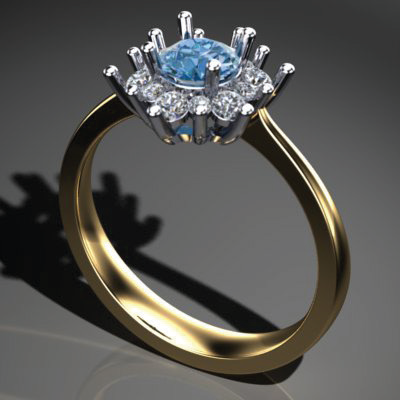 page 297 (shared page)
- 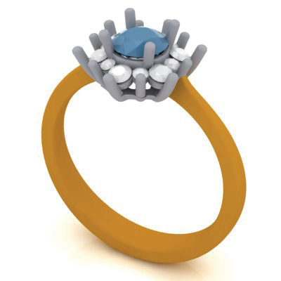 page 297 (shared page)
- 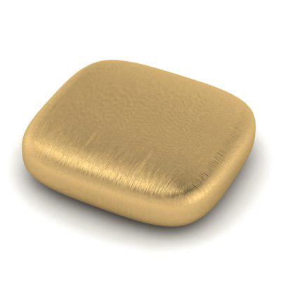 page 297 (shared page)
- 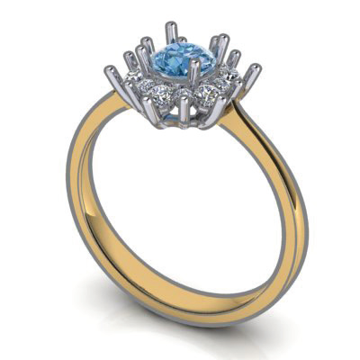 page 297 (shared page)
- 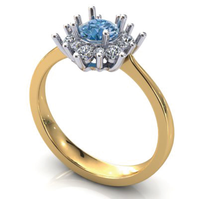 page 297 (shared page)
- 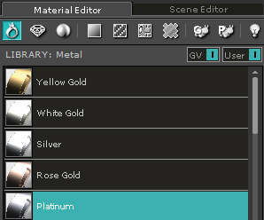 page 297 (shared page)
- 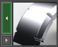 page 297 (shared page)
- 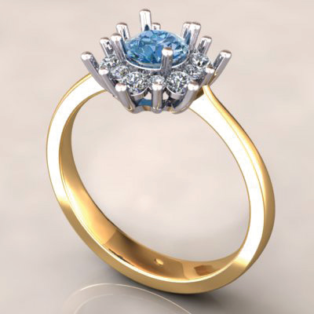 page 297 (shared page)
- 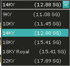 page 298
- 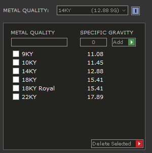 page 299
- 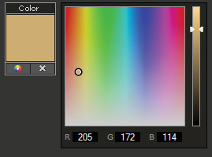 page 299
- 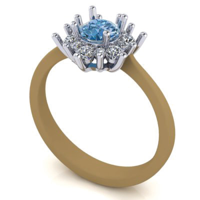 page 299
- 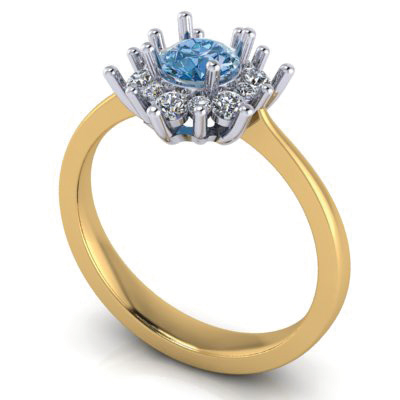 page 299
- 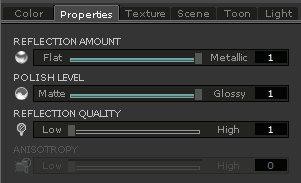 page 299
- 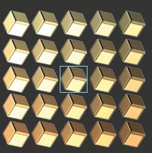 page 299
- 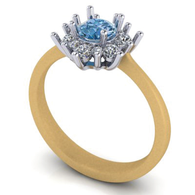 page 300
- 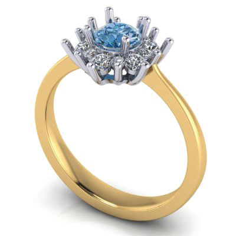 page 300
- 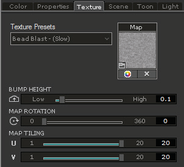 page 300
- 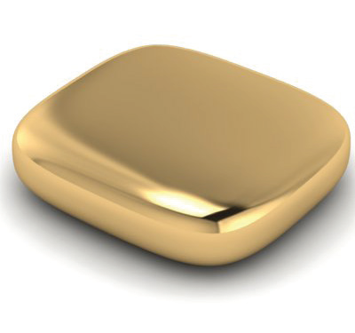 page 300
- 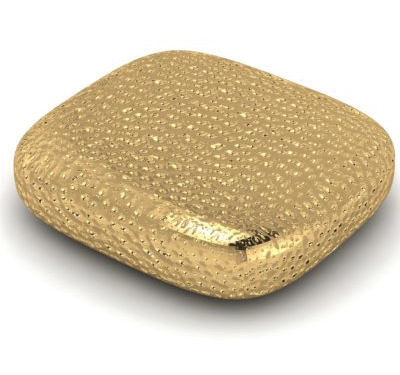 page 300
- 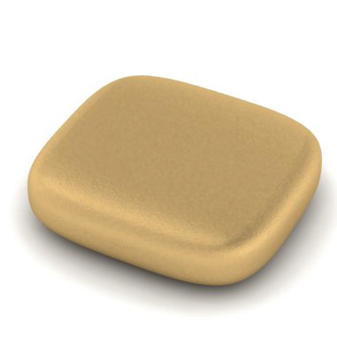 page 301
- 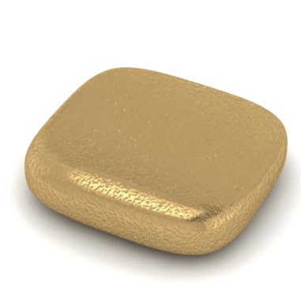 page 301
-  page 301
- 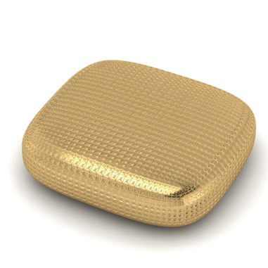 page 301
- 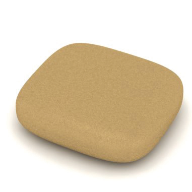 page 301
- 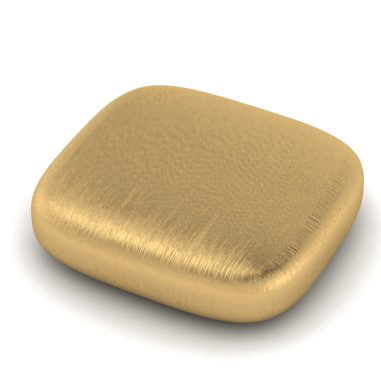 page 301
- 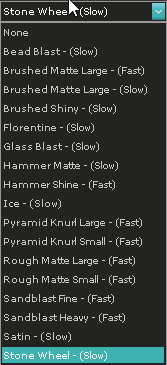 page 301
- 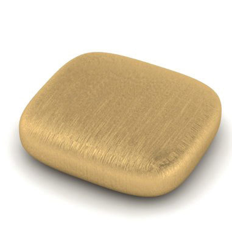 page 301
- 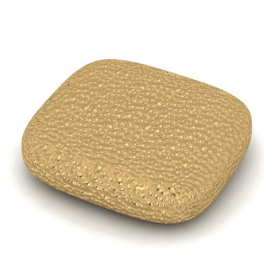 page 301
- 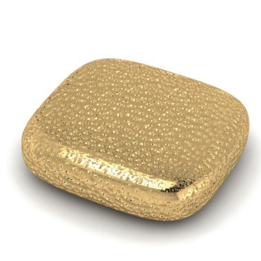 page 301
-  page 301
- 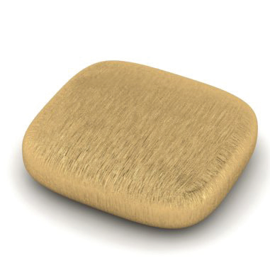 page 301
- 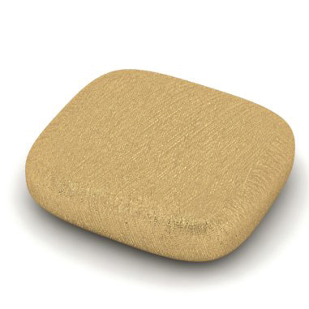 page 301
- 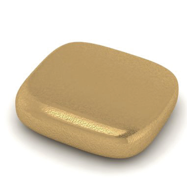 page 301
- 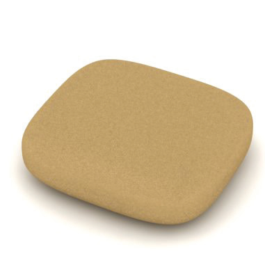 page 301
- 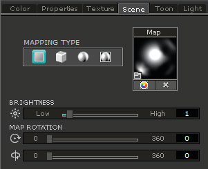 page 302
- 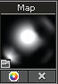 page 302
- 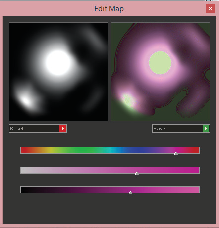 page 302
- 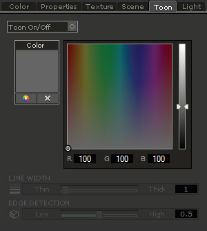 page 302
- 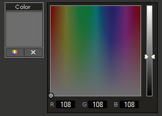 page 303
- 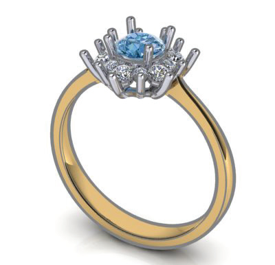 page 303
- 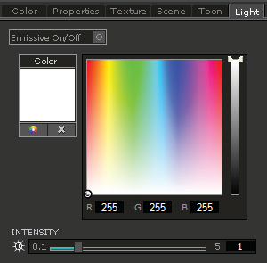 page 303
- 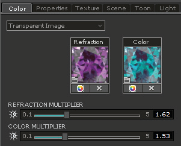 page 304
- 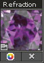 page 304
- 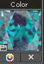 page 304
- 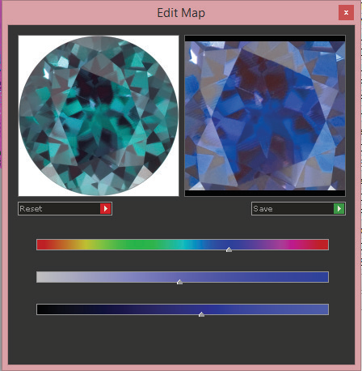 page 304
- 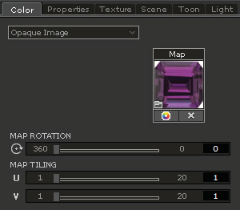 page 305
- 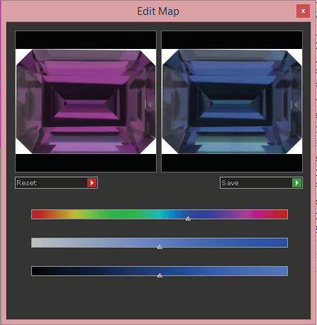 page 305
- 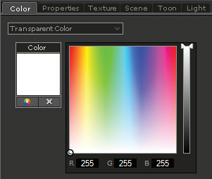 page 305
- 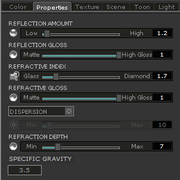 page 306
- 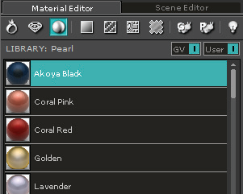 page 306
- 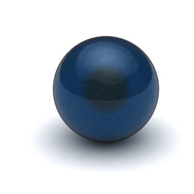 page 307
-  page 307
-  page 307
-  page 307
-  page 307
-  page 307
-  page 308
-  page 308
-  page 308
-  page 308
-  page 308
-  page 309
-  page 309
-  page 310
-  page 310
-  page 311
-  page 311
-  page 311
-  page 312
-  page 312
-  page 312
-  page 312
-  page 313 (shared page)
