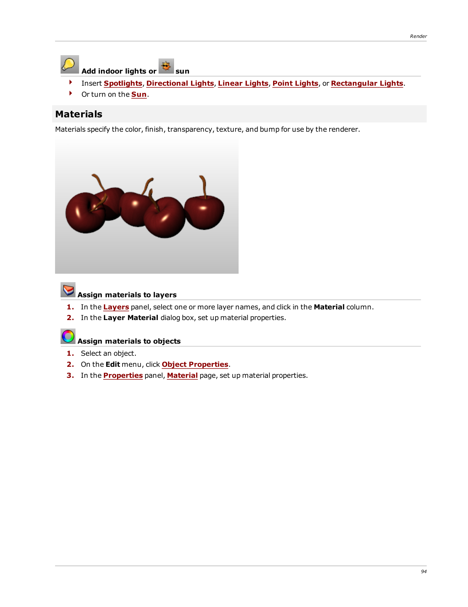

# Materials

- Source PDF: Rhinoceros 5 User's Guide (rhino5.pdf)
- Page range: 102-102
- Section title: Materials
- Section id: rhino5-073-materials
- Note: boundary page(s) are shared with a neighbouring section (two-column layout); text/images may include neighbour content.

---
<!-- section rhino5-073-materials | Materials | rhino5 pages 102-102 -->

<!-- page 102 -->

Render
Add indoor lights or
sun
4
Insert Spotlights, Directional Lights, Linear Lights, Point Lights, or Rectangular Lights.
4
Or turn on the Sun.
### Materials
Materials specify the color, finish, transparency, texture, and bump for use by the renderer.
Assign materials to layers
1. In the Layers panel, select one or more layer names, and click in the Material column.
2. In the Layer Material dialog box, set up material properties.
Assign materials to objects
1. Select an object.
2. On the Edit menu, click Object Properties.
3. In the Properties panel, Material page, set up material properties.

---

## Images

-  page 102 (shared page)
-  page 102 (shared page)
