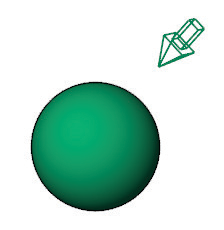
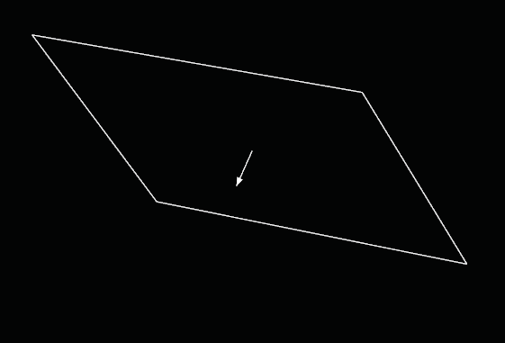
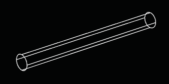
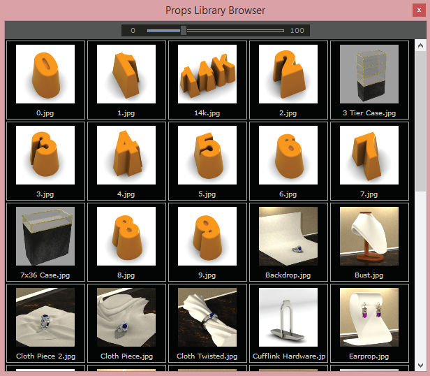
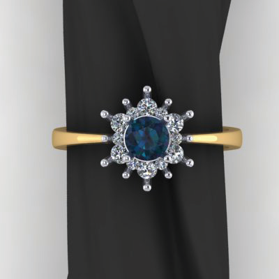

# Create Rectangular Light

- Source PDF: Matrix 8 Instruction Manual Book 2 (matrix_8_book_2.pdf)
- Page range: 314-315
- Section title: Create Rectangular Light
- Section id: m8book2-256-create-rectangular-light
- Note: boundary page(s) are shared with a neighbouring section (two-column layout); text/images may include neighbour content.

---
<!-- section m8book2-256-create-rectangular-light | Create Rectangular Light | m8book2 pages 314-315 -->

<!-- page 314 -->

Enabled: Enabled turns the light object on and
off.
Color: Color provides a tint to the spotlight.
Clicking here opens a color selection box.
object merely indicates the direction the light
shines.
• Turn on the light’s control points and move or drag
the control points to edit the light’s direction and
target.
• To move the light without changing its direction,
move the dolly point (the control point at the
midpoint on the direction vector).
Intensity: Intensity turns up (or down) the
brightness of the light.
Shadows: Shadows turns a shadow on or off.
## Set Spotlight to View
Shadow Radius: Shadow radius increases or
decreases the size of the shadow.
## Create Point Light
‘SetSpotLightToView’
Matches the view to a spotlight direction. Changes
the current view so that the camera position
matches the spotlight source location and the
camera target matches the light target point
(center of base of the cone). The camera angle
matches the light cone angle. This can verify a
light’s view as an analysis aid in setting up a scene.
‘PointLight’
Inserts a light object that emits light from a single
location in all directions (omni light).
Where is this tool:
Access this tool from Render>Set View to
Spotlight
Where is this tool:
Access this tool from Render>
Create Point Light
Steps:
Steps:
• Select Create Point Light from the Render menu.
• Pick the light’s location.
• Select a spot light in the viewport.
• Select Set Spotlight to View from the Render
menu.
## Create Directional Light
## Create Rectangular Light
‘DirectionalLight’
Inserts a light that simulates the sun defined with
parallel rays and a direction.
Where is this tool:
Access this tool from Render>Create
Directional Light
Steps:
‘RectangularLight’
Inserts a rectangular light object that emits light
from an array of light points in one direction.
Location point (1), length control (2), width control
(3), dolly point (4), target point (5).
Where is this tool:
Access this tool from Render>Create
Rectangular Light
Steps:
• Select Create Directional Light from the Render
menu.
• Pick a location at which to aim the directional light.
• Pick a location for the directional light.
• Select Create Rectangular Light from the Render
menu.
• Pick the light’s start point.
• Pick a the light’s length.
• Pick the light’s width.
Notes
• A directional light shines toward a
specified direction. The location of
the light does not matter: the light

<!-- page 315 -->

### Options:
Where is this tool:
Access this tool from Render>Props Library
Target: Aims the light at the specified location.
Steps:
Notes: Turn on the light’s control points and move or
drag the control points to edit the light’s direction,
length, width, and target. To move the light without
changing its direction, move the dolly point (the
control point at the midpoint on the direction
• Select Props Library from the Render menu.
• Select a prop and it will appear, centered at F4.
• Use Move, Scale, Rotate, etc to get the prop right
where you want it for your render. Or, use it in
further modeling applications.
## Create Linear Light
‘LinerLight’
Inserts a light that imitates a fluorescent tube.
Where is this tool:
Access this tool from Render>Create Linear
Light
Steps:
• Select Create Liner Light from the Render menu.
• Pick the start of the light.
• Pick the end of the light.
## Set Renderer
## Props Library
‘SetRenderPlugin’
Set Renderer allows you to choose between
Rhino Render or VRay for Matrix render.
Select this tool to open a library of available props
to bring into the viewports.
Where is this tool:
Access this tool from Render>Set Renderer
Steps:
• Select Set Renderer
from the Render
menu.
• A dialog window
appears listing the render engine options.
• Choose an option you wish to use for rendering.

---

## Images

-  page 314 (shared page)
-  page 314 (shared page)
-  page 314 (shared page)
-  page 315 (shared page)
-  page 315 (shared page)
-  page 315 (shared page)
