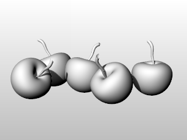
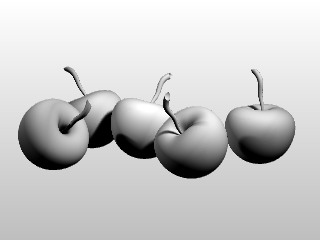
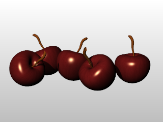

# Lights

- Source PDF: Rhinoceros 5 User's Guide (rhino5.pdf)
- Page range: 101-102
- Section title: Lights
- Section id: rhino5-072-lights
- Note: boundary page(s) are shared with a neighbouring section (two-column layout); text/images may include neighbour content.

---
<!-- section rhino5-072-lights | Lights | rhino5 pages 101-102 -->

<!-- page 101 -->

## Render
In addition to shaded previews, Rhino provides full-color rendering with lights, transparency, shadows,
textures, and bump mapping.
Objects will render white until you add render color, highlight, texture, transparency, and bumps. These
attributes are controlled through the Properties panel, Material page.
The process needed to render scenes consists of four basic steps:
●
Add lighting
●
Assign materials
●
Set up the environment and ground plane
●
Render
Although the steps do not have to be done in this order, using this method seems to make setting up a scene
more efficient. To improve quality, repeat these steps until the image looks right to you.
### Lights
In every Rhino rendering there are light sources that Rhino uses to calculate how the objects are to be
illuminated. If you do not add any light sources to your scene, the default light is used. The default light is a
directional light with parallel rays that acts as though you have a lamp shining over your left shoulder.

<!-- page 102 -->

Render
Add indoor lights or
sun
4
Insert Spotlights, Directional Lights, Linear Lights, Point Lights, or Rectangular Lights.
4
Or turn on the Sun.
### Materials
Materials specify the color, finish, transparency, texture, and bump for use by the renderer.
Assign materials to layers
1. In the Layers panel, select one or more layer names, and click in the Material column.
2. In the Layer Material dialog box, set up material properties.
Assign materials to objects
1. Select an object.
2. On the Edit menu, click Object Properties.
3. In the Properties panel, Material page, set up material properties.

---

## Images

-  page 101 (shared page)
-  page 101 (shared page)
-  page 102 (shared page)
-  page 102 (shared page)
