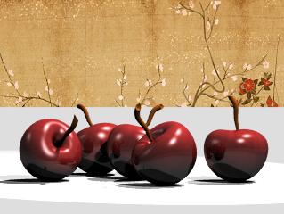

# Ground Plane

- Source PDF: Rhinoceros 5 User's Guide (rhino5.pdf)
- Page range: 103-103
- Section title: Ground Plane
- Section id: rhino5-075-ground-plane
- Note: boundary page(s) are shared with a neighbouring section (two-column layout); text/images may include neighbour content.

---
<!-- section rhino5-075-ground-plane | Ground Plane | rhino5 pages 103-103 -->

<!-- page 103 -->

Render
### Environment
Environments describe the space around the model. This space is reflected in objects and can provide overall
lighting.
Set up the rendering environment
The rendering properties include environment settings like background color and image.
1. Open the Environment Editor panel.
2. Set up environment properties.
### Ground Plane
The ground plane provides an infinite horizontal platform for the image that stretches to the horizon in all
directions positioned at a defined elevation. A ground plane renders much faster than using a surface as a
background. Any material can be assigned to the ground plane.
Turn on a ground plane
1. Open the Ground Plane panel.
2. Set up ground plane properties.

---

## Images

-  page 103 (shared page)
-  page 103 (shared page)
