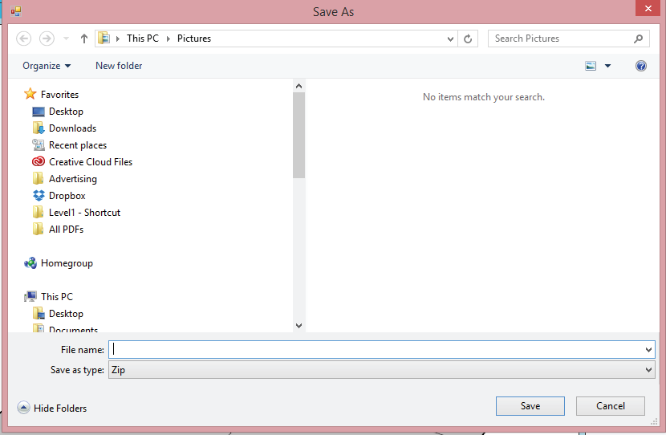
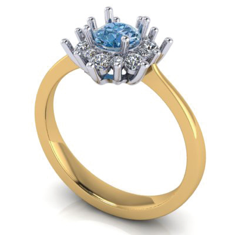
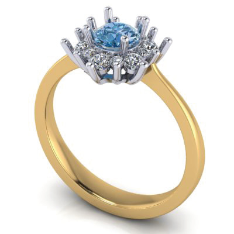

# Export VRay Render

- Source PDF: Matrix 8 Instruction Manual Book 2 (matrix_8_book_2.pdf)
- Page range: 296-296
- Section title: Export VRay Render
- Section id: m8book2-249-export-vray-render
- Note: boundary page(s) are shared with a neighbouring section (two-column layout); text/images may include neighbour content.

---
<!-- section m8book2-249-export-vray-render | Export VRay Render | m8book2 pages 296-296 -->

<!-- page 296 -->

## Native VRay Controls
Classic (Fast)
VRay Material Editor, and VRay Options Editor
are the advanced ways of interacting with VRay
by accessing the native VRay interface to make
the changes to the materials or environmental
controls. This manual process is available for those
users who have advanced knowledge of VRay
and wish to continue using this workflow. Refer to
the VRay manual for additional information.
## Export VRay Render
Color Dome (Fast)
Use Export VRay Render to save your design file
(3DM), all applied materials (vismat), scene files
(visopt) and maps (HDR and JPEG) to one ZIP
file. This contains everything needed for someone
else to render using the same settings you used to
render this design.
Steps:
• After applying materials to the model. Click on the
Export Vray Render.
Cut Out White (Fast)
Falloff (Slow)
## Choose a Style
Each Style contains the environment or scene
used in creating the render. Each operates with it’s
own amended materials along with lighting. So,
when switching from Style to Style the object’s
assigned metal and gem materials are changed
also.
Steps:
Fifth Ave (Slow
• Click on the drop down arrow to the right of the
Style name for the full list of available styles.

---

## Images

-  page 296 (shared page)
-  page 296 (shared page)
-  page 296 (shared page)
-  page 296 (shared page)
-  page 296 (shared page)
-  page 296 (shared page)
