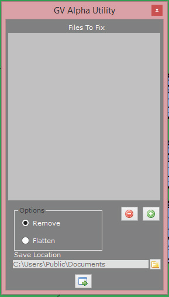

# Render Scheduler

- Source PDF: Matrix 8 Instruction Manual Book 2 (matrix_8_book_2.pdf)
- Page range: 337-338
- Section title: Render Scheduler
- Section id: m8book2-269-render-scheduler
- Note: boundary page(s) are shared with a neighbouring section (two-column layout); text/images may include neighbour content.

---
<!-- section m8book2-269-render-scheduler | Render Scheduler | m8book2 pages 337-338 -->

<!-- page 337 -->

### Command Line Options:
Size: Choose the resolution size (Height x Width)
for your renders.
Format: Choose a file format type from the drop
down box. Available types are JPG, PNG, and
BMP.
Select the Capture Type:
Viewport: A Viewport Capture will generate a
screen capture of your model in a 4 View Layout
and output a picture file. Be sure to select a Shade
Mode for one or all your viewports.
Save To: Select a Location where to save the
renders. Click on the green arrow for the “Browse
for Folder” dialog box to appear.
Render: A Render Capture will generate a
rendering of your model from in a 4 View
Layout and output a picture file. Be sure to apply
render materials first to all your objects.
Width and Height: This records the actual size
(in pixels) of each of your current viewports. Just
click on each one and enter the amount on the
Command Line for the width or height desired of
each viewport. Press enter to complete the
change.
View: Select a view for all the renders. Select
from the four named viewports: Perspective,
Looking Down, Through Finger, or Side View.
Models tab (Adding and Removing Designs):
Select the design files you which to have
rendered. Click on the “+” in the “Model” header to
open the “Pick Models to Import” directory. Add
the designs. To remove a design, just highlight it in
the list and click on the “-” located on the header.
### Options Tab:
Save Channel On/Off: VRay for Rhino users
only. If you have Alpha or Z depth turned on and
saved to a .visopt file, you will produce a separate
BMP file of each of these options.
4 view capture rendered.
Run time: Select a time today to run the render
job. If the time is not changed, the job will start
immediately (or the next time Scheduler checks
for jobs).
Completing the Capture: After making all your
selections in the Command Line be sure to press
“enter” on your keyboard. You will be prompted
to name the file, select a file type and select a
location for saving.
Note: The Scheduler does not update real time. The
time shown is captured at the first open of Scheduler
in this Matrix session. Scheduler looks for jobs with
older, past due times that it needs to run. It checks
for jobs every minute or so.
Note: If you chose “Render” as an option VRay will
immediately begin to render all your viewports.
Remember, do not click on anything while VRay
completes the renders.
## Render Scheduler
Schedule: Click on the green arrow to Schedule
the render job. The job will immediately be listed in
the Jobs Tab. When a job begins a notice appears
“Do you want to run this job?” that allows you to
Run or Cancel a job if you are working in Matrix.
Schedules a job with a specific start time to create
renders from multiple, saved design files.
### Jobs Tab:
Where is this builder:
Access this builder from Render>Render
Scheduler
After clicking on “Schedule” the job will appear
here. It will list the number of files to be rendered
along with the start time. The “Delete” option

<!-- page 338 -->

will remove the job from Render Scheduler. The
“Edit” option will allow you to change any of your
selected settings. The job is removed from this list
when it has completed.
the file symbol with the green arrow at the bottom
of the Alpha Erase dialog box to run the
command. Then, click “OK” to the “Finished” notice
that appears after the command is complete.
## Alpha Erase
‘gvAlphaErase’
Use this tool to remove the transparent
background (Alpha turned on) from PNG image
files. Alpha Erase removes the transparency and
restores the original background or replaces the
transparency with a selected color.
Where is this tool:
Access this tool from Render>Alpha Erase
Alpha Erase only works with .PNG image files
where Alpha is turned on. Start with saved image
files.
Add Files: Click on the “+” to add Files to Fix.
Use this directory to locate your saved image files
(PNG). Select one or multiple files.
Remove Files: Use the “-” to remove any files
from the “Files to Fix” list. Just highlight
the file(s) you want to remove from the “Files to
Fix” list. Then, click on “-.”
### Choose an Option
## Apply Displacement
Remove: Select “Remove” to remove the
transparency (Alpha turned on) from the
image. This will restore the image’s original
background.
‘ApplyDisplacement’
Constructs a displacement display mesh
for surfaces, polysurfaces, or meshes. The
displacement map can be a procedural or image
texture.
Flatten: Select “Flatten” to place a background
color of your choosing in place of the transparent
background on an image. It flattens the image
onto a color. When selecting “Flatten” you will also
select a color. Just click in the color selection box
that appears to the right of “Flatten.”
Note: After running this command, Displacement
appears as an object property for the surface. The
displacement map differs from a bump map set
by the rendering material in that the displacement
mesh is a real object with edges that produce real
highlights and shadows. The illustrations use the
same image for the bump and the displacement.
Save Location: Select a location for the output
files to be stored.
Run the Command: When all the files have
been added and the options selected just click on

---

## Images

-  page 337 (shared page)
-  page 338 (shared page)
