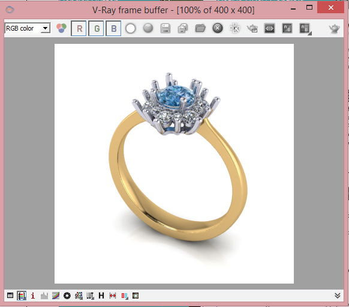
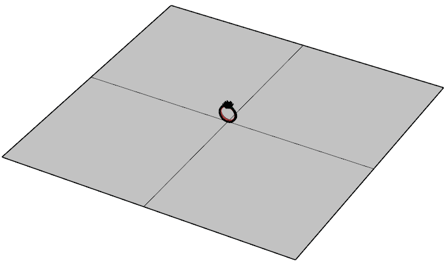
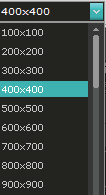

# Resolution Amount

- Source PDF: Matrix 8 Instruction Manual Book 2 (matrix_8_book_2.pdf)
- Page range: 295-295
- Section title: Resolution Amount
- Section id: m8book2-246-resolution-amount
- Note: boundary page(s) are shared with a neighbouring section (two-column layout); text/images may include neighbour content.

---
<!-- section m8book2-246-resolution-amount | Resolution Amount | m8book2 pages 295-295 -->

<!-- page 295 -->

Steps:
## Render Button
When you click on the render button it runs the
set rendering engine, creating a photo realistic
image using the materials applied.
Steps:
• To create the most basic version of this, click the
Create Ground Plane icon next to the Render
button and it will be placed in the viewports.
• Assign a Ground Plane material the same way you
apply any other material, selecting the ground
plane, and applying the material to it. (See
Material Editor).
• Left-click the Render button after all the settings
and materials have been applied to the viewport’s
objects and the render will be produced.
This renders in the default Perspective viewport.
Right-clicking the render button will begin a
render in the active viewport.
## Resolution Amount
Choose the pixels amount in height and width you
wish for the render output. You may render up to
1920 x 1080, full HD resolution.
Steps:
• Select a resolution from the Resolution Amount
drop down.
Save the render using the Save Image button
within the V-Ray frame buffer window. The default
file type is .JPEG. Navigate to the location you
would like to save the file using the standard
windows navigation, name the file and click Save.
## Show VRay Frame Buffer
Note: Save the file as a .PNG and the Ground Plane
will be discarded from the image.  This option
can be used to place the jewelry item on another
background, such as an appraisal.
## Ground Plane
After a render is completed and you close the
Frame Buffer window, use Show VRay Frame
Buffer to show the last render window.
Steps:
VRay requires a GroundPlane; or, an object on
which to place the model.
• After rendering click on the Show Vray Buffer
button. A window with the most recent render will
be displayed.

---

## Images

-  page 295 (shared page)
-  page 295 (shared page)
-  page 295 (shared page)
