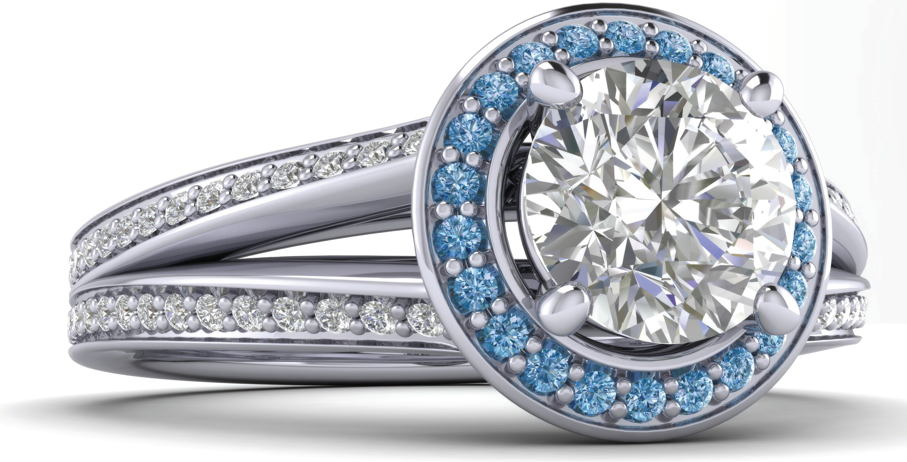
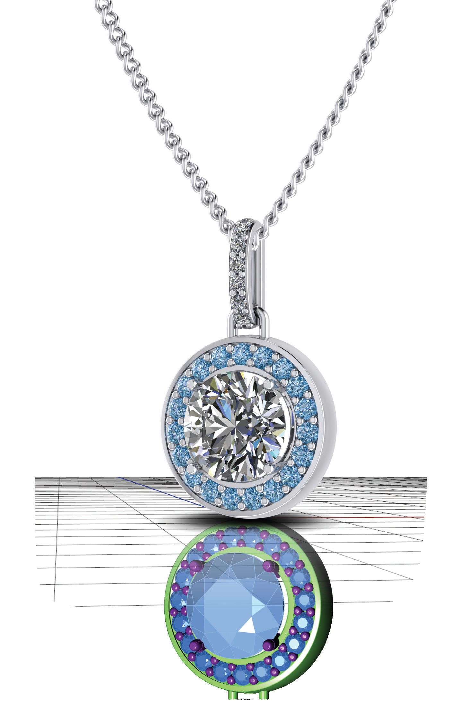

# Render Menu

- Source PDF: Matrix 8 Instruction Manual Book 2 (matrix_8_book_2.pdf)
- Page range: 293-294
- Section title: Render Menu
- Section id: m8book2-243-render-menu

---
<!-- section m8book2-243-render-menu | Render Menu | m8book2 pages 293-294 -->

<!-- page 293 -->

# CHAPTER 30
# Render Menu
### Creates photo-realistic renders and animations quickly and easily.
by placing your model inside an invisible “sphere”
in the program. Onto the inside of this sphere it
maps an environment - or, a “scene.” In VRay, it’s
actually a digital image that lives in Matrix and is
“mapped” onto the inside of this sphere. This is the
image that reflects on the model during rendering.
With each Style the object’s materials along with
the ground plane changes.
VRay Styles
Rendering is a process that adds the look of
realistic materials to Matrix models. To do so, VRay
Styles assigns the metal materials to objects you
select as metal; gem materials to gem objects,
etc. VRay rendering looks so realistic because
the lighting in the scene is able to interact with
the properties of each object the way lighting
interacts with objects in real life.
Marketing
Animation tools make it easy to create video of
designs to use online or send to customers. The
new Batch Render tool setups up a model to
be rendered from multiple views and in multiple
materials. This is perfect for creating images for
an online catalog. With the new Render Editor it is
easy to change look of an existing render and add
a company watermark.
The Role of Materials
In the case of metals, the program assigns it a
highly reflective property to create the “layered”,
multidimensional reflections in imperfect jewelry
created from soft metals rather than hard chrome
or steel. This is taken one step further, creating
textured surfaces including hammered, stippled,
along with different colored metals. Metal quality
is also assigned with the material for use in the
Design Report. Gems can be made clear like
“glass”, so the facets in the cut of the stone
on-screen create the look of faceting in your
rendering the same way real-life gems do. The
program can even calculate “caustics”, whereby
gems’ faceting catches light and throws it around
the scene like a prism. And finally, it can assign
a “fog color” to create a colored gemstone,
complete with an Index of Refraction
that has been assigned to
match real-life gems.
The Role of Styles
Styles range from
photo realistic scenes
to abstract cartoon-like
sketches. VRay can
create reflections
of the object’s environment,

<!-- page 294 -->

### Skills & Commands in this Chapter
Render Stills:
Vray Styles, Render Editor, Batch Render, Layout
Tools, 4 View Capture, Render Scheduler, Alpha
Erase
Lights
Create Spotlight, Create Point Light, Create
Directional Light, Set Spotlight to View, Create
Rectangular Light, Create Linear Light
Animation:
Animation Builder, Animation Builder Advanced,
Matrix Movie Maker
Other Render Tools:
Props Library, Set Render, Environment Map,
Apply Edge Softening, Apply Displacement, Set
Render

---

## Images

-  page 293
-  page 294
