# Animation Builder Advanced

- Source PDF: Matrix 8 Instruction Manual Book 2 (matrix_8_book_2.pdf)
- Page range: 318-324
- Section title: Animation Builder Advanced
- Section id: m8book2-263-animation-builder-advanced
- Note: boundary page(s) are shared with a neighbouring section (two-column layout); text/images may include neighbour content.

---
<!-- section m8book2-263-animation-builder-advanced | Animation Builder Advanced | m8book2 pages 318-324 -->

<!-- page 318 -->

### Explanation of Menus:
## Animation Builder Advanced
File Menu: New Animation: Start an animation
from scratch. This resets all animation data in the
model. You will be prompted to click either yes or
no.
‘gvAnimationBuilderAdvanced’
Create your own animations and save your own
templates for future use. Add multiple features
along with geometry such as Sweeps, Pipe and
Loft displays.
Save as Template: When finished just name
and save all your selected settings in a custom
Template. (Go to the Templates tab to view and
apply the save Templates)
Where is this Builder:
Access this tool from Render>Animation
Builder Advanced
### Workflow:
First, set up your model by applying render
materials in VRay Styles or with F6 Materials
Mode. Then, select a previously set Template or
start from scratch. Add the objects you wish to
animate. Select the animation properties, save
your file, apply all settings, add cameras with their
settings, and add geometry if desired. Save your
settings as a Template in the File menu to be used
again in the future if desired. Run the “Preview”
play with record turned ‘ON’ and your animation
files will populate the selected folder on your
computer. Finally, use Movie Maker to compile the
animation files to create a .mp4 movie.
### Setting up your model:
Edit Menu: Extra
Display Modes:
Select from one of the
many Extra Display
Modes and choose any
for creating additional
animation files. Record
will select the main
Image type under
Properties along with
additional display
modes chosen from
Edit. Choose as many
as you wish to include.
The same number of
frames will be outputted for each display type
along with your main selection.
Before creating the animation, make sure that
the model in the viewports has had materials
assigned with VRay Styles. The animation is
made by talking many “pictures” of the rendered
model from various angles. Keep this mind when
selecting settings: a very complex and lengthy
render will also take quite some time to animate in
this builder.
Record: Toggle Record on or off. Begin the
animation by clicking on the “play” button in the
Preview on the main screen with Record toggled
ON. After the animation files populate
your selected folder use Movie Maker to complete
the .mp4 movie file.
Properties:
Use these options in Properties to select the
image type, animation size, viewport and frame
counts.
Image Type: Select a Viewport or VRay Render.
Size: Select an output resolution size.

<!-- page 319 -->

Viewport: Select to animate from one of the four
viewports: Perspective, Looking Down, Through
Finger, Side View.
Total Frames: Enter the number of total
animation frames desired.
Add Camera Icon: The Camera is the window
through which you are viewing the animation.
The Target is the focus at which the camera is
pointing. If the camera is a point and the target is
a curve, you may see the camera swivel to follow
the target. If the camera is a curve and the target
is a point, you may feel as though the camera
is rotating or moving around the target. If the
camera and target are both curves, you will feel as
though you’re on a moving train, watching another
moving object outside the train. To set both of
these, draw a curve or place a point object in the
viewports.
Save:
Use Save to create a name, file format and a
location where to save the files.
Name: Select a name for your animation.
New Camera or Camera from Active
Viewport: Add a new camera to the animation.
Or, add a camera from the active viewport. When
saved the camera will appear in the Cameras tab
and can be accessed for additional edits.
Format: Choose a File format for the animation
output files.
Save to: Select a location for which to save the
files. Consider that the file count may be high
depending on the frame count.
Preview:
Preview Tab: Move the Preview slider to see the
camera orientation for each frame. Save or Cancel
your camera settings.
Use Preview to “play” the animation preview. Click
the arrow to play the full preview. Or, click and
hold the slider while moving to “scrub” through
and preview each frame. Set to Record along with
preview “play” to create the animation files.
Objects:
Camera Tab:
Choose a Start Frame and End Frame.
All the options for adding animation objects,
cameras, camera paths, camera ease
settings and geometry are located in the Objects
menu. Also, your saved Templates and Pieces are
stored here.
Camera in-box: Draw a curve you wish to use
for the camera path or draw a stationary point
and insert it in the Camera box by using the arrow.
Target in-box: Draw a Target Curve or point and
insert it in the Target box by using the arrow.

<!-- page 320 -->

Ease Type: Select the type of Ease: EaseIn,
EaseOut, EaseInOut, BounceIn, BounceOut, etc.
Ease moves the objects gradually per frame for
a time and Bounce moves the objects swiftly for
a time. Elastic pulls the objects back after they
move along. Save or Cancel the camera settings.
### Lens Tab:
Lens Sets:
### Animated Object Properties:
Objects tab:
This displays the objects you selected for
animation.
• Toggle to enable Lens
Sets
• Select Set 1, 2 or 3
• Select a Lens Start
Frame and End Frame
• Select a Lens Start Size
and End Size
• Select an Ease Type.
• Save or Cancel your
Lens settings.
Preview: Move the Preview slider to see how the
objects move in animation. Save or Cancel the
objects added.
### Lens Tilts:
### Move tab:
Lens Tilts:
Draw and enter into the in-box a curve for which
to move your objects. The objects follow the
curve at the object’s center point.
Move Path: Click here to insert a Path Curve
(draw planar in the Looking Down viewport) along
which the objects will move. Draw a path curve
and click on the arrow to add it.
• Toggle to enable Lens
Tilts
• Select Set 1, 2 or 3
• Select a Lens Start
Frame and End Frame
• Select a Lens Start Size
and End Size
• Select an Ease Type.
• Save or Cancel your
Lens settings.
Pivot Plane: Click on the box to display a Pivot
Plane guide. Click, hold and drag the guide to the
desired location. Then, click the in-box arrow to
set the Pivot. Keep in mind the objects by default
move from the object’s center point.
### Options:
Enable: Toggle on or off this “Move” setting.
Add Objects Icon: If you wish to animate
multiple objects one at a time just have them all
ready in your viewport. Then, pick the first objects
in your Viewports you wish to animate. Press Enter
when done. A new Animated Object Properties
box will appear. When saved the objects will
appear in the Objects tab. Highlight your objects
and click on “Cancel” to remove objects from
animation. Then, repeat for each additional
objects to animate.
Orient: Orient sets the objects to orient on the
curve so the object’s bottom point remains on the
curve instead of the object staying in a stationary
position in space (north and south always
remaining the same). Think of the object moving
like Transform- Orient on Curve objects.

<!-- page 321 -->

Set: Choose up to three “Move” settings for one
animation. Select your preferences for each Set
number (1,2, or 3) and click Save.
Start Frame: Select a Frame number on which
the Move will
begin.
End Frame:
Select a Frame
number on
which the Move
will end.
Pivot Plane: Click on the Pivot Plane box to
show the Pivot object. Move the object to
the desired location. Then, click on the arrow to
set the highlighted Pivot object.
### Options:
Ease Type:
Select the type
of Ease: EaseIn,
EaseOut, EaseInOut, BounceIn, BounceOut, etc.
Ease moves the objects gradually per frame for
a time and Bounce moves the objects swiftly for
a time. Elastic pulls the objects back after they
move along.
Enable: Toggle on or off this “Rotate” setting.
X,Y, Z: Toggle on either X, Y or Z axis and enter an
amount of degrees for which to rotate your object.
Repeat: Choose between None, Loop
(continuous or Loop Reverse.
Set: Choose up to three “Rotate” settings for one
animation. Select your preferences for each Set
number (1,2, or 3) and click Save.
Save or Cancel these settings.
Start Frame: Select a Frame number on which
the Rotate will begin.
### Rotate tab:
End Frame: Select a Frame number on which
the Rotate will end.
Ease Type: Select the type of ease for the
Rotate.
Repeat: Choose between None, Loop (starts
again from the beginning) or Loop
Reverse (reverses at the end in the direction from
where it came).
Save or Cancel these settings.
### Scale tab:
Rotate: Allows you to choose an axis around
which to rotate the object. Assign the number of
degrees in that axis you want it to rotate by filling
in the X, Y, or Z box beside “Rotate.”
Select “Scale” to assign the scale of the item
during this animation. This setting defaults
to 100% of the size of the object when it is not

<!-- page 322 -->

### Mirror:
Enable: Toggle on or off “Copies - Mirror” setting.
selected. Choose a new scale by setting this
option as Enabled. Type in a new value choosing
X, Y or Z direction. Enter a percentage amount
from 0 to 100 in the axis box. Settings are the
same as for the Rotate tab.
Pivot Plane: Click on the Pivot Plane box to
show the Pivot object. Move the object to the
desired location. Then, click on the arrow to set
the highlighted Pivot object. Select X,Y, Z, X>Y,
Z>X, Z>Y or XY>Z. Think of Cutters - Quad-flip
settings cube. X>Y means the object will mirror
Side to Side. Select a setting and scrub the
preview slider to see how it reacts. Remember,
it’s easy to mirror an object on top of itself. So, be
careful using these options.
Save or Cancel these settings.
### Array:
### Copies tab
Start Frame: Select a Frame number on which
the Copies will begin.
End Frame: Select a Frame number on which
the Copies will end.
Hide Original: Toggle on or off to hide the
original objects and only show the mirrored/
arrayed objects. Select between Mirror or Array.
Copies will default to Mirror. Click on the “Array”
tab to switch.
Enable: Toggle on or off “Copies - Array” setting.
Enter an Array Curve in the in-box. Enter the
amount of Arrays in the Number box.
Pivot Plane: Click on the Pivot Plane box to
show the Pivot object. Move the object to
the desired location. Then, click on the arrow to
set the highlighted Pivot object.
Slide: Toggle on or off slide. Slide brings the
arrayed objects into their positions as if they were
off-screen and moved into place by holding and
dragging the objects on-screen.
Enter the spacing amount in the box provided.

<!-- page 323 -->

### Create Geometry:
in the correct order you wish the Sweep to be
made and enter them into the profile in-box. (It’s
assumed that the profiles were regionally selected
previously)
Smart Trim: Smart Trim replaces the large
trim plane with a smaller trim plane. Use only if
your Sweep objects appear to be cut off (sliced
through) in multiple areas.
Tween Tab: Toggle the Enable for Tween on or
off. Select the Frame Range for Tween. Tween will
graduate the shapes of two very different profile
shapes.
Select an Unload Frame Start. Toggle ON to
Enable the Unload. Unload will display the
objects undoing the Sweep. So, it’s a reverse
Sweep.
Select the type of geometry to add to the
animation. Choose between Sweep1, Sweep2, Pipe
or Loft. When saved these will appear as icons on
the Geometry tab.
Sweep 1 or 2: Follow the Command Line
prompts to select rails and profile for the Sweep.
The rails and profile will appear in the Main tab in-
box. Enabled must be toggled ON to add the
Sweep  to the
animation. Select
a Frame Range
(Start and End).
Select a render
material to
display the
Sweep. A
Material list
populates from
the previously
assigned VRay
render materials. Click to Create Animated Object.
Move the Preview slider to preview the animated
Sweep. Go to the Options tab. Select a sweep
type; Rebuild or Refit. Select an Ease type. Toggle
ON “Keep.” Keep will allow you to keep the Sweep
in the animation for the remainder of the overall
animation. Without “keep” your Sweep objects will
be removed from the screen after the end frame
has passed.
### Options:
Sweep 1 x 1: Use this setting if you have trouble
with the order the profiles are automatically
selected for the Sweep. Enable this toggle. Then,
go back and select each profile one by one

<!-- page 324 -->

Templates Tab: Access your saved Templates
here. Templates are listed by named icons.
Double-click to open the Template.
Pipe: Follow the Command Line prompts to
select the pipe curve. Curve selected for Pipe will
appear in the Curve input box (Main tab). Enabled
should be toggled ON. Select the Frame Range
start and end. A Material list populates from the
previously assigned VRay render materials. Select
a render material to display the Pipe. Go to the
Options tab. Select a start Radius amount (mm)
and an end Radius2 amount (mm). Select a Cap
type; None, Flat or Round. Select an Ease type.
Pieces Tab: In Pieces you will find saved
Cameras, Animations, or Geometry. These are the
saved components from “Add Component.” Just
double-click to open any of them to use with your
current file. After double clicking to add to your
file the item will appear in the Objects, Cameras or
Geometry tabs.
Save Components: This icon appears to the
right of the Add Camera, Add Objects and
Create Geometry icons. Just click on “Save
Components” to save a camera, object or created
geometry. This will now appear as a named icon in
the Pieces tab.
## Matrix Movie Maker
Tween Tab: Toggle the Enable for Tween on or
off. Select the Frame Range for Tween. Tween will
graduate the shapes of two very different profile
shapes. Select an Unload Frame Start. Toggle
ON to Enable the Unload. Unload will display the
objects undoing the Pipe. So, it’s a reverse Pipe.
Move the Preview slider to see a preview of Pipe.
After all selections have been made click to Save
the Pipe settings. A Pipe icon will now appear in
the Geometry tab.
Movie Maker tool “sews together” the static
renders you create in Animation Builder or
Render Editor and turns them into animated
movies.
Where is this tool:
Access this tool from Render>Matrix Movie
Maker
Loft: Follow the Command Line prompts to
select the Loft curves. Curves selected for Loft
will appear in the Curve input box (Main tab).
Select the Frame Range start and end. A Material
list populates from the previously assigned VRay
render materials. Select a render material to
display the Loft.
### Options Tab:
Select Normal or Loose. Use Loose for multiple
profiles that will produce a more blended and
not rigid surface. Select an Ease type. Toggle ON
“Keep.” Keep will allow you to keep the Sweep
in the animation for the remainder of the overall
animation. Without “keep” your Sweep objects will
be removed from the screen after the end frame
has passed.
### Before using Movie Maker:
• Create a series of images files using Animation
Builder or Render Editor.
Tween Tab: Toggle the Enable for Tween on or
off. Select the Frame Range for Tween. Tween will
graduate the shapes of two very different profile
shapes. Select an Unload Frame Start. Toggle
ON to Enable the Unload. Unload will display the
objects undoing the Loft. So, it’s a reverse Loft.
Move the Preview slider to see a preview of Loft.
After all selections have been made click to Save
the Loft settings. A Loft icon will now appear in
the Geometry tab.

---

## Images

-  page 318 (shared page)
- 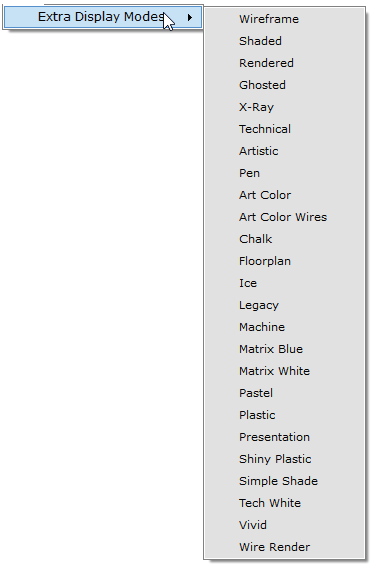 page 318 (shared page)
- 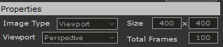 page 319
- 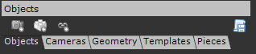 page 319
- 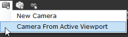 page 319
- 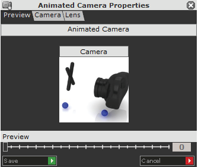 page 319
- 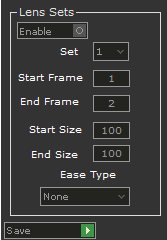 page 320
- 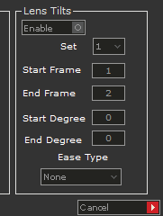 page 320
- 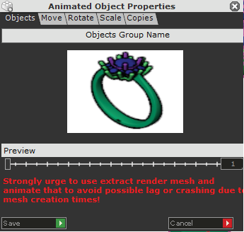 page 320
- 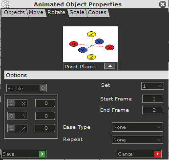 page 321
- 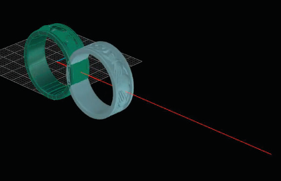 page 321
- 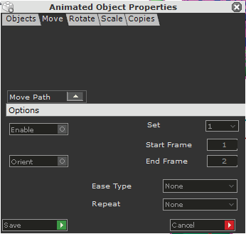 page 321
- 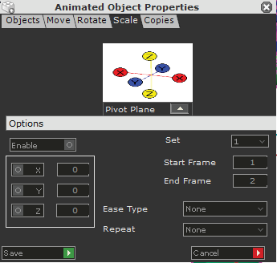 page 322
- 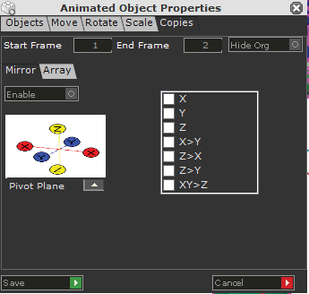 page 322
- 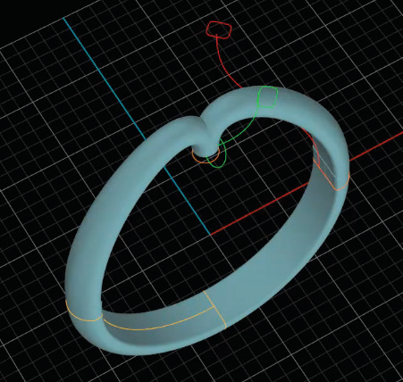 page 323
- 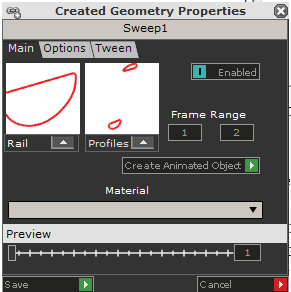 page 323
- 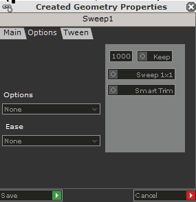 page 323
- 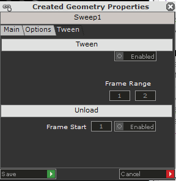 page 323
- 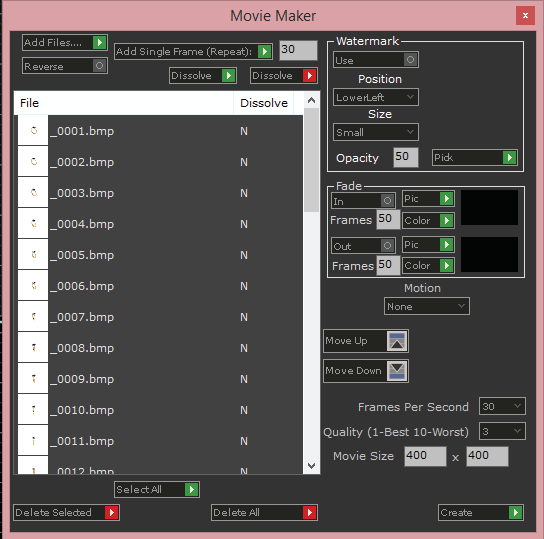 page 324 (shared page)
