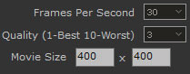
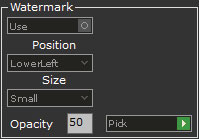
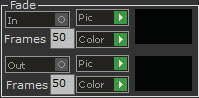

# Matrix Movie Maker

- Source PDF: Matrix 8 Instruction Manual Book 2 (matrix_8_book_2.pdf)
- Page range: 324-326
- Section title: Matrix Movie Maker
- Section id: m8book2-264-matrix-movie-maker
- Note: boundary page(s) are shared with a neighbouring section (two-column layout); text/images may include neighbour content.

---
<!-- section m8book2-264-matrix-movie-maker | Matrix Movie Maker | m8book2 pages 324-326 -->

<!-- page 324 -->

Templates Tab: Access your saved Templates
here. Templates are listed by named icons.
Double-click to open the Template.
Pipe: Follow the Command Line prompts to
select the pipe curve. Curve selected for Pipe will
appear in the Curve input box (Main tab). Enabled
should be toggled ON. Select the Frame Range
start and end. A Material list populates from the
previously assigned VRay render materials. Select
a render material to display the Pipe. Go to the
Options tab. Select a start Radius amount (mm)
and an end Radius2 amount (mm). Select a Cap
type; None, Flat or Round. Select an Ease type.
Pieces Tab: In Pieces you will find saved
Cameras, Animations, or Geometry. These are the
saved components from “Add Component.” Just
double-click to open any of them to use with your
current file. After double clicking to add to your
file the item will appear in the Objects, Cameras or
Geometry tabs.
Save Components: This icon appears to the
right of the Add Camera, Add Objects and
Create Geometry icons. Just click on “Save
Components” to save a camera, object or created
geometry. This will now appear as a named icon in
the Pieces tab.
## Matrix Movie Maker
Tween Tab: Toggle the Enable for Tween on or
off. Select the Frame Range for Tween. Tween will
graduate the shapes of two very different profile
shapes. Select an Unload Frame Start. Toggle
ON to Enable the Unload. Unload will display the
objects undoing the Pipe. So, it’s a reverse Pipe.
Move the Preview slider to see a preview of Pipe.
After all selections have been made click to Save
the Pipe settings. A Pipe icon will now appear in
the Geometry tab.
Movie Maker tool “sews together” the static
renders you create in Animation Builder or
Render Editor and turns them into animated
movies.
Where is this tool:
Access this tool from Render>Matrix Movie
Maker
Loft: Follow the Command Line prompts to
select the Loft curves. Curves selected for Loft
will appear in the Curve input box (Main tab).
Select the Frame Range start and end. A Material
list populates from the previously assigned VRay
render materials. Select a render material to
display the Loft.
### Options Tab:
Select Normal or Loose. Use Loose for multiple
profiles that will produce a more blended and
not rigid surface. Select an Ease type. Toggle ON
“Keep.” Keep will allow you to keep the Sweep
in the animation for the remainder of the overall
animation. Without “keep” your Sweep objects will
be removed from the screen after the end frame
has passed.
### Before using Movie Maker:
• Create a series of images files using Animation
Builder or Render Editor.
Tween Tab: Toggle the Enable for Tween on or
off. Select the Frame Range for Tween. Tween will
graduate the shapes of two very different profile
shapes. Select an Unload Frame Start. Toggle
ON to Enable the Unload. Unload will display the
objects undoing the Loft. So, it’s a reverse Loft.
Move the Preview slider to see a preview of Loft.
After all selections have been made click to Save
the Loft settings. A Loft icon will now appear in
the Geometry tab.

<!-- page 325 -->

### Managing Files for Movie Maker
Add Files Steps:
Dissolve (green arrow): Select the images
you wish to use for Dissolve. Dissolve is used to
combine different camera view animations or
multiple animations together. Select some frames
(around 20 is a good start) at the end of the first
animation and the same number of frames at the
beginning of the next animation and click on the
green Dissolve arrow to enable. Dissolve acts as a
way to overlay the images in a pleasing way that’s
not a harsh contrast when going from one camera
view or model in an animation to the next. The “n”
turns to “y” next to each image where Dissolve is
enabled.
Dissolve (red arrow): Select the images you
wish to remove from Dissolve.
Frames Per Second: Enter the amount of
Frames per Second for the movie. A count of
30 frames per second is the default and the
standard amongst animators.
• Select Matrix Movie Maker from the Render menu.
• Choose the images to be utilized by this builder.
Browse and open the file location.
• Then, click on the very first file in this folder and
OK. (Supported file types are .bmp,.jpg, and .png).
A message will show stating that it appears that
the file you chose is the first in a numbered series,
and would you like to “Import all?”
• Click “Yes” so that it will pull in every rendered
image in this folder. If the files are not a numbered
series just select all the files you want to use for
Movie Maker. Now, all the selected files appear in
the window.
Move Up and Move Down: Once all of the files
have been loaded into your Movie Maker window,
you may reorganize them if you so desire. Notice
the buttons to the right of the files that have
arrows. By selecting a file in
the window and clicking on
one of the arrows, the file
would be moved up or down
in sequence respectively.
Delete Selected: The “Delete Selected” button
will delete a selected file(s).
Quality (1 Best, 10 Worst): Change the
number of this setting to effect the quality of
your video. The lower the number the better the
quality and the slower the generation time of the
file. Conversely, the larger the number in this box
the lower the quality and the quicker the movie is
created.
Delete All: “Delete All” will delete all of the files
out of the window.
Movie Size: Choose the resolution height and
width. Make the movie display smaller or larger in
size by selecting the resolution size.
Select All: “Select All” will select all the files in the
window.
### Customizing Your Movie Maker Options:
Reverse: Reverse the numbered file order by
starting with the highest number instead of the
lowest.
Create: Click on “Create” and wait a few minutes
for the movie to compile. Name the
.mp4 movie file and select a location in which to
place it.
### Watermark Options:
Add Single Frame (Repeat): Click the arrow to
open the dialog box to select an image file you
wish to repeat. Enter the repeat frame count in the
box.
Use: Click this to toggle on the Watermark option.
When enabled an image appears to
the right. Choose “Pick” to select an image.

<!-- page 326 -->

Pic: Select a picture to use for fading out.
Pick: Choose “Pick” to open the dialog box to
select an image. Use your company logo
or any image of your choosing.
Color: Choosing a color for the Fade Out will
make the movie end with the color chosen
and fade from seeing your piece rotating the way
you chose.
Position Options Lower Left or Lower
Right: Select where to orient the Watermark.
Size: Select Small, Medium or Large for your
Watermark size.
Frames count box: The number assigned to
Fade Out is the number of seconds that it
will take for the color to fade away.
## Render Editor
Opacity: The default value is 50. The number
zero on one end of the spectrum would make the
watermark solid. The number 100, on the other
end of the spectrum, would make the image 100
percent invisible or transparent.
‘gvRenderEditor’
Start with a pre-selected theme or choose your
own background, add graphics to the render,
place a custom watermark and more. Render
Editor also provides controls to adjust the
rendered metal color or gem color. Composite
the original render with one of the many Shade
Modes to show a partial view of each. This tool
uses the Alpha Masking capability of VRay, which
provides a means to separate your ring from the
VRay background. There are virtually no limits to
the use of this powerful tool.
### Fade:
Where is this tool:
Access this tool from Render>Render Editor
In: Toggle “Fade In” on or off.
### Before opening Render Editor:
Pic: Select a picture to use for fading in.
Color: Choosing a color for the Fade In will make
the movie start with the color chosen and fade to
see your piece rotating the way you chose.
Assign render materials to all components before
opening the Render Editor. The editor will render
your model upon opening. So, first open the VRay
Render and apply render materials to all metals
and gems on your model. Be sure to include a
ground plane with a material applied. Also, apply a
Style environment. Do a test render if you wish.
### Opening Render Editor:
Frames count box: The number assigned to
Fade In is the number of seconds that it will take
for the color to fade away.
Out: Toggle “Fade Out” on or off.
Immediately, VRay will begin rendering your
model. The editor uses this render as a
base for all settings. This is the “Original Render,”
appropriately named in the Editor’s Composite
options. The render will appear on a preview
Layout. Use the mouse’s scroll wheel to increase
or decrease the Layout size. Using Render Editor
Options at the Top Bar File Menu

---

## Images

-  page 324 (shared page)
-  page 325
-  page 326 (shared page)
-  page 326 (shared page)
