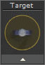

# Animation Builder

- Source PDF: Matrix 8 Instruction Manual Book 2 (matrix_8_book_2.pdf)
- Page range: 317-318
- Section title: Animation Builder
- Section id: m8book2-262-animation-builder
- Note: boundary page(s) are shared with a neighbouring section (two-column layout); text/images may include neighbour content.

---
<!-- section m8book2-262-animation-builder | Animation Builder | m8book2 pages 317-318 -->

<!-- page 317 -->

Pre-reduction: Attempts to reduce dense
meshes to increase the visual effect of the
softening.
As the camera is rotated, the view of the model
will change in the Perspective viewport. This is
also the only viewport in which the camera cannot
be seen. After the camera is adjusted perfectly,
click on the Perspective viewport to make it active.
## Animation Builder
Follow Path: The “Follow Path” option allows the
user to assign a custom path for the camera,
changing the camera as it moves through space.
This builder produces a brief digital movie or a
series of frame-by-frame image files of a rendered
model in motion on the screen.
Where is this tool:
Access this tool from Render>Animation
Builder
### Setting up your model:
Camera: The Camera option allows the user to
assign a path for the camera to
follow as it rotates around the
target. The path curve (Interp
Curve) can be drawn so that the
camera can “zoom” in and out,
focusing on different aspects of
the design and providing both far-
away and close-up views of the same model.
Before creating the animation, make sure that the
model in the viewports has had materials assigned
with VRay. The animation is made by talking many
“pictures” of the rendered model from various
angles. Keep this mind when selecting settings:
a very complex and lengthy render will also take
quite some time to animate in this builder.
### Choose a Path:
Target: The Target curve is the focus around
the model for the camera. Make
sure that this circle is far enough
away from the model, since it also
assigns the distance from the
camera to the target. Draw a curve
(circle) and enter it into the Target
in-box. Choose a Movement Select
either a Clockwise or Counter-Clockwise view for
the animation.
Fixed Circle: “Fixed Circle” is the default path
option in the Animation Builder. This option
rotates the ring in a simple, 360-degree rotation at
the angle specified by the user.
Frame Count: Assign a frame count and frames
per second. A suggested frames per second
count movie will be recorded at 30 frames per
second, which is the same as a TV show or
movie. So, a 60-frame count will produce a 2
second movie.
Filename: Click on “Filename” to choose a name
and location where to save the animation files.
Render: Click “Render” to begin the animation.
Be sure that the Perspective viewport is active.
Be patient as the files are created.
Changing the Camera Angle: Find the
camera by right-clicking a viewport title and
selecting “Show Camera.” Click and drag the
control points of the camera (found at the top,
bottom, and center-bottom of the camera) until
the camera is properly positioned. It is a good
idea to experiment with this builder to find the
preferred camera orientation based upon the
model and on individual taste. Do this in a Planar
viewport, watching the Perspective viewport (as
though you were looking through the lens) to see
if your movements are having the desired effect.

<!-- page 318 -->

### Explanation of Menus:
## Animation Builder Advanced
File Menu: New Animation: Start an animation
from scratch. This resets all animation data in the
model. You will be prompted to click either yes or
no.
‘gvAnimationBuilderAdvanced’
Create your own animations and save your own
templates for future use. Add multiple features
along with geometry such as Sweeps, Pipe and
Loft displays.
Save as Template: When finished just name
and save all your selected settings in a custom
Template. (Go to the Templates tab to view and
apply the save Templates)
Where is this Builder:
Access this tool from Render>Animation
Builder Advanced
### Workflow:
First, set up your model by applying render
materials in VRay Styles or with F6 Materials
Mode. Then, select a previously set Template or
start from scratch. Add the objects you wish to
animate. Select the animation properties, save
your file, apply all settings, add cameras with their
settings, and add geometry if desired. Save your
settings as a Template in the File menu to be used
again in the future if desired. Run the “Preview”
play with record turned ‘ON’ and your animation
files will populate the selected folder on your
computer. Finally, use Movie Maker to compile the
animation files to create a .mp4 movie.
### Setting up your model:
Edit Menu: Extra
Display Modes:
Select from one of the
many Extra Display
Modes and choose any
for creating additional
animation files. Record
will select the main
Image type under
Properties along with
additional display
modes chosen from
Edit. Choose as many
as you wish to include.
The same number of
frames will be outputted for each display type
along with your main selection.
Before creating the animation, make sure that
the model in the viewports has had materials
assigned with VRay Styles. The animation is
made by talking many “pictures” of the rendered
model from various angles. Keep this mind when
selecting settings: a very complex and lengthy
render will also take quite some time to animate in
this builder.
Record: Toggle Record on or off. Begin the
animation by clicking on the “play” button in the
Preview on the main screen with Record toggled
ON. After the animation files populate
your selected folder use Movie Maker to complete
the .mp4 movie file.
Properties:
Use these options in Properties to select the
image type, animation size, viewport and frame
counts.
Image Type: Select a Viewport or VRay Render.
Size: Select an output resolution size.

---

## Images

-  page 317 (shared page)
-  page 317 (shared page)
-  page 317 (shared page)
-  page 318 (shared page)
-  page 318 (shared page)
