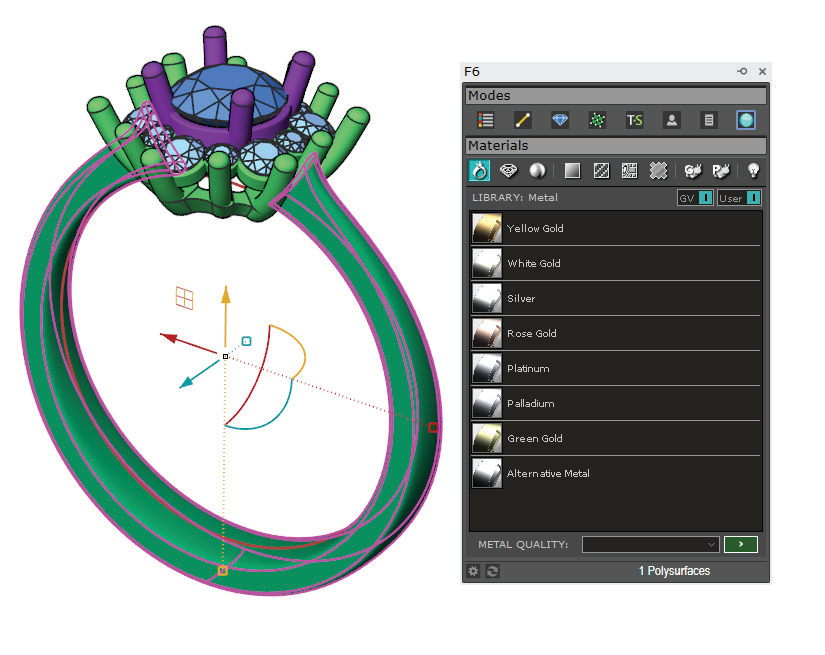
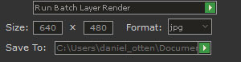
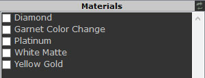
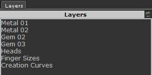
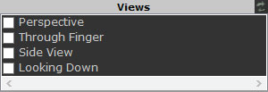

# Batch Render

- Source PDF: Matrix 8 Instruction Manual Book 2 (matrix_8_book_2.pdf)
- Page range: 333-335
- Section title: Batch Render
- Section id: m8book2-266-batch-render
- Note: boundary page(s) are shared with a neighbouring section (two-column layout); text/images may include neighbour content.

---
<!-- section m8book2-266-batch-render | Batch Render | m8book2 pages 333-335 -->

<!-- page 333 -->

### Getting Started
by clicking on the first tile with the “+.” This
image is added to your render similar to “Place
Background.” A new Layers item is
added with the name, “Alternate Background.”
Design: Design or open a model to render. Be
sure to assign a different Layer color to each
component (or like components) to render with a
unique Material.
Graphics Tab: Choose from a wide range of
graphics including hearts and balloons or click
on the “+” to add your own graphic. A new Layers
item is added as the graphic file’s name.
Orient: Orient the design in the Viewport at a
desired angle for Rendering. You will be able to
select multiple Viewport options. So, be sure the
angle of the design is to your liking in each of the
Viewports you will be selecting later.
Note: Stock graphics have Alpha enabled so the
image appears on a transparent background. You
can apply this setting and save as a PNG to mimic
this appearance on your own imported graphic files.
Removing your imported graphics: If you
wish to remove any graphic files that you added
with the “+” just go to the Matrix 8 folder in
Documents. (C:\Users\xxxx\Documents\Matrix8\
RenderEditor\Library\Graphics) Locate the file
name and press “Delete” in your keyboard. These
files appear alphabetically so sorting by Detailed
View and Date may help you locate the files.
Assign Render Materials: Open VRay Styles
and apply render materials for rendering. The
materials only need to be included in the model.
Later, you will choose which Layer color object(s)
to render for each material. Add a default ground
plane (on the default Lights Layer color) and
assign as many ground plane materials to use
(each will be its own render along with each of the
Metal and Gem Material combinations).
Frames Tab: Select from one of the many
Frames in this gallery. A new Layers item is added
under the name of “Frame.”
Themes Tab: Start with one of the many preset
“Themes” for your edited render. Just click once to
apply the Theme. Each Theme has its own unique
value sliders. Generally, the “Size” slider indicates
the intensity of the effect.
Choose from one of these named Themes:
Colored Pencil, Lens Flare, Oil Paint, Pencil Sketch,
Pointillist, Polaroid, Tint, or User Depth of Field.
Hint: Clicking on your render and scrolling the wheel
on your mouse will increase or decrease the size of
the edited render preview layout.
## Batch Render
File - SAVE AS: Using the Matrix Main menu
save your file using “SAVE AS” (or SAVE) and
NOT “Save Small As” if you wish to use it again in
the future. Save As will allow you to keep all the
applied render materials with the design file if you
wish to use Batch Render again at another time.
Steps:
‘gvBatchRender’
This is a simple, quick way to create multiple
renders from one file containing many different
rendering materials by using Layer color controls.
• Open Batch Render tool from the Render menu.
• Set the render size and format and save location.
• Apply Materials.
• Start render
Where is this builder:
Access this builder from Render>Batch Render

<!-- page 334 -->

### Options:
Size: Enter the resolution size in number of pixels
(height and width) for the output of the created
renders.
Format: Select the file format type: PNG, BMP or
JPG.
Save Location: Find a suitable folder location on
your computer for the created renders by clicking
on the green browse arrow near the “Save To” box.
“Browse for Folder” dialog will open allowing you
to select the folder location. The selected Location
will appear in the box.
Work flow - Selecting Materials for each
Layer color: Highlight and select the first Layer
color. Typically, this might be the “Lights” Layer for
the ground plane. With this highlighted (active)
make the Material selection by checking the box
shown in front of the Material name. Find the
ground plane material(s) to add to the Lights
Layer.
Next, repeat this process by selecting the next
Layer color on the list of Layers. With the
Layer highlighted (active) select the material(s)
you wish to include on this Layer by checking
the boxes next to each Material name. Repeat for
each Layer color listed that you want to render
with a material.
Materials: All render materials previously added
to the design file will be listed here. This is the
list from which you will assign each Layer color’s
material. The material must show up on this list
to be selected for the Batch render. You can
add materials from Vray Style at any time. The
Materials list updates each time a Material is
added to your model.
Hint: Only assign materials to the Layer colors to be
rendered. A Creation curve or User Layer may appear
on the list but curves do not render.
Example: Metal 01 will be assigned Yellow Gold
and Platinum and Metal 02 assigned
Green Gold and Rose Gold thus producing four
combinations of renders for your
design.
Note: The only materials you will render are those
that you select and check its box. However, if you
wish to remove any materials from the list you must
use “VRay Material Editor” located in the Materials
Manager. This allows you to amend a material or
remove it completely from the current model. Just
right-click on the material name from the Materials
List in the Editor and choose, “Remove Material.”
Views: Check the box next to each View name
desired for rendering your design.
Layers: All Layer colors on the objects in your
model will appear in a list here. Use each Layer
color to assign the desired render material.
Run Batch Layer Render: Click on the green
arrow at the top of the Batch Render dialog
box to run the Batch render. Do this only after
all the Materials and Views have been assigned.

<!-- page 335 -->

Rendering begins immediately and continues until
all render combinations have completed.
corner. The surface can be scaled with Transform
tools, moved or deleted.
Hint: Hold Shift to activate Ortho so the surface is
placed squarely. (See View Menu - Picture Frame)
Remove Background: This removes the
Background selected in the Background
tab.
Adding Viewports (optional): Add one
or more additional Viewports to your Matrix
viewports to accommodate the rendering views
needed. Name each additional Viewport a unique
name. Do this before selecting, “Run Batch layer
Render.”
Remove Frame: This removes the Frame
selected in the Frame tab.
Hint: Type “ViewportTabs” in the Command Line and
choose, “Show.” This will display the Viewport Tabs
below the viewports. Click the “+” to add a viewport.
Double-click the viewport name on its Tab to rename
it.
## Layout Tools
Save Current Layout as Template:
After starting with New Layout and
selecting each component, click on “Save
Current Layout as Template” to save the Layout as
a template to be used again.
Remove Current Layout: This removes
the Current Layout
Choose from unique Layout Templates or create
your own Layout for printing Viewport screen
captures. Your model can be rendered in VRay
or a viewport capture taken in any of the shade
modes.
Where is this Tool:
Access this tool from Render>Layout Tools
### Explanation of the Icons
Note: Use the Viewport Tabs shown under the
Command Line to switch between any view you wish.
Right-click on the “4View Layout” Viewport Tab
name and select “Delete” in order to delete the
new Layout. If you delete one of your four default
viewports (Perspective, Through Finger, Looking
Down, Side View) by accident go to the Matrix View
Menu and choose “Restore Viewports.” This restores
the four default viewports.
### Tabs Template:
New Layout: New Layout opens a blank
layout screen as a Viewport Tab that you
can customize.
Use the tools in the “Views” tab to add a render or
shade mode picture to your layout.
Print: Print opens a Print Setup preview
where you can select a printer.
Mode: Select from the drop down arrow the
Shade Mode or VRay render to display your
objects. The default “Template” displays your
objects in lighter-colored Wireframe, detailed
Mode.
Layout Properties: Opens the “Modify Layout”
browser with options to name the Layout viewport
tab, select a printer, choose a view or select the
layout size.
Preset Templates: Select from any of the
preset Templates or any of your custom
saved Templates here.
Add Picture: Add Picture opens an
“Open Bitmap” browser to select an image
file. It places the image as a Picture Frame
surface on the layout. Follow the Command Line
prompts by clicking once for placing the first
corner and then again for placing the second

---

## Images

-  page 333 (shared page)
-  page 334
-  page 334
-  page 334
-  page 334
