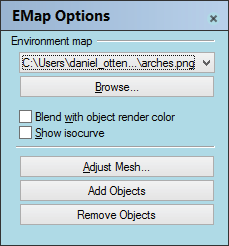
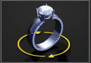
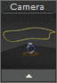

# Apply Edge Softening

- Source PDF: Matrix 8 Instruction Manual Book 2 (matrix_8_book_2.pdf)
- Page range: 316-317
- Section title: Apply Edge Softening
- Section id: m8book2-261-apply-edge-softening
- Note: boundary page(s) are shared with a neighbouring section (two-column layout); text/images may include neighbour content.

---
<!-- section m8book2-261-apply-edge-softening | Apply Edge Softening | m8book2 pages 316-317 -->

<!-- page 316 -->

## Environment Map
for fewer or more polygons. Or, use the detailed
mesh options.
Add or Remove Objects: Select additional
objects or select objects to remove for
environment map analysis.
‘EMap’
This command visually evaluates surface
smoothness using an image bitmap reflected in
the surface.
## Apply Edge Softening
Where is this tool:
Access this tool from Render>Environment
Map
Steps:
‘ApplyEdgeSoftening’
Constructs an edge-softening display mesh for
surfaces, polysurfaces, or meshes.
• Select Environment Map from the Render menu.
• Select objects for environment map analysis:
• See the Command Line prompt. After the objects
are selected an options dialog box will appear.
Note: After running this command, Edge Softening
appears as a property for the surface.
Edge softening applies a mesh radius or chamfer to
edges in the model.
Steps
• Select Apply Edge Softening from the Render
menu.
• Select objects to apply edge softening to.
• Specify Command Line options.
• Box object (left) and box with edge softening
applied (right).
### Command-line options:
RemoveAll: After edge softening is applied,
removes edge softening from all objects.
Edge Softening Properties: Manages surface
edge softening properties for the selected
objects.
Selection box or Browse: Choose from a
preset list (click on the drop down arrow) of
environment map images or choose “Browse” to
select your own.
On: Enables edges softening.
### Settings:
Blend with Object: This blends the bitmap with
the render color of the object, which
lets you simulate different materials with the
environment map.
Softening: Specifies a softening amount. The
visual radius approximation depends on the
density of the underlying mesh.
Show Isocurve: This displays the object’s
isocurves even while shaded.
Chamfer: The edge will be cut straight across
with a hard edged chamfer. No attempt is made to
soften this into a rounded edge.
Adjust Mesh: When using Environment Map,
an invisible mesh will be created based on the
settings in the Mesh Options dialog box if the
object does not have a surface analysis mesh. Use
this dialog box Simple controls to move the slider
Faceted: The object, including the edge
softening effect will be shaded as faceted as in
flat shade.

<!-- page 317 -->

Pre-reduction: Attempts to reduce dense
meshes to increase the visual effect of the
softening.
As the camera is rotated, the view of the model
will change in the Perspective viewport. This is
also the only viewport in which the camera cannot
be seen. After the camera is adjusted perfectly,
click on the Perspective viewport to make it active.
## Animation Builder
Follow Path: The “Follow Path” option allows the
user to assign a custom path for the camera,
changing the camera as it moves through space.
This builder produces a brief digital movie or a
series of frame-by-frame image files of a rendered
model in motion on the screen.
Where is this tool:
Access this tool from Render>Animation
Builder
### Setting up your model:
Camera: The Camera option allows the user to
assign a path for the camera to
follow as it rotates around the
target. The path curve (Interp
Curve) can be drawn so that the
camera can “zoom” in and out,
focusing on different aspects of
the design and providing both far-
away and close-up views of the same model.
Before creating the animation, make sure that the
model in the viewports has had materials assigned
with VRay. The animation is made by talking many
“pictures” of the rendered model from various
angles. Keep this mind when selecting settings:
a very complex and lengthy render will also take
quite some time to animate in this builder.
### Choose a Path:
Target: The Target curve is the focus around
the model for the camera. Make
sure that this circle is far enough
away from the model, since it also
assigns the distance from the
camera to the target. Draw a curve
(circle) and enter it into the Target
in-box. Choose a Movement Select
either a Clockwise or Counter-Clockwise view for
the animation.
Fixed Circle: “Fixed Circle” is the default path
option in the Animation Builder. This option
rotates the ring in a simple, 360-degree rotation at
the angle specified by the user.
Frame Count: Assign a frame count and frames
per second. A suggested frames per second
count movie will be recorded at 30 frames per
second, which is the same as a TV show or
movie. So, a 60-frame count will produce a 2
second movie.
Filename: Click on “Filename” to choose a name
and location where to save the animation files.
Render: Click “Render” to begin the animation.
Be sure that the Perspective viewport is active.
Be patient as the files are created.
Changing the Camera Angle: Find the
camera by right-clicking a viewport title and
selecting “Show Camera.” Click and drag the
control points of the camera (found at the top,
bottom, and center-bottom of the camera) until
the camera is properly positioned. It is a good
idea to experiment with this builder to find the
preferred camera orientation based upon the
model and on individual taste. Do this in a Planar
viewport, watching the Perspective viewport (as
though you were looking through the lens) to see
if your movements are having the desired effect.

---

## Images

-  page 316 (shared page)
-  page 317 (shared page)
-  page 317 (shared page)
-  page 317 (shared page)
