# Render Editor

- Source PDF: Matrix 8 Instruction Manual Book 2 (matrix_8_book_2.pdf)
- Page range: 326-333
- Section title: Render Editor
- Section id: m8book2-265-render-editor
- Note: boundary page(s) are shared with a neighbouring section (two-column layout); text/images may include neighbour content.

---
<!-- section m8book2-265-render-editor | Render Editor | m8book2 pages 326-333 -->

<!-- page 326 -->

Pic: Select a picture to use for fading out.
Pick: Choose “Pick” to open the dialog box to
select an image. Use your company logo
or any image of your choosing.
Color: Choosing a color for the Fade Out will
make the movie end with the color chosen
and fade from seeing your piece rotating the way
you chose.
Position Options Lower Left or Lower
Right: Select where to orient the Watermark.
Size: Select Small, Medium or Large for your
Watermark size.
Frames count box: The number assigned to
Fade Out is the number of seconds that it
will take for the color to fade away.
## Render Editor
Opacity: The default value is 50. The number
zero on one end of the spectrum would make the
watermark solid. The number 100, on the other
end of the spectrum, would make the image 100
percent invisible or transparent.
‘gvRenderEditor’
Start with a pre-selected theme or choose your
own background, add graphics to the render,
place a custom watermark and more. Render
Editor also provides controls to adjust the
rendered metal color or gem color. Composite
the original render with one of the many Shade
Modes to show a partial view of each. This tool
uses the Alpha Masking capability of VRay, which
provides a means to separate your ring from the
VRay background. There are virtually no limits to
the use of this powerful tool.
### Fade:
Where is this tool:
Access this tool from Render>Render Editor
In: Toggle “Fade In” on or off.
### Before opening Render Editor:
Pic: Select a picture to use for fading in.
Color: Choosing a color for the Fade In will make
the movie start with the color chosen and fade to
see your piece rotating the way you chose.
Assign render materials to all components before
opening the Render Editor. The editor will render
your model upon opening. So, first open the VRay
Render and apply render materials to all metals
and gems on your model. Be sure to include a
ground plane with a material applied. Also, apply a
Style environment. Do a test render if you wish.
### Opening Render Editor:
Frames count box: The number assigned to
Fade In is the number of seconds that it will take
for the color to fade away.
Out: Toggle “Fade Out” on or off.
Immediately, VRay will begin rendering your
model. The editor uses this render as a
base for all settings. This is the “Original Render,”
appropriately named in the Editor’s Composite
options. The render will appear on a preview
Layout. Use the mouse’s scroll wheel to increase
or decrease the Layout size. Using Render Editor
Options at the Top Bar File Menu

<!-- page 327 -->

Copy: “Copy” makes a copy of the current, edited
render along with all your added, visible layers.
Save: After all of the setting changes and
additions have been made and you are
finished editing your render, click on “Save” to save
the edited render image as a JPG, BMP or PNG.
Copy Selected Layer: “Copy Selected Layer”
makes a copy of the selected layer item only.
Paste: “Paste” places a new layer of the copied
item to your “Layers” list.
Insert: “Insert” allows you to add a picture file of
your own to the “Layers” list.
Send to Layout: “Send to Layout” will open a
new “Matrix Layout” tab in the Matrix
Viewport with your complete Render Editor
image. All of your visible Layer items become a
“Picture Frame” object appearing in the new tab.
This object can be scaled, rotated or moved.
Save Current Layer: Select a Layer and choose
“Save Current Layer” to save it as an image file.
### Working with Layers
Render materials and all other items in your model
appear in a listing under “Layers.” Each is listed
separately. Use this “Layers” list as a selection tool
to apply other effects or edits to each item.
Send Current Layer to Layout: “Send to
Layout” will open a new “Matrix Layout” tab in the
Matrix Viewport highlighting the selected item.
That item appears as a “Picture Frame” object in
the Layout. You can then scale, rotate or move the
object as you wish.
Revert: “Revert” will reset all your settings, on all
layers, in the edited render back to the settings
of the original render. Only the layers from the
original render will be visible after choosing
“Revert.”
Make Slide Show Movie: Select a group of
image files, fifteen or less, to compile a
.mp4 movie of these images. Be patient as the
movie complies and until the movie file appears in
the selected directory.
Make Contact Sheet: Select a group of image
files to produce a set of thumbnail-sized
images on one sheet.
Common Header Icons
Show/ Hide: On the
header name of each item
in the “Layers” list an icon
for Show/ Hide appears to
the right side. Some items, like curves for example,
will default to “Hide.” Click on the icon to toggle to
Hide or Show.
### Edit Menu:
Undo: “Undo” will reverse the last change you
made.
Lock/ Unlock: On the header name of each
item an icon for Lock/ Unlock appears to the right
side. Lock prevents you from moving that item.

<!-- page 328 -->

Layers List: Select each Layer item one-by-one
to apply other edits under “Layer Effects.”
Background (Alternate): This appears as a
item in the “Layers” list when any background from
the “Backgrounds” tab is selected. You can change
the background and select multiple backgrounds
from the “Backgrounds” tab and it will appear
under this one item and not individually.
### Middle Bar Icons:
Move Layer Up: Select an item under “Layers”
and click on the “Move Layer Up” button to move
the selected item above another item.
Example: By selecting one of the named materials
like Diamond, Ruby, Green Gold, Yellow Gold, etc.
you can apply color effects and Blur/ Sharpen
effects. Graphic Layers allow for additional editing
including Color Effects, Location - Orientation,
Tiling, Blur -Sharpen, Beveling and Shadowing.
Curves: “Curves” displays all curves visible in your
model including Annotations, Leaders and
Dimension Text.
Move Layer Down: Select an item under
“Layers” and click on the “Move Layer Down”
button to move the selected item below another
item.
Design: The “Design” area will list of all the
individual metal and gem render materials
assigned to objects on your model. These items
are part of your “Original Render” and cannot be
hidden.
Gem Material: Any gem material is listed here by
the material name.  Metal Material: Each material
you have assigned to any metals will be listed by
the material name.
Background (default): This is the ground plane
material shown in the “Original Render.”
Add Text Layer: This opens a “Text Edit”
box where text can be entered. Click on the
large “T” in the bottom, right corner to select
Font type, style and size. The text box will appear
on top of the render. Just grab and drag a corner
to adjust the box size. Then, click inside the box
with your cursor turning into a “hand” and hold as
you drag the box to any location you wish.

<!-- page 329 -->

Color Effect: Move the three sliders to adjust
the Color, Saturation or Brightness of the selected
item. Also, choose to apply a Grayscale, Sepia or
Invert effect as well.
Hue (Color): “Hue” is the range of all pure colors
to select.
Saturation: “Saturation” allows you to change
the intensity of the pure color in the degree as it
differs from gray / white.
Illumination (Brightness): “Illumination” option
will lighten or darken a selected color on a larger
scale than Saturation (from full light to no light).
Opacity slider: Adjusting the “Opacity” makes
the selected item appear translucent or more
opaque (less cloudy or more cloudy).
Add from Viewport: “Add from Viewport” adds
a Viewport layer item(s) to “Layers.” Just
highlight any item in your viewport (a head
and gem for example) and choose “Add
from Viewport.” The items will be shown as a new
Layer in the same shade mode and orientation
seen in the actual, active viewport from which the
item was selected.
Reset Layer: “Reset Layer” changes the
selected layer back to the original settings
of that layer. The selected item will return to
the color of that item in the original VRay render
or the default setting as imported from the
Graphics, Background or Frames Libraries.
Delete Layer: “Delete Layer” permanently
removes the selected layer from the “Layers”
list and the render. A dialog box opens with
the option to “Delete this layer?” Yes or No.
### Color Effects Drop Down Box:
None: No additional color effect added.
### Layer Effects Tab:
Grayscale: Convert your selected “Layers”
item into neutral, white to black, color tones by
selecting “Grayscale.”
Sepia: Convert your selected “Layers” item into
reddish-brown color tones by selecting “Sepia.”
Invert: Select “Invert” to reverse the effect of a
high tone to make it a low tone. It will make black
Select an item on your “Layers” list first and apply
“Layer Effects” here. Certain items will have limited
editing capabilities. Gems cannot be tiled or
moved. If a “Layer Effect”is grayed out it cannot be
applied to your selected item. Graphics items, for
example, can be edited with all the Layer Effects
options. To access a “Layer Effects” feature, click
on the arrow before the title name to expand
the options list for that feature.

<!-- page 330 -->

appear the opposite on the color wheel to look as
white.
Reverse: “Reverse” flips the
vertical, top to down, layout of
that item. What appears on
the bottom now appears on top.
### Location - Orientation:
FlipReverse: “FlipReverse”
combines both Flip and Reverse
functions.
Use “Location - Orientation” options to move,
scale, rotate or skew a graphic, background, or
frame. This option is grayed out for certain items
like gems and metals. Moving any of the sliders will
help to fine-tune a position or orientation of the
selected item.
Left: Move the “Left” slider to adjust the horizontal
(left to right) position of the selected item.
SkewX: “SkewX” moves the top of the image
horizontally in the opposite direction of the
bottom of the image.
Top: Move the “Top” slider to adjust the vertical
(top to down) position of the selected item.
Width: Move the “Width” slider to scale the
selected item in one dimension horizontally.
SkewY: “SkewY” moves the left-side of the image
vertically in the opposite direction of the right-side
of the image.
Height: Move the “Height” slider to scale the
selected item in one dimension vertically.
Rotation: Move the “Rotation” slider to rotate the
selected item clockwise or counterclockwise.
This graphic has been skewed along the X axis.
Tile: Use “Tile” to array (multiply) your image
horizontally (X) and vertically (Y).
Note: You can move, scale and rotate a graphic by
clicking and dragging on it’s corners to scale or an
edge to scale 1D. You can Rotate the graphic by using
the round rotation handle on the bottom edge of the
graphic frame
### Flip options drop down:
None: “None” keeps the original
orientation of that item.
Flip: “Flip” reverses the horizontal,
left to right, layout of that item.
The left side now appears on the
right.

<!-- page 331 -->

None: No Bevel effect applied.
In: The “In” option shows as a beveled Inset.
Blur - Sharpen: Use the drop down box to
select Blur or Sharpen. Then, move the slider to
increase or decrease that effect on your selected
“Layers” item.
Out: The “Out” option shows as a Raised bevel.
None: To remove a Blur or Sharpen effect, just
choose “None” from the drop down menu.
Blur: Increased “Blur” makes the item appear
cloudy and less distinct or clear.
Shadow: First, click on the master On/Off button
in the title bar (to the right side) to activate the
“Shadow” effect for your selected graphic. Then,
click inside the “Color” box to select a color. The
“Shadow” appears directly behind your graphic
image until you apply the Offset settings.
Color: Click inside this box to select a “Shadow”
color. Use the advanced setting, “Define Custom
Colors” to mix a color of your choosing. Be sure
to select “Add to Custom Colors” when using the
advanced option.
The shank in this image has had blur applied to it.
Opacity: The “Opacity” slider defaults to the
most opaque setting. Move it slowly to the left for
a more translucent appearance.
Sharpen: Increased “Sharpen” makes the item
have a more defined shape, enhancing every
edge and surface.
OffsetX: “OffsetX” moves the shadow
horizontally, away from behind your original
graphic along the X axis.
Bevel: Use the slider to select the degree of the
Inset or Raised “Bevel” effect you wish to apply to
your graphic. This option works well with
backgrounds.
OffsetY: “OffsetY” moves the shadow vertically,
away from behind your original graphic along the
Y axis.
Blur: “Blur” makes the “Shadow” appear cloudy
with less definition. This helps the shadow appear
authentic like an afternoon sun shining on your
graphic.
Note: Shadows can only be applied to graphic
images. If applying a shadow to a“Background”
or “Frame,” you must minimize the background or
frame within the Layout first.

<!-- page 332 -->

### Wire Composite Tab:
This control gives you the ability to join or
composite two images into one by selecting a
Shade mode along with your VRay render or by
using two Shade Modes of your choosing
(Advanced).
Pick Mode: Use the drop down arrow to open
the selection box. Select a Shade Mode to
combine with the VRay render. Immediately, you
will see your model appear in the viewport with
that Shade mode applied. And, the preview of
your model will appear in the preview box.
Angle slider: The angle defaults straight up and
down. Moving the slider adjusts the
angle amount where the two images meet from
straight vertical towards the horizontal.
Move this slider slowly to find the desired angle.
Blend slider: Move this slider slowly to acquire
the desired amount of the selected Shade Mode
image to blend with your VRay render. This moves
the newly-selected, shaded image (first image)
over the original render (second image). It allows
you to choose the amount you see of the first
image as it meets your second image.
### Advance Mode:
Drop down box for Draw / Combine
Modes: These various modes determine how the
pixels relate to each other. They can be described
as a “scene” that controls the lighting related to
the shaded or render objects you are combing.
Technically, it shows how the back pixels relates
to the front pixels. Choose one of these modes or
scenes to your liking: Normal, Blend, Hard Light,
Soft Light, Lighten, Darken, Luminize, Modulate,
Multiply, or Overlay.
### Component Tabs and Themes:
“Advance” opens another “Pick Mode” drop down
box to select from all the available
Shade Modes instead of using the default Original
VRay render as your second image.
Add a unique background to your layout or use
your logo image as a watermark.
Backgrounds Tab: Choose between as
assortment of background images to add to
your render. Or, choose your own custom image
Additional sliders: The sliders that appear
when Advanced Mode is active, control the
Position and Amount of the blended area where
the two images meet. The top slider controls the
Opacity.

<!-- page 333 -->

### Getting Started
by clicking on the first tile with the “+.” This
image is added to your render similar to “Place
Background.” A new Layers item is
added with the name, “Alternate Background.”
Design: Design or open a model to render. Be
sure to assign a different Layer color to each
component (or like components) to render with a
unique Material.
Graphics Tab: Choose from a wide range of
graphics including hearts and balloons or click
on the “+” to add your own graphic. A new Layers
item is added as the graphic file’s name.
Orient: Orient the design in the Viewport at a
desired angle for Rendering. You will be able to
select multiple Viewport options. So, be sure the
angle of the design is to your liking in each of the
Viewports you will be selecting later.
Note: Stock graphics have Alpha enabled so the
image appears on a transparent background. You
can apply this setting and save as a PNG to mimic
this appearance on your own imported graphic files.
Removing your imported graphics: If you
wish to remove any graphic files that you added
with the “+” just go to the Matrix 8 folder in
Documents. (C:\Users\xxxx\Documents\Matrix8\
RenderEditor\Library\Graphics) Locate the file
name and press “Delete” in your keyboard. These
files appear alphabetically so sorting by Detailed
View and Date may help you locate the files.
Assign Render Materials: Open VRay Styles
and apply render materials for rendering. The
materials only need to be included in the model.
Later, you will choose which Layer color object(s)
to render for each material. Add a default ground
plane (on the default Lights Layer color) and
assign as many ground plane materials to use
(each will be its own render along with each of the
Metal and Gem Material combinations).
Frames Tab: Select from one of the many
Frames in this gallery. A new Layers item is added
under the name of “Frame.”
Themes Tab: Start with one of the many preset
“Themes” for your edited render. Just click once to
apply the Theme. Each Theme has its own unique
value sliders. Generally, the “Size” slider indicates
the intensity of the effect.
Choose from one of these named Themes:
Colored Pencil, Lens Flare, Oil Paint, Pencil Sketch,
Pointillist, Polaroid, Tint, or User Depth of Field.
Hint: Clicking on your render and scrolling the wheel
on your mouse will increase or decrease the size of
the edited render preview layout.
## Batch Render
File - SAVE AS: Using the Matrix Main menu
save your file using “SAVE AS” (or SAVE) and
NOT “Save Small As” if you wish to use it again in
the future. Save As will allow you to keep all the
applied render materials with the design file if you
wish to use Batch Render again at another time.
Steps:
‘gvBatchRender’
This is a simple, quick way to create multiple
renders from one file containing many different
rendering materials by using Layer color controls.
• Open Batch Render tool from the Render menu.
• Set the render size and format and save location.
• Apply Materials.
• Start render
Where is this builder:
Access this builder from Render>Batch Render

---

## Images

-  page 326 (shared page)
-  page 326 (shared page)
- 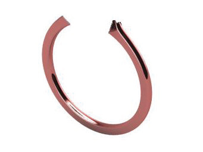 page 327
- 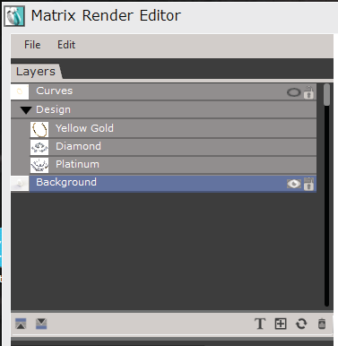 page 327
- 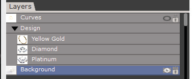 page 328
- 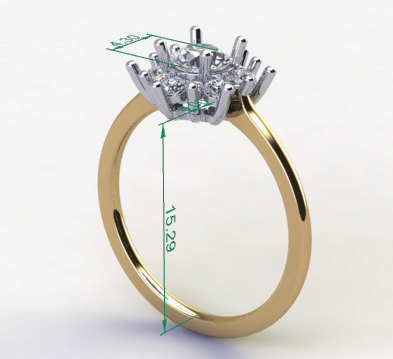 page 328
- 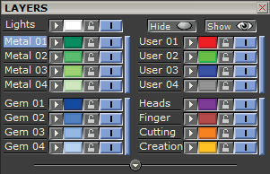 page 328
- 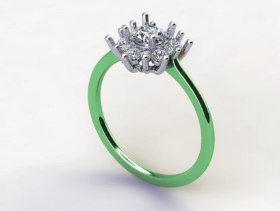 page 329
- 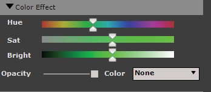 page 329
- 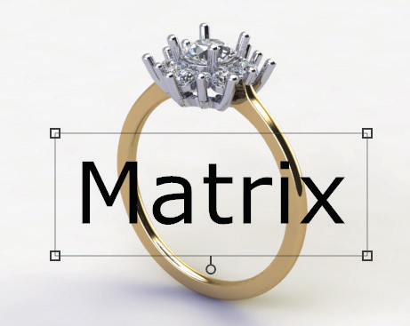 page 329
- 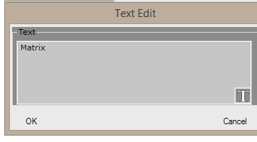 page 329
- 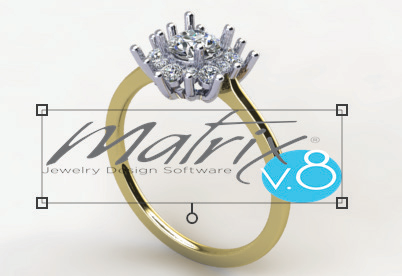 page 330
- 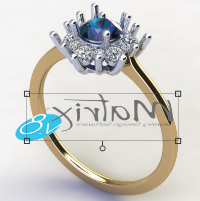 page 330
- 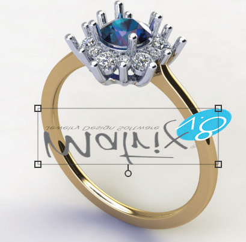 page 330
- 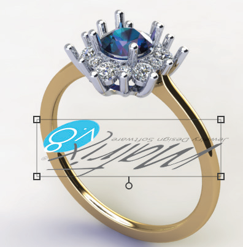 page 330
- 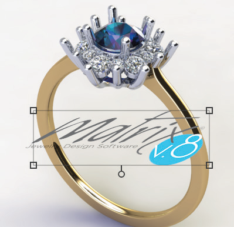 page 330
- 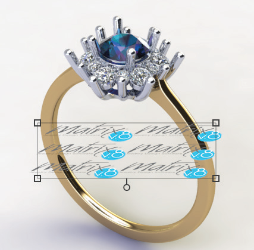 page 330
- 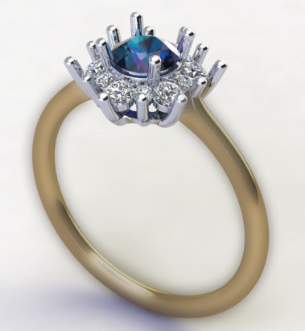 page 331
- 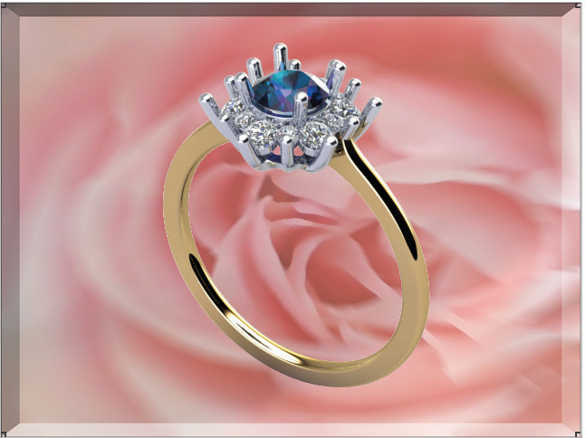 page 331
- 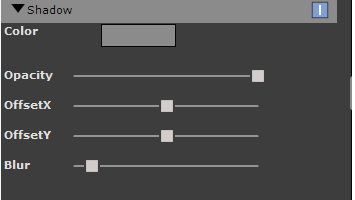 page 331
- 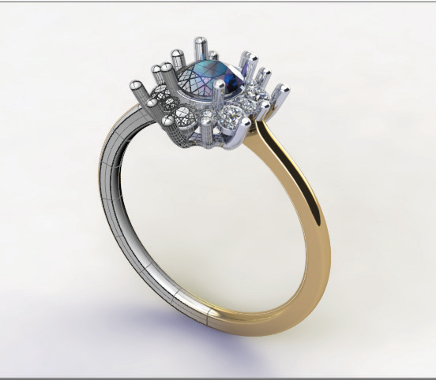 page 332
- 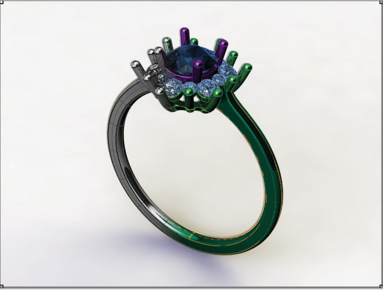 page 332
- 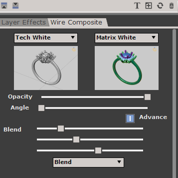 page 332
-  page 333 (shared page)
