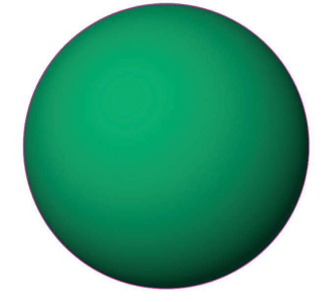
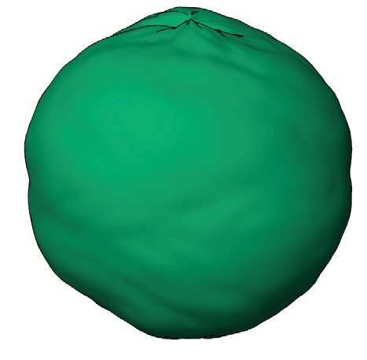
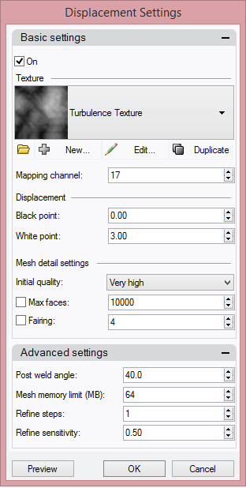

# Apply Displacement

- Source PDF: Matrix 8 Instruction Manual Book 2 (matrix_8_book_2.pdf)
- Page range: 338-340
- Section title: Apply Displacement
- Section id: m8book2-271-apply-displacement
- Note: boundary page(s) are shared with a neighbouring section (two-column layout); text/images may include neighbour content.

---
<!-- section m8book2-271-apply-displacement | Apply Displacement | m8book2 pages 338-340 -->

<!-- page 338 -->

will remove the job from Render Scheduler. The
“Edit” option will allow you to change any of your
selected settings. The job is removed from this list
when it has completed.
the file symbol with the green arrow at the bottom
of the Alpha Erase dialog box to run the
command. Then, click “OK” to the “Finished” notice
that appears after the command is complete.
## Alpha Erase
‘gvAlphaErase’
Use this tool to remove the transparent
background (Alpha turned on) from PNG image
files. Alpha Erase removes the transparency and
restores the original background or replaces the
transparency with a selected color.
Where is this tool:
Access this tool from Render>Alpha Erase
Alpha Erase only works with .PNG image files
where Alpha is turned on. Start with saved image
files.
Add Files: Click on the “+” to add Files to Fix.
Use this directory to locate your saved image files
(PNG). Select one or multiple files.
Remove Files: Use the “-” to remove any files
from the “Files to Fix” list. Just highlight
the file(s) you want to remove from the “Files to
Fix” list. Then, click on “-.”
### Choose an Option
## Apply Displacement
Remove: Select “Remove” to remove the
transparency (Alpha turned on) from the
image. This will restore the image’s original
background.
‘ApplyDisplacement’
Constructs a displacement display mesh
for surfaces, polysurfaces, or meshes. The
displacement map can be a procedural or image
texture.
Flatten: Select “Flatten” to place a background
color of your choosing in place of the transparent
background on an image. It flattens the image
onto a color. When selecting “Flatten” you will also
select a color. Just click in the color selection box
that appears to the right of “Flatten.”
Note: After running this command, Displacement
appears as an object property for the surface. The
displacement map differs from a bump map set
by the rendering material in that the displacement
mesh is a real object with edges that produce real
highlights and shadows. The illustrations use the
same image for the bump and the displacement.
Save Location: Select a location for the output
files to be stored.
Run the Command: When all the files have
been added and the options selected just click on

<!-- page 339 -->

Steps:
• Select Apply Displacement from the Render
menu.
• Select objects to apply displacement mapping to.
• Specify a texture.
• Specify the displacement settings options.
The model on the right has displacement applied.
### Command Line Option
RemoveAll: After displacement is applied,
removes displacement mapping from all objects in
the model.
### Displacement Properties
Manages surface displacement properties for the
selected objects. Basic settings
On: Enables the displacement mapping display.
Texture: Specifies a procedural texture or image
file used to map the displacement.
Import From File: Opens a Rhino Texture file
(.rtex).
### Displacement
New: Creates a new displacement texture.
Edit: Edits the current displacement texture
settings.
Black point: Amount of displacement
(in currently used units) for black colors on
displacement texture. Can be any number.
Duplicate: Duplicates the current displacement
texture settings.
White point: The amount of displacement for
the white color in the procedure or image.
### Mesh detail settings
Mapping channel: Mapping channel number for
the displacement mapping.
Initial quality: Specifies how densely the object is
subdivided and displacement texture is sampled
initially. Using too low initial quality may result in
loss of some features in the displacement. Too

<!-- page 340 -->

high initial quality makes displacement process
unnecessarily dense and slow.
Max faces: Runs a mesh reduction as a post
process and simplifies the result of displacement
to meet the specified number of faces.
Fairing: Straightens rough feature edges. This
is similar to anti-aliasing. The value specifies the
number of passes.
Advanced settings: Post weld angle specifies
the maximum angle between face normals of
adjacent faces that will get welded together.
Mesh memory limit (MB): Specifies in
megabytes how much memory can be allocated
for use by the displacement mesh.
Refine steps: After the initial subdivision and
displacement texture sampling further refinement
takes place. The value specifies the number of
refinement passes.
Refine sensitivity: Specifies how sensitive the
divider for contrasts on the displacement texture
is. Specify 1 to split all mesh edges on each refine
step. Specify 0.99 to make even slight contrasts
on the displacement texture cause edges to be
split. Specifying 0.01 only splits edges where
heavy contrast exists
## SaveRenderWindowAs
‘SaveRenderWindowAs’
Saves the image in the render window to a file.
Steps
• Select Save Render Window As from the Render
menu.
• In the Save Bitmap dialog box, choose the name,
location, and file type for the bitmap file.
• You can save the bitmap in .bmp, .tga, .jpg, .pcx,
.png, and .tif formats.

---

## Images

-  page 338 (shared page)
-  page 339
-  page 339
-  page 339
