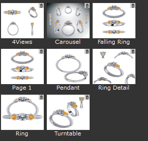
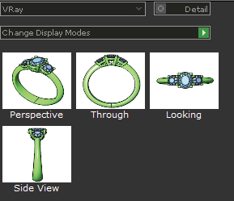
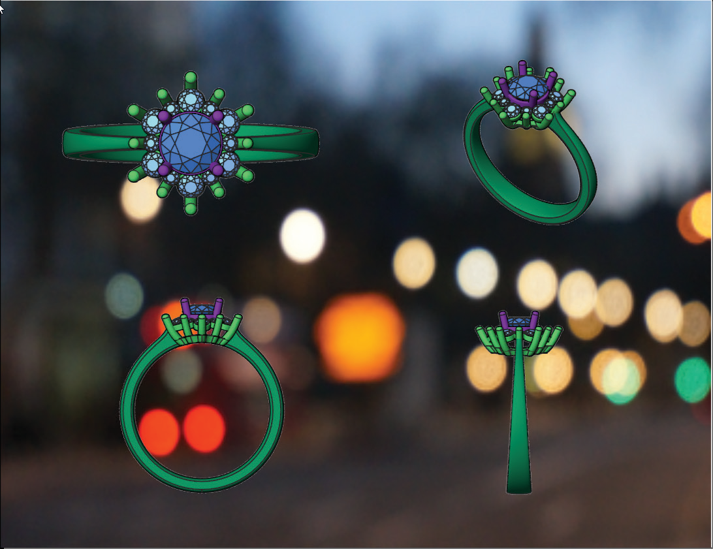
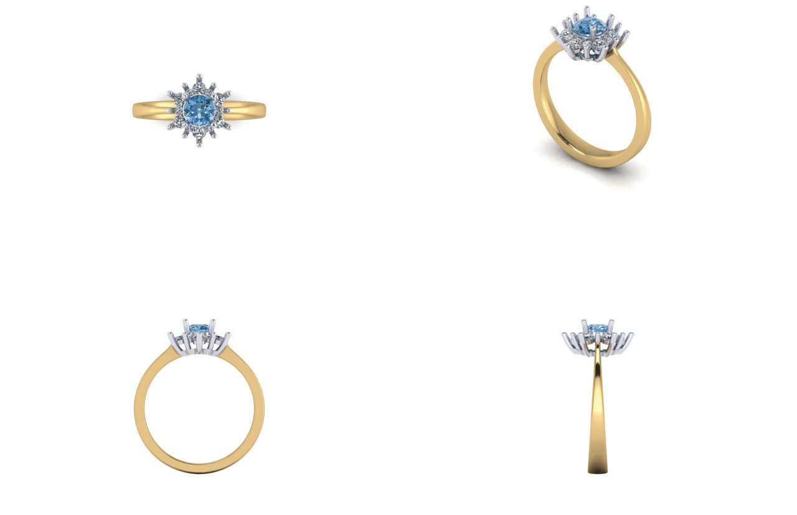

# 4 View Capture

- Source PDF: Matrix 8 Instruction Manual Book 2 (matrix_8_book_2.pdf)
- Page range: 336-337
- Section title: 4 View Capture
- Section id: m8book2-268-4-view-capture
- Note: boundary page(s) are shared with a neighbouring section (two-column layout); text/images may include neighbour content.

---
<!-- section m8book2-268-4-view-capture | 4 View Capture | m8book2 pages 336-337 -->

<!-- page 336 -->

Detail, live viewport. Make adjustments to the
position of your model. Then, double-click again
to view the surface image.
Change Display Mode: Select and highlight a
surface with an image that you wish to replace.
Then, select the new mode from the drop down
selection box and click on “Change Display Mode.”
A new image will now appear on your layout
replacing the old one.
Backgrounds: This places a background image
behind your model image.
### Views:
Frames: Select from an assortment of frames to
add to the Layout. Graphics.
Steps:
Shade Mode: Click on the drop down arrow to
select a “Shade Mode” you wish to screen capture.
Select “VRay” to generate a render.
• Click on a graphic to add it to the Layout. The
graphic will be added as a “Picture
• Frame” object that can be scaled (Transform
menu), moved (drag) or deleted.
Hint: To remove a surface image generated in View
or a Graphic just highlight the surface object and
press “Delete” on your keyboard.
## 4 View Capture
Viewport: After a shade mode is selected, click
on one of the Viewport options to generate a
screen capture or VRay render for that viewport.
This adds a new surface image with the selected
view to your layout.
‘gvFourViewCapture’
This tool allows you to screen capture or render
your four viewports. The capture or render
outputs to a “4 View” layout as an image file.
Where is this Tool:
Access this tool from Render>4 View Capture
Detail: Check the selection for Detail to activate
this option when creating your new surface view.
When active “Detail” will create a capture of the
active viewport allowing you to zoom in or out or
move the objects as in a live view. This works for
all modes except VRay which is stagnate. Just
double-click the created surface image to see the

<!-- page 337 -->

### Command Line Options:
Size: Choose the resolution size (Height x Width)
for your renders.
Format: Choose a file format type from the drop
down box. Available types are JPG, PNG, and
BMP.
Select the Capture Type:
Viewport: A Viewport Capture will generate a
screen capture of your model in a 4 View Layout
and output a picture file. Be sure to select a Shade
Mode for one or all your viewports.
Save To: Select a Location where to save the
renders. Click on the green arrow for the “Browse
for Folder” dialog box to appear.
Render: A Render Capture will generate a
rendering of your model from in a 4 View
Layout and output a picture file. Be sure to apply
render materials first to all your objects.
Width and Height: This records the actual size
(in pixels) of each of your current viewports. Just
click on each one and enter the amount on the
Command Line for the width or height desired of
each viewport. Press enter to complete the
change.
View: Select a view for all the renders. Select
from the four named viewports: Perspective,
Looking Down, Through Finger, or Side View.
Models tab (Adding and Removing Designs):
Select the design files you which to have
rendered. Click on the “+” in the “Model” header to
open the “Pick Models to Import” directory. Add
the designs. To remove a design, just highlight it in
the list and click on the “-” located on the header.
### Options Tab:
Save Channel On/Off: VRay for Rhino users
only. If you have Alpha or Z depth turned on and
saved to a .visopt file, you will produce a separate
BMP file of each of these options.
4 view capture rendered.
Run time: Select a time today to run the render
job. If the time is not changed, the job will start
immediately (or the next time Scheduler checks
for jobs).
Completing the Capture: After making all your
selections in the Command Line be sure to press
“enter” on your keyboard. You will be prompted
to name the file, select a file type and select a
location for saving.
Note: The Scheduler does not update real time. The
time shown is captured at the first open of Scheduler
in this Matrix session. Scheduler looks for jobs with
older, past due times that it needs to run. It checks
for jobs every minute or so.
Note: If you chose “Render” as an option VRay will
immediately begin to render all your viewports.
Remember, do not click on anything while VRay
completes the renders.
## Render Scheduler
Schedule: Click on the green arrow to Schedule
the render job. The job will immediately be listed in
the Jobs Tab. When a job begins a notice appears
“Do you want to run this job?” that allows you to
Run or Cancel a job if you are working in Matrix.
Schedules a job with a specific start time to create
renders from multiple, saved design files.
### Jobs Tab:
Where is this builder:
Access this builder from Render>Render
Scheduler
After clicking on “Schedule” the job will appear
here. It will list the number of files to be rendered
along with the start time. The “Delete” option

---

## Images

-  page 336 (shared page)
-  page 336 (shared page)
-  page 336 (shared page)
-  page 337 (shared page)
