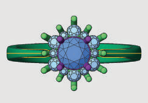
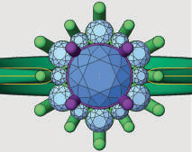
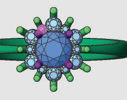
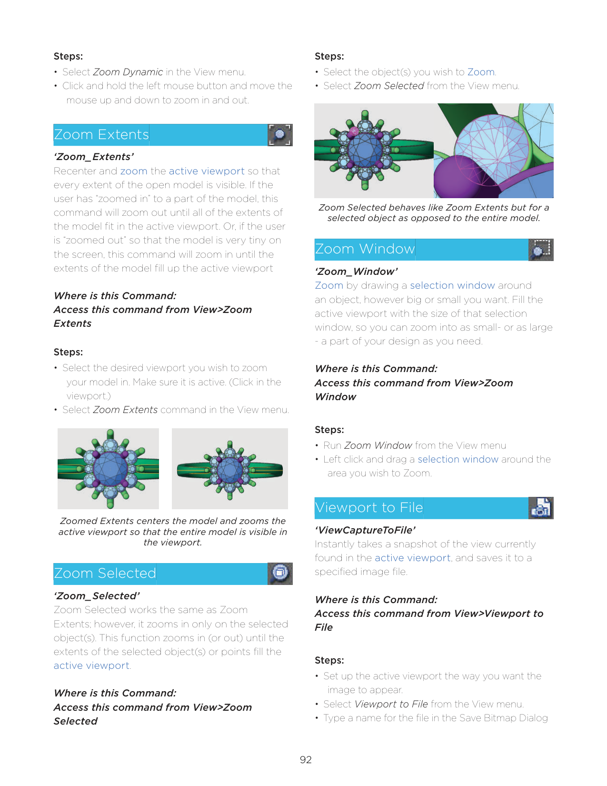
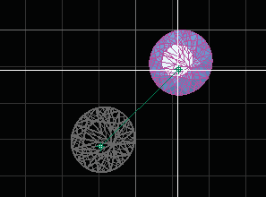
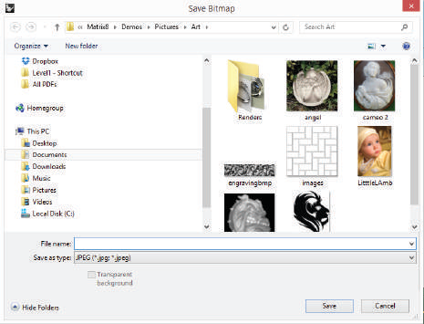

# Viewport to File

- Source PDF: Matrix 8 Instruction Manual Book 1 (matrix8_book_1.pdf)
- Page range: 102-103
- Section title: Viewport to File
- Section id: m8book1-094-viewport-to-file
- Note: boundary page(s) are shared with a neighbouring section (two-column layout); text/images may include neighbour content.

---
<!-- section m8book1-094-viewport-to-file | Viewport to File | m8book1 pages 102-103 -->

<!-- page 102 -->

Steps:
Steps:
• Select the object(s) you wish to Zoom.
• Select Zoom Selected from the View menu.
• Select Zoom Dynamic in the View menu.
• Click and hold the left mouse button and move the
mouse up and down to zoom in and out.
## Zoom Extents
Zoom Selected behaves like Zoom Extents but for a
selected object as opposed to the entire model.
## Zoom Window
‘Zoom_Extents’
Recenter and zoom the active viewport so that
every extent of the open model is visible. If the
user has “zoomed in” to a part of the model, this
command will zoom out until all of the extents of
the model fit in the active viewport. Or, if the user
is “zoomed out” so that the model is very tiny on
the screen, this command will zoom in until the
extents of the model fill up the active viewport
Where is this Command:
Access this command from View>Zoom
Extents
‘Zoom_Window’
Zoom by drawing a selection window around
an object, however big or small you want. Fill the
active viewport with the size of that selection
window, so you can zoom into as small- or as large
- a part of your design as you need.
Steps:
Where is this Command:
Access this command from View>Zoom
Window
• Select the desired viewport you wish to zoom
your model in. Make sure it is active. (Click in the
viewport.)
• Select Zoom Extents command in the View menu.
Steps:
• Run Zoom Window from the View menu
• Left click and drag a selection window around the
area you wish to Zoom.
## Viewport to File
Zoomed Extents centers the model and zooms the
active viewport so that the entire model is visible in
the viewport.
‘ViewCaptureToFile’
Instantly takes a snapshot of the view currently
found in the active viewport, and saves it to a
specified image file.
## Zoom Selected
Where is this Command:
Access this command from View>Viewport to
File
Steps:
‘Zoom_Selected’
Zoom Selected works the same as Zoom
Extents; however, it zooms in only on the selected
object(s). This function zooms in (or out) until the
extents of the selected object(s) or points fill the
active viewport.
• Set up the active viewport the way you want the
image to appear.
• Select Viewport to File from the View menu.
• Type a name for the file in the Save Bitmap Dialog
Where is this Command:
Access this command from View>Zoom
Selected

<!-- page 103 -->

## System 6 HD View
and navigate to where you would like to save the
image.
• Select a file type from the drop down menu
selection. Click ‘Save’.
Imports an image file created by certain versions
of our System 6 HD Camera & software that
presents all three views (Looking Down, Through
Finger, and Side View) of a ring in Background
Bitmap format at the same time, scales and
centers, to use as a guide while modeling.
Where is this Command:
Access this command from View>System 6 HD
3 View
Steps:
• Click on the System 6 HD 3 View command for an
“Open” dialog box to appear.
• Select the System 6 picture file to import into
Matrix as a Background Bitmap.
• Use this bitmap image as a guide in modeling in
Matrix.
Viewport to File brings up a standard system save
dialog. Name the file and save it in the desired
location
.
## Set Crosshairs
## Zoom 1:1
‘Crosshairs’
Turns on a set of crosshairs - or, white tracking
lines that follow your cursor around onscreen
as you work to help you track the vertical and
horizontal location of the cursor at all times.
Zooms the active viewport so that the view is full
scale. The command must be calibrated for this to
work properly. In Perspective views, only objects
on the target plane will be displayed full scale; in
Parallel views, objects on any plane perpendicular
to the camera axis are displayed full scale. The
model must have units set.
Where is this Command:
Access this command from View>Set
Crosshairs
Where is this Command:
Access this command from View>Zoom 1:1
Steps:
Steps:
• Click on the Set Crosshairs icon to toggle on.
• Click on the Set Crosshairs icon again to toggle
off.
• Make sure you have calibrated the Zoom 1:1
command using Zoom 1:1 Calibrate
• Select the Zoom 1:1 command in the View menu.
Crosshairs ‘ON’ tracks the cursor’s position on-
screen.

---

## Images

-  page 102 (shared page)
-  page 102 (shared page)
-  page 102 (shared page)
-  page 102 (shared page)
-  page 102 (shared page)
-  page 103 (shared page)
-  page 103 (shared page)
