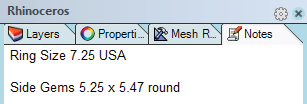
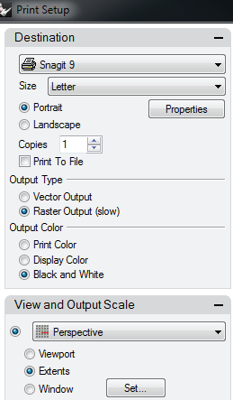
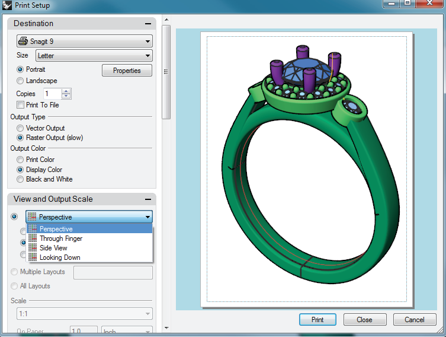

# Print 

- Source PDF: Matrix 8 Instruction Manual Book 1 (matrix8_book_1.pdf)
- Page range: 93-96
- Section title: Print 
- Section id: m8book1-084-print
- Note: boundary page(s) are shared with a neighbouring section (two-column layout); text/images may include neighbour content.

---
<!-- section m8book1-084-print | Print  | m8book1 pages 93-96 -->

<!-- page 93 -->

the file via email or other electronic media.
Where is this Command:
Access this command from File>Save Small
typing.
• Click on the X in the upper right-hand corner of the
window when the notes are completed to save
them and close the window.
Steps:
• Select Save Small from the File menu.
• Specify a name for the .3DM file in the Save Matrix
Model dialog box.
• Click on the Save button.
Note: Clearing the render mesh makes the file
smaller, but the model will shade and render more
slowly the next time the file is opened.
## Save Small As
Note: Upon saving the project as a .3dm file,
the notes will be saved as well, and when the project
file (.3dm file) is opened again later, the notes will
still be present. Click on Notes again to continue
typing notes and to view the former notes that were
saved.
## Print
The Save Small As button functions the same
way the Save As button does, yet, as in the Save
Small command, the render mesh or “skin” created
during rendering or shading is not saved along
with the model, making the file size smaller.
This command prints a viewport image of the
model or allows you to save the image to a file.
Where is this Command:
Access this command from File>Save Small As
Where is this Command:
Access this command from File>Notes
Steps:
Steps:
• Select Print from the File menu.
• The Print Setup dialog box appears. In it, change
the print options to create the desired effect.
• Select Save Small As from the File menu.
• Specify a name for the .3DM file in the save dialog
box.
• Click on the Save button.
### Menu Options:
Note: Clearing the render mesh makes the file
smaller, but the model will shade and render more
slowly the next time the file is opened.
Destination:
## Notes
Select the Notes command to add notes to save
with the project.
Use the options in this section to determine the
printer, the size of paper, the orientation of the
image on the paper (portrait or landscape) as
well as how many copies of the image to print.
Printer: Select from a list of printers available on
your computer.
Where is this Command:
Access this command from File>Notes
Steps:
Size: Select from available paper sizes. Options
are dictated by the select printer.
Portrait/Landscape: Specify the orientation for
the image.
• Select Notes from the File menu and the Notes
window appears.
• Position the left mouse button in the blank space
near the top of the window or below the last line
of type that was entered and click once to begin
Properties: Opens the Windows printer driver
settings for the selected printer.

<!-- page 94 -->

View and Output Scale:
Copies: Specify the number of copies to print.
Print to File: Creates a .Printer Files (.prn) and
opens a standard system save dialog.
Select which viewport to print and toggle one of
the following three options to define what will be
printed:
Viewport: This option prints the selected
viewport, end to end, without the grid lines (only
the wireframe model or models will appear, but
they will be small because space will be left
around them in proportion to how much is left in
the active viewport on-screen).
Extents: This option prints just the model
between the margins set for the page. The item
printed will usually be much larger on the page
using this option because the empty space left on
the grid is not considered.
Output Type: Output type determines whether
the image is a vector image or a raster image.
Imagine every line in a vector image as a point
connected with
a curve. So as an
image is scaled
up, the resolution
is not impacted.
Comparatively,
imagine every line
of a raster image
as small points.
As this image
is scaled, the
points become
discernible or
pixelated.
Output Color:
Print Color:
Uses the layer
Print Color setting
to print curves
and wireframes.
Window: Press the “Window” button and the
Print dialog box will disappear briefly, returning the
user to the viewports. Draw a box around the area
of the model(s) to print by clicking and dragging
the cursor from one corner of the selected region
to the other. The dialog box will appear after
the box is drawn, and only this region will print,
without accounting for the empty space on the
grid or the remainder of the model. This produces
the most “zoomed in” outcome, filling the printed
page with only this small section of the model.
Display Color:  Prints objects the same color
that displays in the viewports.
Black and White: Converts color to grayscale.
Set: Select a new area of the viewport to print.
Resize the print area by clicking and dragging on
the ‘window grips’. Move the selection by clicking
and dragging the grip at the center of the window.
Note: The following options appear disabled unless
additional layouts have been added. The Layout Tools
in the render menu are one way to add these layouts.
Multiple Layouts: Print multiple layouts in a
single print job. Enter a comma-separated list of
page numbers or page ranges. For example: 1,2,4-
8.  If printing to a PDF this will create a single PDF
file.
Print All Layouts: Prints all layout pages
Note: When printing multiple layouts to an image file,
multiple image files will be created. All files will have
an ascending index suffix appended to the file name.

<!-- page 95 -->

Scale: Select the scale from the list or set the
scale in paper units = model units.
Offset From: These options are grayed out
(unavailable) if centered is chosen.
Lower Left: Moves the image in from the lower
left corner the specified distance.
On paper = In model: Sets the units used on
the printed page and the equivalent units used in
the model.
Upper Left: Moves the image in from the upper
left corner the specified distance.
Margins and Position (Model Views Only):
Lower Right: Moves the image in from the lower
right corner the specified distance.
Margins are the non-printable areas around the
page. Control the size of the Margins and the
position of the image on the page.
Upper Right: Moves the image in from the
upper right corner the specified distance.
Units: Specify whether the margins are set in
inches, centimeters, millimeters, or pixels.
X, Y, offset values and unit: Specify the offset
amount in the x- and y and sets the offset units.
Margins: Sets the location of the margins for all
four sides.  Top, Left, Bottom and Right using the
specified units.
Linetypes and Line Widths:
Top, Left, Width and Height: Sets the location
of the Top and Left margins and the Width and
Height of the print area in the specified units.
Linetype: Specifies whether curves are displayed
with a set pattern, for example a dashed line.
Create a line type using the SetLinetype
command.
Match pattern definition: The printed line
type pattern matches the values in the linetype
definition file.
Match viewport display: The printed line type
pattern matches the current display properties
Top, Right, Width and Height: Sets the
location of the Top and Right margins and the
Width and Height of the print area in the specified
units.
Bottom, Left, Width and Height: Sets the
location of the Bottom and Left margins and the
Width and Height of the print area in the specified
units.
Line width:
Scale by: Sets a global modifier to scale the
printed line widths.
Default line width: Sets the width of the line
type. This value ranges from Hairline through
normal drafting widths (in millimeters) through No
Print.
Bottom, Right, Width and Height: Sets the
location of the Bottom and Right margins and the
Width and Height of the print area in the specified
units.
Centered, Width and Height: Centers the
print area and sets a Width and Height.
To define your own line widths, add line-width values
to the printwidths.txt file in the Rhino support folder.
Match the Viewport Aspect Ratio: Set the
margins and position to the same aspect ratio
(height: width) as the selected viewport/layout.
Non-scaling objects:
Point objects: Set the size for point objects on
the printed page.
Match Maximum Printable Area: Sets the
margins to the selected printers maximum.
Arrowhead size: Set the size for arrowheads on
the printed page.
Position:
Centered: Centers the image in the printable
area.

<!-- page 96 -->

Text dot font size: Size for the text dot font on
the printed page.
Filename Bottom: The file name is printed at
the bottom of the page.
Visibility:
Printer Details:
Displays information about the selected printer.
Specify what optional objects will appear on the
printed image.
Background Color: Prints the viewport
background color.
Scale X/Scale Y: If the printer requires
calibration in order to print exactly, a scale factor
can be applied.
## Stuller Studio CAM Services
Background Bitmap: Prints the viewport
background bitmap.
Manufacturing your Matrix design has never been
easier. Link to the Stuller Studio CAM Services
website from within the Matrix interface.
Wallpaper: Prints the viewport wallpaper.
Wallpaper is a bitmap that displays behind the
viewport grid instead of in front of it.
Lights: Prints all light objects.
Where is this Command:
Access this command from File>Stuller Studio
CAM Services
Clipping Planes: Prints Clipping Plane objects.
Note: A Stuller account and Internet connection are
required to use Stuller Studio CAM Services.
Only Selected Objects: Prints only selected
objects.
Steps:
Locked Objects: Locked objects will be printed.
Uncheck the check box to “hide” locked objects
on the printed page.
Grid: Prints the construction plane grid.
Grid axes: Prints the construction plane grid
axes.
Margins: Prints a dashed line at the margins.
Text:
Notes None: Notes are not printed.
• Save your completed model to your hard drive.
• Select Stuller Studio CAM Services from the File
menu.
• The Stuller Studio CAM Services web page opens
in your default web browser.
• When prompted login to your Stuller Account.
• Click on the New Request Tab to start a new order.
• Click on the Browse button and navigate to the
location where you saved your Matrix File.
• Specify your choice of alloy and finish.
• Specify Semi-Finished, Full Polished Casting, or
Fully Set- when fully set is specified you will be
prompted to provide details of gemstone sizes
and locations.
• Save request.
Notes Top: Notes are printed at the top of the
page.
Notes Bottom: Notes are printed at the bottom
of the page.
Shortly after a request is saved, a Stuller CAD/
CAM expert will call to discuss your project. You
will be provided a quote and a timeline for your
project. Stuller will send you an agreement form
requiring your signature.
Filename None: No file name is printed.
Filename Top: The file name is printed at the
top of the page.
Fax or e-mail your signed form back and leave
the rest to Stuller’s manufacturing experts. Spend
your time designing rather than worrying about
the manufacturing process.

---

## Images

-  page 93 (shared page)
-  page 94
-  page 94
