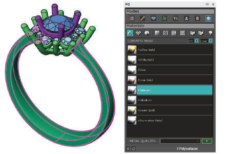
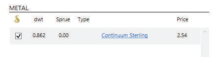
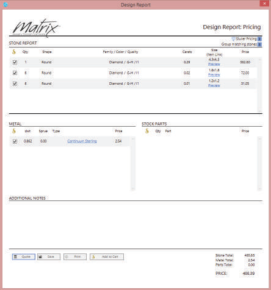
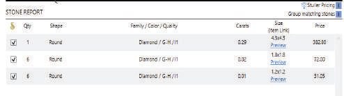
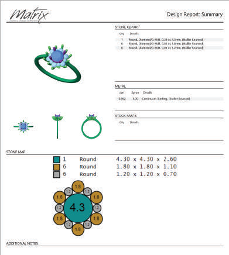

# Design Report

- Source PDF: Matrix 8 Instruction Manual Book 1 (matrix8_book_1.pdf)
- Page range: 41-43
- Section title: Design Report
- Section id: m8book1-022-design-report
- Note: boundary page(s) are shared with a neighbouring section (two-column layout); text/images may include neighbour content.

---
<!-- section m8book1-022-design-report | Design Report | m8book1 pages 41-43 -->

<!-- page 41 -->

## Design Report
‘gvDesignReport’
The Design Report accesses the design’s applied
render materials while joining reports for gem and
metal weights, providing real-time Stuller pricing
quotes. Use this, combined with the Print option,
Design Summary, a gem map along with a four-
view render of your design, to organize your jobs
more efficiently.
Where is this tool:
Access this tool from Info & Settings
Menu>Design Report
Steps:
Menu>Smart Track
Rhino’s SmartTrack is a system of temporary
reference lines and points that is drawn in the
viewport using implicit relationships among
various 3-D points, other geometry in space, and
the coordinate axes’ directions. Temporary infinite
lines (tracking lines) and points (smart points)
are available to Object Snaps very much like real
lines and points. You can snap to intersections of
the tracking lines, perpendiculars, and directly to
smart points as well as intersections of tracking
lines and real curves. The tracking lines and
smart points are displayed for the duration of a
command. Add or “capture” new points as needed
up to the current maximum after which the oldest
smart points disappear as new ones are added.
Captured points can be cleared at any time if they
are not proving useful.
Steps
• Select SmartTrack from the Info & Settings menu.
• This toggles On SmartTrack. Select again to toggle
Off.
• Apply Materials for gems and metals, including
Metal Quality, to all objects.
• Select Design Report from the Info & Settings
Menu.
• Select additional gem quality options.
• Select Print to view the Design Summary Report.
• Select Quote to view Stuller Pricing.
Capture Smart Points Automatically:
### Setting up the Model
Steps
• Capture Smart Points automatically by hovering
over an object snap point.
Manually:
• Press the Ctrl key once to place a manual Smart
Point anywhere in space. This makes it easy to for
example to place Smart Points along curves.
• Press “Ctrl” twice to clear all Smart Points.
Render Materials: The Design Report uses the
model’s assigned render materials. So, first apply
metal and gem materials (via VRay Styles or F6
Materials Mode) to each object in the design. Be
sure to designate the specific Metal quality. With
gems you will have the ability to select specific
qualities later. The design does not need to be
water-tight to produce metal volumes. Once the
design is assigned metal and gem materials it is
ready for a real-time Stuller quote.
Notes: Captured Smart Points are drawn in
their own color and styles: gray with a cross for
captured, but not currently active points (that is
they are not sending out any tracking lines), and
blue for active Smart Points. Tracking lines are
drawn once a Smart Point is captured and the
cursor is in a predictable relation with the captured
point(s). In this case, predictable means that the
cursor is along or near an Ortho line through the
point, at or near the intersection between Ortho
lines from two Smart Points. When a single Smart
Point is highlighted and the Ortho cursor is seen
with a distance, Type a distance or enter relative
coordinates to place a point relative to the active
Smart Point.

<!-- page 42 -->

Metal Report: The metal report displays the
DWT amount, Sprue DWT, quality or metal
type.
Launch the Design Report: Click the Design
Report button in the Info & Settings menu to
open the report. Upon launch the design is
checked for volume and made water-tight. So, it
may take several seconds and up to a minute or
longer to display the report. Large models with
tens or hundreds of components will require more
waiting time when launching the Design Report.
You must be connected to the Internet and have
a Stuller.com account to receive real-time pricing
quotes.
Sprue: Click on the “0.00” DWT amount under
“Sprue” to type an amount of raw material
required for casting to be included in your order.
Type: Click on the underlined metal name in
“Type” to access Stuller’s raw material product web
page.
Stock Parts: Any Stuller findings included in the
design will be listed here along with quantity, and
the parts description.
Additional Notes: Add any note pertaining to
this design you wish.
### Design Report Components
Stuller Real-Time Quotes: Next to every
item listed is a check box that is checked “On”
by default. All of the checked items are quoted.
Any unchecked item will not be quoted. Check or
uncheck each item as needed.
The Design Report is comprised of a stone
report, metal report, stock parts listing, notes and
quoting options. It also includes the ability to save
by using the “Print” option. Also, parts and raw
material orders from Stuller can be completed
directly from the report.
Turn On Stuller Pricing: Stuller Pricing is “On”
by default. See the button at the top right
of the report. Click on the square, blue On/Off
toggle to disable Stuller pricing.
Quote: When all items are set as needed just
click the “Quote” button on the bottom left of
the report. Enter your Stuller.com account user
name and password. You will only be required to
do this once. Matrix will
remember this every
time it’s used after this.
Stone Report: The stone report section will
display each stone quantity, shape, quality and
size along with the single carats weights. The
“Group Matching Stones” is checked “on” by
default (upper right corner). Stone Family / Color
/ Quality: The report will provide a default value
upon the first open. So, you will want to change
the quality of each stone in your design. Click
directly on the name of the stone to change the
stone entirely (family), change the color, or select
a new clarity (quality). Choose from the selections
in the drop down menu that appears.

<!-- page 43 -->

Metal pricing is listed in raw materials only. Gem
pricing is per group. (There are no setting fees
associated with the Design Report. Pricing is for
raw materials only.)
Changing Selections: The report will quote any
item that is currently available at Stuller. If an item
appears as “not available” you can go back and
change the quality or check the item’s availability
at Stuller.com. If a stone quality is changed a
“Reset” icon will appear along with a round, yellow
warning icon.
Save: Save in a .xps format for future viewing.
Reset:  Reset will reset that item back to the
default upon launch of the report. Viewing an
Item on Stuller.com: After the quote is completed
a “preview” link will appear under each listed item.
Click the link to view that item’s Stuller web page.
Viewing the Design Report Summary along with
the Print Preview.
Add to Cart: Click on “Add to Cart” to display
your shopping cart at Stuller.com. You can
complete your purchase here.
Print / View: After clicking on “Print” a Design
Report Summary will appear as the first page
along with the main Design Report as page two.
## Rhino History
Design Report Summary: The summary
includes a four-view capture of the design along
with a stone map (see explanation in Gems>Gem
Map) and the listing of stones, metals and parts.
The bottom of the page includes a Customer
Approval signature space, date, and a pricing box.
‘History’
History stores the connection between a
command’s input geometry and the result so
that when the input geometry changes, the result
updates accordingly. For example, with History
Recording and Update turned on, a lofted surface
can be changed by editing the input curves.
Increase or Decrease the Preview: Increase
the print preview size by clicking on the “+”
microscope symbol or decrease the size by
clicking on the “-.”
Where is this Command:
Access this command from Info and
Settings>Rhino History
Steps:
• Click on the Rhino History button to toggle History
Recording and Updating “On” or” Off.”
Preview Layout Styles: Choose a viewable
layout by selecting any one of the layout style
icons shown at the top of the Preview box (one
page, two pages, etc).
### Command Line Options:
Print: Print to your attached printer or save as a
document (if computer software is installed that
allows print to file).
These options are only available when you run the
history command in the Command Line. If you use
the Rhino History button it simply toggles the
recording and updating of History “On” or” Off.”

---

## Images

-  page 41
-  page 42
-  page 42
-  page 42
-  page 43 (shared page)
