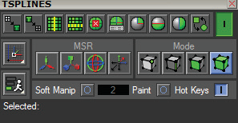
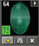
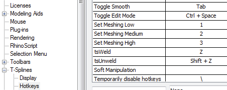
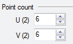

# T-Splines HUD 

- Source PDF: Matrix 8 Instruction Manual Book 2 (matrix_8_book_2.pdf)
- Page range: 42-43
- Section title: T-Splines HUD 
- Section id: m8book2-045-t-splines-hud
- Note: boundary page(s) are shared with a neighbouring section (two-column layout); text/images may include neighbour content.

---
<!-- section m8book2-045-t-splines-hud | T-Splines HUD  | m8book2 pages 42-43 -->

<!-- page 42 -->

## T-Splines HUD
Note:
When the H.U.D. is turned
Manipulate different parts of a T-Spline model
using the tools located within the “Heads Up
Display” or H.U.D.
ON a new icon will appear in the Perspective
Viewport near the viewport name to indicate
T-Splines H.U.D. is enabled or T-Spline objects are
present.
Where is this menu:
Access this menu from T-Spline>TSplines HUD
An indicator (TS) also appears
whenever a T-Spline object
occupies a Job Bag.
### Working with the HUD tools:
Convert objects from Matrix to T-Spline and
T-Spline to Rhino (Matrix, NURBS). Use Symmetry
tools to create objects quicker. Toggle from
Smooth Mode to Box Mode to work faster or Box
Mode to Smooth Mode to check the aesthetics of
the design.
Once clicked, the Heads Up Display (H.U.D.) will
dock just below the main menu and contains tools
for modeling with T-Splines. Drag and drop this
menu to a new location by clicking on the H.U.D.’s
title bar, holding the mouse down, and dragging
to a new location.
Turn ON the main On/Off button located to
the upper right to enable the H.U.D.’s tools.
The MSR tools and the Mode tools work in
conjunction with one another. First, select the
Mode you would like to work with or part of the
model you would like to manipulate, Next, choose
the MSR tool or how you would like to manipulate
the Mode.
HUD Tools:
Drag Mode sets the coordinates used while
manipulating the model. Choose a Speed Mode
(Compatibility Mode, Fast or Fastest) that allows
for optimum performance while modeling and
converting to NURBS.
The bottom of the T-Splines H.U.D. houses a
few On/Off switches. Altering these settings
will change T-Splines overall performance. With
the exception of the Hot Keys toggle, the other
controls within this menu reset to their default
position each time you restart Matrix. Upon
restarting, take note to revisit this menu if you wish
to make changes to any of the settings.
All the tools found in T-Splines H.U.D. are
explained in detail at the beginning of this chapter.
• Convert to T-Splines
• T-Splines to Rhino Surface
• Loop Select
• Ring Select
• Symmetry Off
• Symmetry
• X and Y Symmetry
• Y Symmetry
• X Symmetry
• Box/ Smooth Toggle
• Drag Mode
• MSR (Translate (Move), Scale, Rotate, Set Pivot
Point)
• Mode (Select Vert, Select Edge, Select Face, Select
Object)
• Compatibility Mode (Compatible, Fast, Fastest)
• Soft Manipulation
• Paint
• Hot Keys

<!-- page 43 -->

### Soft Manip, Paint, Hot Keys, Selected:
## Convert to T-Splines
‘tsConvert’
Converts an untrimmed, single, NURBS surface,
Matrix mesh or .OBJ object to a T-Spline object.
Where is this Command:
Access this command from T-Spline>TSplines
HUD>Convert to T-Splines
Soft Manipulate On/Off: When Soft
Manipulation is enabled, a moved vertex (Vert)
has a more gradual effect on the neighboring
surface. This control is set to Off as a default.
Steps:
• Select Convert to T-Splines command in the HUD.
• Select the surface or mesh to convert to a T-Spline
surface.
Rules for converting an object:
Set Soft Radius: Sets the radius value for the
Soft Manipulation. Enter a value in the provided
box. This setting allows you to determine the
area of influence that will be affected when being
manipulated. The smaller the value, the more
localized the manipulation will be. The higher the
value, the greater impact the manipulation will
have over the entire object.
Paint: This affects the way you select items on-
screen. When Paint selection is turned on, click
and drag across faces over the T-Splines model to
add them to the selection, rather than needing to
click on faces individually while holding Shift.
• Single surfaces will convert.
• Polysurfaces will not convert. (Explode the
polysurface and convert the single surfaces.)
• T-Splines will remember all trim information during
the conversion. (T-Spline object will appear as the
original, untrimmed surface)
• Matrix surface objects were originally created with
straight sides. So, the converted T-Splines object
will have straight sides. See picture.
Matrix surface (triangle) before and after Convert to
T-Splines.
Hotkeys: Hotkeys in T-Splines enables the user to
quickly change between MSR types and Selection
Modes while editing. Getting comfortable with
Hotkeys makes working in T-Splines more efficient.
When Hotkeys are ON, commands cannot be
typed in the Command Line. (Hotkeys are turned
off by default) A list of Hotkeys can be found in
the Options menu (T-Spline>Options). Or, Rhino
Options>T-Splines>Hotkeys.
Hint: Rebuild a Surface (Surface Menu> Rebuild)
to change the UV point count to increase or
decrease the potential number of faces on the
converted T-Spline object.
Selected: This field populates with the name(s) of
the T-Splines objects when T-Splines objects are
highlighted.
Surface on the left was rebuilt
with the Point Count
increasing from 2 to 6 for both
U and V directions.

---

## Images

-  page 42
-  page 42
-  page 43 (shared page)
-  page 43 (shared page)
-  page 43 (shared page)
-  page 43 (shared page)
