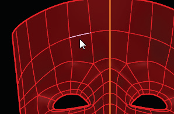
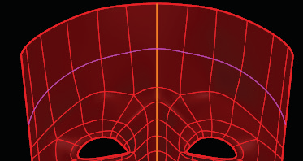

# Ring Select 

- Source PDF: Matrix 8 Instruction Manual Book 2 (matrix_8_book_2.pdf)
- Page range: 45-45
- Section title: Ring Select 
- Section id: m8book2-048-ring-select
- Note: boundary page(s) are shared with a neighbouring section (two-column layout); text/images may include neighbour content.

---
<!-- section m8book2-048-ring-select | Ring Select  | m8book2 pages 45-45 -->

<!-- page 45 -->

### Command Line Options (typing the
### command only):
Copy=No/Yes: No Copy will replace the
selected T-Spline object with a surface or
polysurface. Yes Copy will create a Matrix object
but leave the original T-Spline too.
Output Type:
Mesh: Outputs a mesh.
Choose Loop Select and the entire Loop of edges is
selected.
Polysurf: Outputs a polysurface.
## Ring Select
Auto: Outputs a mesh if the T-Spline is in Box
mode and a polysurface if the T-Spline is in
Smooth mode.
‘tsSelection’ SelectRing
Ring Select like Loop Select makes selecting
groups of edges easier. Ring Select selects edges
that are parallel to one another as opposed to
continuous edges (like Loop Select).
Star Continuity (G0, G1 or Auto): The Auto
setting will choose the continuity or amount of
blend for you. G0 or G1 determines the amount of
blend produced in the polysurface.
History Enabled No/Yes: Yes will enable Rhino
History. No leaves Rhino History off.
Where is this Command:
Access this command from T-Spline>TSplines
HUD>Ring Select
Steps:
## Loop Select
‘tsSelection’ SelectLoop
With one edge selected this command will select
the entire, continuous loop of edges.
• Select a T-Spline edge.
• Click on Ring Select in the T-Splines HUD to select
all edges that are in a ring around the T-Spline
object (parallel to the original edge.).
Where is this Command:
Access this command from T-Spline>TSplines
HUD>Loop Select
Steps:
Select a T-Spline
edge
• Select a T-Spline edge. (HUD mode is set to Select
Edge.)
• Click on Loop Select in the T-Splines HUD.
• Or, with an edge selected double-click on the
selected edge.
The loop of edges will all be selected.
After clicking on
Ring Select the
parallel edges are
now selected.
One T-Spline Edge
is selected.

---

## Images

-  page 45 (shared page)
-  page 45 (shared page)
-  page 45 (shared page)
-  page 45 (shared page)
