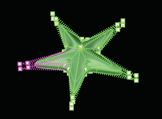
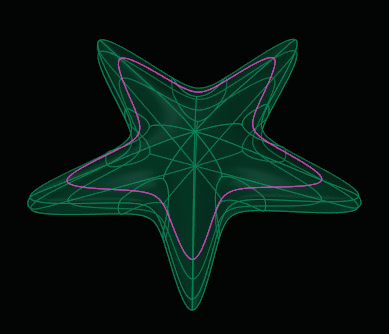
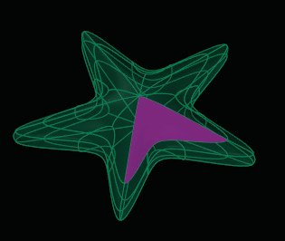
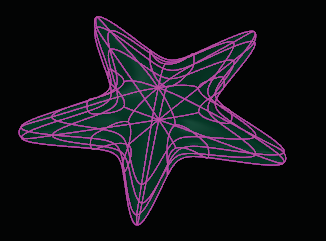
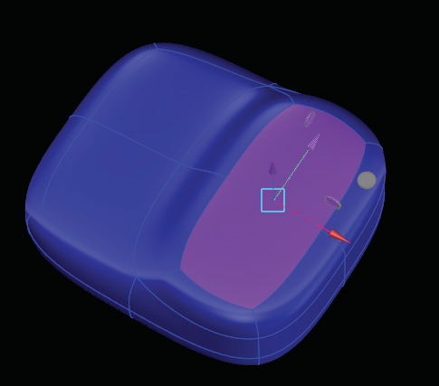

# Select Face (Mode) 

- Source PDF: Matrix 8 Instruction Manual Book 2 (matrix_8_book_2.pdf)
- Page range: 52-53
- Section title: Select Face (Mode) 
- Section id: m8book2-063-select-face-mode
- Note: boundary page(s) are shared with a neighbouring section (two-column layout); text/images may include neighbour content.

---
<!-- section m8book2-063-select-face-mode | Select Face (Mode)  | m8book2 pages 52-53 -->

<!-- page 52 -->

## Select Vert (Mode)
Or by typing ‘S’ when T-Splines and Hot Keys
are activated.
Steps:
This is the first of four edit modes available in the
T-Splines HUD. When ‘Vert’ mode is selected, one
or more vertices (a vertex grip or control point)
which define the surface can be selected and
used for editing. Choose the appropriate mode to
select an Edge, Face or the entire Object.
Where is this Command:
Access this command from TSpline >TSplines
HUD>Select Vert
• Click on Select Edge in the T-Spline HUD to set the
edit mode.
• Select an edge. Or, press and hold the ‘Shift” key
while selecting multiple edges.
• To select a loop of edges, click on one edge to
highlight it, then double-click to select the entire
loop of edges.
Or by typing ‘A’ when  T-Splines and Hot Keys
are activated.
Steps:
Edit Mode set to “Select Edge”.
• Click on Select Vert (Vertex) in the T-Spline HUD
to set the edit mode.
• The vertices on the design will now appear and
are able to be selected. To select more than one
point, either region select or hold the ‘Shift’ key
to grab multiple vertices.
## Select Face (Mode)
This is the third of four edit modes available in the
T-Splines HUD. When Face mode is selected, one
or more faces which define the surface can be
selected. Choose the appropriate mode to select
a Vertex (Vert), Edge or the entire Object.
Edit Mode set to “Select Vert”.
Where is this Command:
Access this command from TSpline >TSplines
HUD>Select Face
## Select Edge (Mode)
Or by typing ‘D’ when T-Splines and Hot Keys
are activated.
This is the second of four edit modes available in
the T-Splines HUD. When Edge mode is active,
one or more edges which define the surface can
be selected and used for editing. Choose the
appropriate mode to select a Vertex (Vert), Face
or the entire Object.
Steps:
Where is this Command:
Access this command from TSpline >TSplines
HUD>Select Edge
• Click on Select Face in the T-Spline HUD to set the
edit mode.
• To select more than one face, either region select
or hold the ‘Shift’ key to grab multiple faces.

<!-- page 53 -->

## Extrude
‘tsExtrude’
The T-Splines Extrude command is a very
powerful way to quickly create surfaces that can
be altered using the Translate (Move), Scale and
Rotate manipulators. This tool is great to use
with an existing Primitive shape (Box, Sphere,
Quadball, etc.), allowing you to build upon the
simple Primitive creating a more complex shape.
Edit Mode set to “Select Face”.
Where is this Command:
Access this command from T-Spline>Extrude
## Select Object (Mode)
### Extrude Faces:
This is the last of four edit modes available in the
T-Splines HUD. When Object mode is selected,
the entire T-Spline will be highlighted. Choose the
appropriate mode to select a Vertex (Vert), Edge
or Face.
When using the T-Splines Extrude command
with an existing face on your model, a column of
new faces will be added around the original face,
connecting and transitioning the newly-added
surface. You can extrude a single face, multiple
adjacent faces, or multiple faces that are not
connected to one another.
Steps:
Where is this Command:
Access this command from TSpline >TSplines
HUD>Select Object
Or by typing ‘F’ when T-Splines and Hot Keys
are activated.
• Select faces to Extrude.
• Click the Extrude command from the T-Spline
menu.
• Press Enter.
• Drag the Translate (Move) Manipulator.
Steps:
• Click on Select Object in the T-Spline HUD to set
the edit mode.
• Click on the object to select it.
Extrude Faces before and after.
### Extrude Edge:
When using the Extrude command with an edge,
this tool adds a surface to an existing border edge
or edges, extending the border of your model.
Steps:
Edit Mode set to “Select Object”.
• Select Border edges to Extrude.
• Click the T-Splines Extrude command.
• Press Enter.
• Drag the Translate (Move) manipulator.

---

## Images

-  page 52 (shared page)
-  page 52 (shared page)
-  page 53 (shared page)
-  page 53 (shared page)
-  page 53 (shared page)
-  page 53 (shared page)
