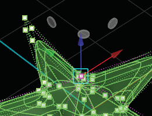

# Translate (MSR) 

- Source PDF: Matrix 8 Instruction Manual Book 2 (matrix_8_book_2.pdf)
- Page range: 50-50
- Section title: Translate (MSR) 
- Section id: m8book2-057-translate-msr
- Note: boundary page(s) are shared with a neighbouring section (two-column layout); text/images may include neighbour content.

---
<!-- section m8book2-057-translate-msr | Translate (MSR)  | m8book2 pages 50-50 -->

<!-- page 50 -->

## Translate	 (MSR)
Translate Vert (Vertex)
The Move (Translate) manipulator allows you to
relocate verts, edges, faces, or the entire object.
This is the first of the MSR commands in the
HUD. The manipulator is comprised of red, blue
and green arrows, small gray flat disks and a teal
square located at the center of the manipulator.
The colored arrows allows you to move along one
axis. The gray disks allow more freedom within
the movement and allow you to move the object
within two planes.
## Scale (MSR)
Where is this Command:
Access this command from TSpline >TSplines
HUD> Translate
The Scale manipulator allows you to scale vertices,
edges, faces, or the entire object. Its manipulator
works in exactly the same fashion as Translate,
however, it visually looks a little different. This is
the second of the MSR commands in the HUD.
Or by typing ‘W’ when T-Splines and Hot Keys
are activated.
Where is this Command:
Access this command from TSpline >TSplines
HUD> Scale
Or by typing ‘R’ when  T-Splines and Hot Keys
are activated.
Blue Handle: The Blue handle allows you to
move a vertex, edge, face or object along the Z
axis.
Red Handle: The Red handle allows you to move
a vertex, edge, face or object along the X axis.
Blue Handle: The Blue handle allows you to
scale 1D a vertex, edge, face or object along the Z
axis.
Green Handle: The Green handle allows you to
move a vertex, edge, face or object along the Y
axis.
Red Handle: The Red handle allows you to scale
1D a vertex,  edge, face or object along the X axis.
Teal Handle: Positioned at the center of the
Scale Manipulator, allows for free movement of the
selected item in three-dimensional space.
Green Handle: The Green handle allows you to
scale 1D a vertex,  edge, face or object along the
Y axis.
Gray Disks: Between each major handle there is
a gray disk that allows you to perform a 2D move
(XY, XZ, YZ). Moving a vertex, ,edge, face or object
between two planes at the same time.
Teal Handle: Positioned at the center of the
Scale Manipulator, will perform a 3D scale of a
vertex,  edge, face or object.
Gray Disks: Between each major handle there is
a gray disk that allows you to perform a 2D scale.
Scaling a vertex, edge, face or object between
two planes at the same time.
Note: Double-click on the blue, red or green handle
to enter a translation amount into the Command
Line moving an object a set amount. Type a negative
number to move in the opposite direction. Change
the Handle (axis) or Style (MSR) from the Command
Line after double-clicking on a handle.

---

## Images

-  page 50 (shared page)
