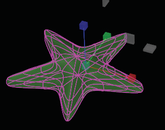
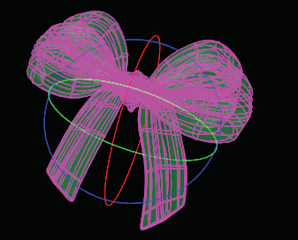
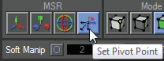

# Set Pivot Point (MSR) 

- Source PDF: Matrix 8 Instruction Manual Book 2 (matrix_8_book_2.pdf)
- Page range: 51-51
- Section title: Set Pivot Point (MSR) 
- Section id: m8book2-060-set-pivot-point-msr
- Note: boundary page(s) are shared with a neighbouring section (two-column layout); text/images may include neighbour content.

---
<!-- section m8book2-060-set-pivot-point-msr | Set Pivot Point (MSR)  | m8book2 pages 51-51 -->

<!-- page 51 -->

Note: Double-click on the blue, red or green handle
to enter a scale factor into the Command Line to
scale an object a set amount. You can also change
the Handle (axis) or Style (MSR) from the Command
Line after double-clicking on a handle.
Note: Double-click on the blue, red or green handle
to enter a rotation amount into the Command Line to
rotate an object a set amount. You can also change
the Handle (axis) or Style (MSR) from the Command
Line after double-clicking on a handle.
Scale an object
Rotate an object
## Rotate (MSR)
## Set Pivot Point	 (MSR)
The Rotate manipulator allows you to rotate verts,
edges, faces, or the entire object. This is the third
of the MSR commands in the HUD. The Rotate
manipulator is very simple to use. When active, a
set of red, green and blue circles surrounds the
object. Each circle defines the axis in which the
rotation will take place.
Where is this Command:
Access this command from TSpline >TSplines
HUD>Rotate
By default, each of the manipulators are placed
at the center of the vert, edge, face or the entire
object that is being manipulated. In other words,
if you created a bounding box around the object
and placed a point at the center, this is where
the manipulator will appear when initiated. The
location of the manipulator pivot point can be
changed by clicking the pivot icon. This allows
you to scale or rotate from one side of a model
instead of just from the middle of your selection.
It is helpful to use O-Snaps to snap the pivot
point to a new location. This is the last of the MSR
commands in the HUD.
Or by typing ‘E’ when T-Splines and Hot Keys
are activated.
Where is this Command:
Access this command from TSpline >TSplines
HUD>Set Pivot Point
Or by typing ‘T’ when T-Splines and Hot Keys
are activated.
Blue Handle: The Blue handle allows you to
rotate a vertex, edge, face or object around the Z
axis.
Red Handle: The Red handle allows you to
rotate a vertex, edge, face or object around the X
axis.
Steps:
Green Handle: The Green handle allows you to
rotate a vertex,  edge, face or object round the Y
axis.
• Select Set Pivot Point in the T-Spline HUD.
• Pick a point to set the new location for the Pivot
Point. (Activate O-Snaps to help in the selection.)

---

## Images

-  page 51 (shared page)
-  page 51 (shared page)
-  page 51 (shared page)
