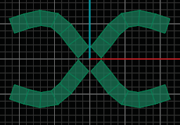
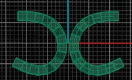

# Box/Smooth Toggle 

- Source PDF: Matrix 8 Instruction Manual Book 2 (matrix_8_book_2.pdf)
- Page range: 48-49
- Section title: Box/Smooth Toggle 
- Section id: m8book2-054-box-smooth-toggle
- Note: boundary page(s) are shared with a neighbouring section (two-column layout); text/images may include neighbour content.

---
<!-- section m8book2-054-box-smooth-toggle | Box/Smooth Toggle  | m8book2 pages 48-49 -->

<!-- page 48 -->

## X Symmetry
‘gvtsMirrorX’
A symmetry short cut which adds symmetry to a
model across the X axis.
Note: The object in one quadrant will mirror in X and
Y axis and become Symmetric. This command only
gives Symmetric results. Also, if the object’s verts
do not fall along the axis in which you are mirroring,
you may end up with odd overlaps and a model that
is not solid or has holes in it. The Set Points tool is
great for ensuring the item will line up perfectly prior
to mirroring. Refer to T-Spline>Set Points to better
understand how to use this tool
Where is this Command:
Access this command from T-Spline>TSplines
HUD> X Symmetry
Steps:
• Center the T-Spline object at F4.
• Delete the faces from the X or -X quadrant.
• Click on X Symmetry in the HUD menu.
• Select a T-Spline object.
• Press Enter when done.
Object is now Symmetric across the X axis.
Object with X and Y Symmetry. Use Append to add
faces to close both sides.
## Y Symmetry
Object is
Symmetric
across the X
axis. (X+ is
mirrored to X-)
‘gvtsMirrorY’
A symmetry short cut which adds Symmetry
to a model across the Y axis. This creates a
symmetrical relationship between the top and
bottom of the object in the Looking Down
viewport.
## Box/Smooth Toggle
‘tsSmoothToggle’
Toggles the T-Splines surface between Smooth
Mode and Box Mode.
Where is this Command:
Access this command from T-Spline>TSplines
HUD> Y Symmetry
Steps:
Where is this Command:
Access this command from TSpline >TSplines
HUD>Box/Smooth Toggle
Hot Key: TAB
Steps:
Start with a complete model that doesn’t have
Symmetry.
• Center the T-Spline object at F4
• Delete the faces from the Y or -Y quadrants.
• Select Y Symmetry from the HUD menu.
• Select the T-Splines object.
• Press Enter when done.
• Select a T-Spline object.
• Click on the Box/Smooth Toggle.
Object is now Symmetric across the Y axis.
Object is
Symmetric
across the
Y axis. (Y+
is mirrored
to Y-)
Sphere in Box Mode (left) and Smooth Mode (right)

<!-- page 49 -->

### Command Line Options (typed
### command only):
‘DragMode’ is a Rhino command and can be
typed in the Command Line. Control Polygon and
‘Next’ are two additional options appearing.
ControlPolygon: Allows dragging a curve or
surface control point along the control polygons
that connect to it.
Note:
A T-Spline can be viewed as a smooth surface
or as a boxy mesh. On complex models,
manipulating in Box Mode can be much faster,
while Smooth Mode can be used to check the
aesthetics and dimensions of the model. To toggle
between Box Mode and Smooth Mode, select
the object you would like to toggle, and press
the Box/ Smooth Toggle icon. If you are in edit
mode, you can also press the TAB key to toggle all
T-Splines in the scene.
Note: When dragging multiple control points press
the Shift key to make all points move the same
absolute amount instead of moving proportionally
based on the length of each control polygon chord.
## Drag Modes
Next: Sets object dragging to the next mode in
the list.
A Drag Mode sets the coordinates and controls
how the manipulator is used when adjusting
T-Spline designs.
## Compatibility Mode
World Coordinates: Uses the World (X, Y and
There are three different speed modes in which
to work while in T-Splines. These include; Fast,
Fastest and Compatibility.
Z) Coordinates while dragging the
manipulator to make changes to the model
and is the default Drag Mode. The manipulator is
aligned to World X, Y and Z coordinates with F4
as the center.
Where is this Command:
Access this command from TSpline >TSplines
HUD> Compatibility Mode
C-Plane Coordinates: This aligns or sets the
Compatibility Mode: Switch to Compatibility
manipulator to use the C-Plane
Coordinates while adjusting the model. This
is useful when a T-Spline object is set to a Surface
View creating a custom C-Plane for that object
(Display menu). The manipulator is aligned with
the custom C-Plane.
Viewport Coordinates: The manipulator is
Mode just before converting to NURBS.
Compatibility mode works at a higher
mesh density, hogging computer resources
but creating beautiful results. When working in
Compatibility mode, every time a change is made
to the T-Spline surface, a NURBS surface is
created in the background. This is ideal if
preparing to convert to NURBS, but not ideal
when designing. While designing, it is
recommended to work in Fastest Mode.
aligned to the active view and changes
orientation while the view is changed (the
object is moved in the viewport). The manipulator
only displays X and Y.
Fast/Fastest Mode: During normal modeling it
Normal Coordinates: The manipulator uses the
is recommended to work in either Fast or
Fastest mode. These two modes lower the
amount of modeling overhead so that the
object’s coordinates. Each selected face
scales to itself, for example. The manipulator
uses the selected T-Spline’s center and UV
coordinates. (Rhino names this UVN)
Hint: When switching between modes, deselect a
selection item and reselect it. This will prompt the
manipulator to update to the new mode.
computer can dedicate its resources to
T-Splines. To display the mesh takes time.
When working in Fast and Fastest mode
the mesh is created with a very high mesh setting
and it is subdivided so that it appears smooth
even though in reality the mesh is really rough.

---

## Images

-  page 48 (shared page)
-  page 48 (shared page)
-  page 48 (shared page)
-  page 48 (shared page)
