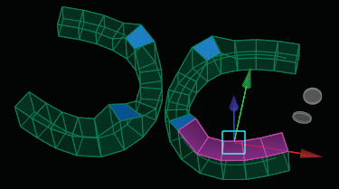
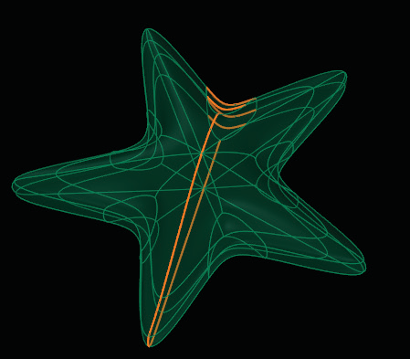

# Symmetry

- Source PDF: Matrix 8 Instruction Manual Book 2 (matrix_8_book_2.pdf)
- Page range: 46-47
- Section title: Symmetry
- Section id: m8book2-050-symmetry
- Note: boundary page(s) are shared with a neighbouring section (two-column layout); text/images may include neighbour content.

---
<!-- section m8book2-050-symmetry | Symmetry | m8book2 pages 46-47 -->

<!-- page 46 -->

## Symmetry Off
### Discovering existing Symmetry on a
### complete model:
Steps:
‘tsSymmetryOff’
Removes Symmetry from a surface.
Where is this Command:
Access this command from T-Spline>TSplines
HUD>Symmetry Off
Steps:
• Select Symmetry from the HUD menu.
• Select the T-Spline to add Symmetry. (HUD Mode
is “Select Object”)
• Select “Discover” in the Command Line.
• Select the Symmetry type: Axial (two symmetric
halves), or Radial (multiple symmetric parts
around a circle).
• Follow the steps below for each type.
• Select the Symmetry Off command from the
T-Spline HUD.
• Select the T-Splines surface with Symmetry.
• Symmetry will now be turned off for the selected
surface.
Discover the symmetry:
There are three (3) options for discovering
Symmetry.
### Command Line Options:
### (1) Select an edge on the axial
### boundary:
Steps:
Isolate: Allows you to turn off Symmetry for just
part of the surface. Just select (hold the Shift key
for multiple selection) the “On” faces of the model
to isolate from Symmetry Off. Highlighted faces
will have Symmetry turned on along with the
boarder edges.
•  Select the edge to serve as the Symmetry
boundary.  If the two sides had different shapes,
the command will arbitrarily pick one and adjust
the other side to be symmetric.
### (2) Select a Face:
Steps:
• Select the root face.
• If the two sides of your model have different
shapes, then click any face on the side of the
model you want to keep as the “root face.”
Isolate Symmetry Off is used so just the highlighted
faces have Symmetry On.
## Symmetry
‘tsSymmetry’
Applies symmetry (mirroring) along the X, Y,
or Z axis (axial) or a center of rotation (radial)
symmetry to a T-Splines surface. You can discover
existing Symmetry on a complete model, or add
new Symmetry to a complete a partial model.
Orange border is outlined  showing existing Line of
Symmetry using Discover Symmetry.
Where is this Command:
Access this command from T-Spline>TSplines
HUD>Symmetry

<!-- page 47 -->

### (3) Select Face Edge Vert:
3Point: Allows you to determine the Symmetry
axis by selecting 3 points.
Steps:
### Radial Symmetry:
Creates symmetry around a circle by placing a
center of rotation.
Steps:
In case the “root face” method gets mixed up,
this provides more information on where the
symmetry line should be. Select root face. If the
two sides of your model have different shapes,
then click any face on the side of the model you
want to keep as the “root face.” Select symmetric
face. Pick the face you want to be symmetric to
the root face on the other side of the model.
Steps:
• Select the T-Spline object to add symmetry to.
• Select Add in the Command Line.
• Select the type of symmetry to apply (Radial).
• Select the center of rotation.
• Click to set a point for the angle or first reference.
• Click to set a point for the second reference.
### Command Line Options:
• Select root edge. Select any edge on the root face.
• Select symmetric edge. Select the corresponding
edge on the symmetric face.
• Select root vert. Select a vertex on the root edge.
• Select symmetric vert. Select the corresponding
vertex on the symmetric edge.
Segments: Determines the number of radial
portions of the symmetry.
### Adding Symmetry to complete a partial
### model:
Steps:
Weld: Determines whether to weld the vertices
on the borders of the model or not. Weld=No will
combine the parts into one object but not weld
the vertices.
Tolerance: If Weld=Yes, all vertices on the
symmetry border will be welded if they fall within
this tolerance.
• Select the Symmetry type: Axial (two symmetric
halves), or Radial (multiple symmetric parts
around a circle).
• Apply Symmetry. Axial and Radial symmetry each
have their own procedures for doing this. See
below.
## X and Y Symmetry
### Axial Symmetry (along X, Y or Z axis):
Steps:
‘gvtsMirrorXY’
This Gemvision command is a Symmetry short cut
which adds Symmetry to a model across both the
X and Y axis.
• Start of Symmetry Plane: click a point on the start
of the plane. It is helpful to have the Point O-Snap
turned on for this step.
• End of Symmetry Plane: click a point on the end of
the plane.
Where is this Command:
Access this command from T-Spline>TSplines
HUD> X and Y Symmetry
### Command Line Options:
Weld: Determines whether to weld the vertices
on the borders of the model. Weld=No will
combine the parts into one object but not weld
the vertices.
Steps:
• Center the T-Spline object at F4.
• Delete the faces from 3 of the 4 quadrants (X,Y)
(X,-Y) (-X,Y) (-X,-Y).
• Select X and Y Symmetry from the HUD menu.
• Select the T-Splines object.
• Press Enter when done.
Tolerance: If Weld=Yes, all vertices on the
symmetry border will be welded if they fall within
this tolerance.

---

## Images

-  page 46 (shared page)
-  page 46 (shared page)
