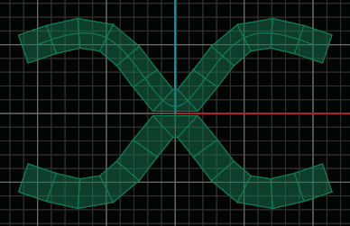
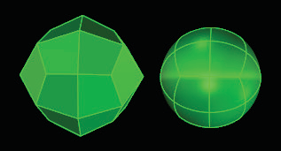

# X Symmetry 

- Source PDF: Matrix 8 Instruction Manual Book 2 (matrix_8_book_2.pdf)
- Page range: 48-48
- Section title: X Symmetry 
- Section id: m8book2-053-x-symmetry
- Note: boundary page(s) are shared with a neighbouring section (two-column layout); text/images may include neighbour content.

---
<!-- section m8book2-053-x-symmetry | X Symmetry  | m8book2 pages 48-48 -->

<!-- page 48 -->

## X Symmetry
‘gvtsMirrorX’
A symmetry short cut which adds symmetry to a
model across the X axis.
Note: The object in one quadrant will mirror in X and
Y axis and become Symmetric. This command only
gives Symmetric results. Also, if the object’s verts
do not fall along the axis in which you are mirroring,
you may end up with odd overlaps and a model that
is not solid or has holes in it. The Set Points tool is
great for ensuring the item will line up perfectly prior
to mirroring. Refer to T-Spline>Set Points to better
understand how to use this tool
Where is this Command:
Access this command from T-Spline>TSplines
HUD> X Symmetry
Steps:
• Center the T-Spline object at F4.
• Delete the faces from the X or -X quadrant.
• Click on X Symmetry in the HUD menu.
• Select a T-Spline object.
• Press Enter when done.
Object is now Symmetric across the X axis.
Object with X and Y Symmetry. Use Append to add
faces to close both sides.
## Y Symmetry
Object is
Symmetric
across the X
axis. (X+ is
mirrored to X-)
‘gvtsMirrorY’
A symmetry short cut which adds Symmetry
to a model across the Y axis. This creates a
symmetrical relationship between the top and
bottom of the object in the Looking Down
viewport.
## Box/Smooth Toggle
‘tsSmoothToggle’
Toggles the T-Splines surface between Smooth
Mode and Box Mode.
Where is this Command:
Access this command from T-Spline>TSplines
HUD> Y Symmetry
Steps:
Where is this Command:
Access this command from TSpline >TSplines
HUD>Box/Smooth Toggle
Hot Key: TAB
Steps:
Start with a complete model that doesn’t have
Symmetry.
• Center the T-Spline object at F4
• Delete the faces from the Y or -Y quadrants.
• Select Y Symmetry from the HUD menu.
• Select the T-Splines object.
• Press Enter when done.
• Select a T-Spline object.
• Click on the Box/Smooth Toggle.
Object is now Symmetric across the Y axis.
Object is
Symmetric
across the
Y axis. (Y+
is mirrored
to Y-)
Sphere in Box Mode (left) and Smooth Mode (right)

---

## Images

-  page 48 (shared page)
-  page 48 (shared page)
-  page 48 (shared page)
-  page 48 (shared page)
