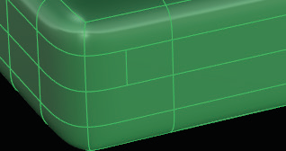
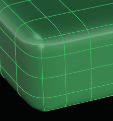
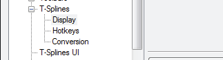

# Options 

- Source PDF: Matrix 8 Instruction Manual Book 2 (matrix_8_book_2.pdf)
- Page range: 97-97
- Section title: Options 
- Section id: m8book2-119-options
- Note: boundary page(s) are shared with a neighbouring section (two-column layout); text/images may include neighbour content.

---
<!-- section m8book2-119-options | Options  | m8book2 pages 97-97 -->

<!-- page 97 -->

## Standardize Surface
‘tsStandardize’
The Standardize Surface command ensures that
T-Splines surfaces remain NURBs compatible.
After running
the Standardize
Surface command
the T-Point is
extended until it is
two faces from any
Star point.
Where is this Command:
Access this command from T-Spline>
Standardize Surface
## Options
The T-Splines software is designed to be
as flexible and simple as possible; however,
maintaining a NURBS compatible surface requires
that T-Splines be standardized. Standardization
does not change the shape of the surface, but
may add control points to satisfy geometry
requirements necessary for NURBS conversion.
‘tsOptions’
This command opens the Rhino Options for
T-Splines.
Where is this Command:
Access this command from T-Spline>Options
Although standardization is always performed
when the T-Spline is in Smooth mode, the added
points are hidden by default. If you wish to see
these extra points, use this command.
Rhino Properties menu is where all the default
settings for Rhino are stored. These reset options
are an integral part of the program and will
determine how the program functions.
When you standardize a surface, all T-points within
two isocurves of star points will be extended until
the T-points are separated from star points by at
least two isocurves. See example below.
Steps:
Be careful when making changes to these presets
because one small change can make a huge
difference how Matrix and T-Splines function.
• Select Standardize Surface from the T-Spline
menu.
• Select a T-Spline object to standardize.
The T-Splines section of this menu includes four
separate topics; Display, Hotkeys, Conversion and
T-Splines UI (User Interface).
Expand the selection on the left by clicking on
the “+” next to ‘T-Splines)
T-Point near the corner (above) of the model is within
one face of the Star point on the corner of the cube
(where the 3 edges meet).

---

## Images

-  page 97 (shared page)
-  page 97 (shared page)
-  page 97 (shared page)
