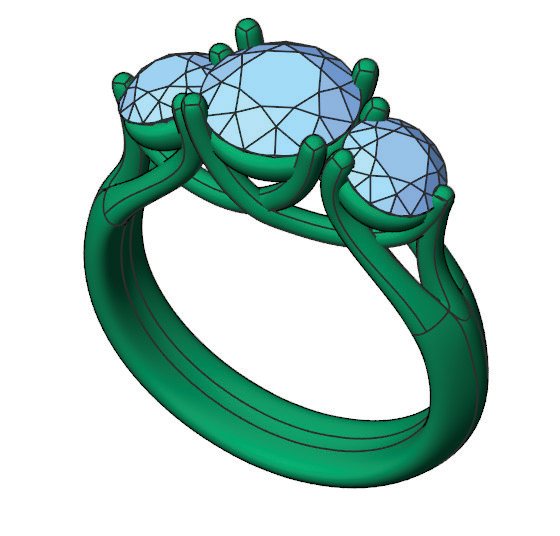

# T-Splines

- Source PDF: Matrix 8 Instruction Manual Book 2 (matrix_8_book_2.pdf)
- Page range: 41-41
- Section title: T-Splines
- Section id: m8book2-044-t-splines

---
<!-- section m8book2-044-t-splines | T-Splines | m8book2 pages 41-41 -->

<!-- page 41 -->

# CHAPTER 23
# T-Splines
### Integrate T-Splines with traditional Nurbs modeling and benefit from this organic
### approach to modeling
### Skills & Commands in this Chapter
Tspline Manipulators:
Translate, Scale, Rotate, Set Pivot Point
T-Spline Modes:
Select Vert, Select Edge, Select Face, Select
Object
T-Splines is an exciting and powerful way to
model within Matrix. This workflow is very different
from the traditional Nurbs method and offers
many great benefits. Hand in hand, the two
technologies will allow you to design and create
jewelry that is only limited by your imagination.
T-Splines will open your eyes to a new world of
organic modeling that allows you to quickly edit
and refine your jewelry designs. These designs
can then be easily converted back to Nurbs
surfaces and you can continue to work on your
design with traditional Matrix tools.
Creating free-form surfaces and organic shapes
within T-Splines adds to your arsenal of tools and
allows you to quickly explore shapes, pushing and
pulling them until they are just right.
Remaining HUD Tools:
Convert to T-Splines, Convert to Rhino Surface,
Loop Select, Ring Select, Symmetry Off,
Symmetry, X and Y Symmetry, Y Symmetry,X
Symmetry, Box Smooth Toggle, Drag Mode,
Compatibility Mode, Soft Manipulate, Paint, Hot
Keys.
T-Spline Primitives:
Box, Sphere, Quadball, Cylinder, Cone, Torus,
Plane

---

## Images

-  page 41
