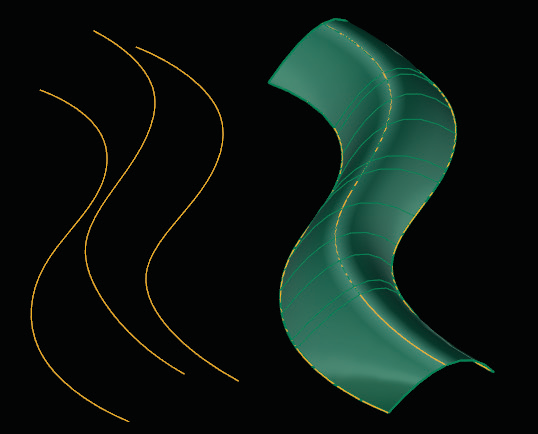
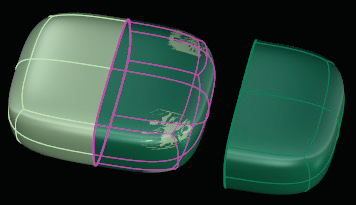

# Duplicate 

- Source PDF: Matrix 8 Instruction Manual Book 2 (matrix_8_book_2.pdf)
- Page range: 82-82
- Section title: Duplicate 
- Section id: m8book2-097-duplicate
- Note: boundary page(s) are shared with a neighbouring section (two-column layout); text/images may include neighbour content.

---
<!-- section m8book2-097-duplicate | Duplicate  | m8book2 pages 82-82 -->

<!-- page 82 -->

Exact (default): Surface will go through the
curves, but will have more control points than a
Minimal Loft.
Tight: Surfaces created with the Tight option
follow the original curve layout closely. This option
is ideal when your curve layout bends around
corners.
Uniform: This style guarantees that every control
point affects the surface exactly the same way, no
matter how much the surface is edited.
Curve Options:
Align Curves: Click the end of a shape curve to
reverse (flip) the direction. This is useful if a twist
exists in the surface.
Preview: Allows real-time preview when
changing options.
Closed Loft On/Off: The ‘Closed Loft’ option
continues the Loft through the last curve and
round to the first. This is only available when
lofting three or more curves.
Cancel/ OK: Click on Cancel to stop the
command. Click on ‘OK’ to complete the
command.
## Duplicate
Match Start/Match End Tangency: The
Match Tangency Start and Match Tangency End
options become available when the start and/or
end curve is a surface edge so the tangency of
the new surface will match the old.
‘tsDuplicateFaces’
Use this command to quickly copy Faces from
an existing model. Use this command to isolate a
group of faces from a T-Spline object and copy
them to a new location within the viewport. Use
Duplicate to add a matching band.
Where is this Command:
Access this command from T-Spline>Duplicate
Steps:
• Select Faces to duplicate.
• Click on the Duplicate command in the T-Spline
menu.
Loft curves (left) and Loft complete (right).
Loft Exactness:
Determines how closely the surface will fit to
the curves. Choose between Minimal, Exact or
Moderate.
Duplicate faces was used on half of the box.
## Match
Minimal: Surface is not guaranteed to pass
through the curves, but each row of control points
will have the same number of points as the input
curves.
Moderate: Produces a surface with fewer
control points than Exact but with tighter surface
definition than Minimal.
‘tsMatch’
The Match command can be used to connect
T-Spline surfaces to other T-Spline surfaces or to a
NURBS surface.

---

## Images

-  page 82 (shared page)
-  page 82 (shared page)
