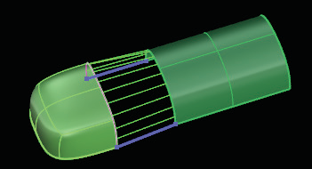
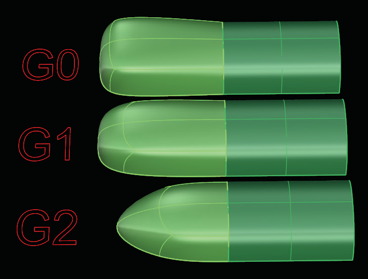

# Match 

- Source PDF: Matrix 8 Instruction Manual Book 2 (matrix_8_book_2.pdf)
- Page range: 82-83
- Section title: Match 
- Section id: m8book2-098-match
- Note: boundary page(s) are shared with a neighbouring section (two-column layout); text/images may include neighbour content.

---
<!-- section m8book2-098-match | Match  | m8book2 pages 82-83 -->

<!-- page 82 -->

Exact (default): Surface will go through the
curves, but will have more control points than a
Minimal Loft.
Tight: Surfaces created with the Tight option
follow the original curve layout closely. This option
is ideal when your curve layout bends around
corners.
Uniform: This style guarantees that every control
point affects the surface exactly the same way, no
matter how much the surface is edited.
Curve Options:
Align Curves: Click the end of a shape curve to
reverse (flip) the direction. This is useful if a twist
exists in the surface.
Preview: Allows real-time preview when
changing options.
Closed Loft On/Off: The ‘Closed Loft’ option
continues the Loft through the last curve and
round to the first. This is only available when
lofting three or more curves.
Cancel/ OK: Click on Cancel to stop the
command. Click on ‘OK’ to complete the
command.
## Duplicate
Match Start/Match End Tangency: The
Match Tangency Start and Match Tangency End
options become available when the start and/or
end curve is a surface edge so the tangency of
the new surface will match the old.
‘tsDuplicateFaces’
Use this command to quickly copy Faces from
an existing model. Use this command to isolate a
group of faces from a T-Spline object and copy
them to a new location within the viewport. Use
Duplicate to add a matching band.
Where is this Command:
Access this command from T-Spline>Duplicate
Steps:
• Select Faces to duplicate.
• Click on the Duplicate command in the T-Spline
menu.
Loft curves (left) and Loft complete (right).
Loft Exactness:
Determines how closely the surface will fit to
the curves. Choose between Minimal, Exact or
Moderate.
Duplicate faces was used on half of the box.
## Match
Minimal: Surface is not guaranteed to pass
through the curves, but each row of control points
will have the same number of points as the input
curves.
Moderate: Produces a surface with fewer
control points than Exact but with tighter surface
definition than Minimal.
‘tsMatch’
The Match command can be used to connect
T-Spline surfaces to other T-Spline surfaces or to a
NURBS surface.

<!-- page 83 -->

Where is this Command:
Access this command from T-Spline>Match
Continuity=G1: Matches surfaces using Tangent
continuity aligning the second control points on
each surface.
Steps:
Continuity=G2: Matches surface using
Curvature continuity by aligning the second and
third control points in each surface, creating an
entirely different shape in the new surface.
• Select Match from the T-Spline menu
• Select a border edge loop on a T-Spline surface.
• Select the edges or curve to match to.
• Press Enter when done. The two surfaces remain
as individual surfaces
Match
Preview
with
connectors
highlighted
in blue.
### Options:
Example of Match between a T-Spline object and a
NURBS object with Continuity options set.
Alignment:
Add: This option prompts to click a location
along the original T-Spline edge and a location
along the surface you are matching, determining
the new edge alignment.
Delete: Deletes an existing alignment connector.
Tangent Scale: When Continuity is set to G1
or G2 set a Tangent Scale amount other than
one (default) to adjust the tangency of the two
matched edges. Try increasing the scale factor by
one to see different results.
AlignmentType:
ArcLength: The physical distance between
each point on the T-Spline surface and the
corresponding point on the target surface is
minimized.
Parametric: Each point on the T-Spline surface
is matched up to a point of a similar parametric
distance along the match target curve or surface.
UseFalloff=Yes/No: Allows the user to
determine how much of the surface is affected by
the Match. If falloff is not used, then the surface
will be minimally affected. If a falloff distance is
entered, then the surface will be affected up to
this distan­ce away.
FlipAlignment Direction: Reverse the
alignment direction. This can be used to remove a
twist in the surface.
Falloff Distance: When Falloff is set to ‘Yes”
enter a distance value. This controls the how much
the surface is affected by the Match by setting a
distance-then the surface will be affected up to
this distan­ce away.
Continuity: Continuity determines the shape of
the new surface, so experiment with the continuity
setting and choose the shape you like best
Use Refinement=Yes/No: The Refine option
will add control points to the T-Spline to match the
surfaces within a given tole­rance.
Continuity=G0: Match with Position continuity-
When this option is toggled to ‘G0’ it merely
makes the two surfaces touch.
Preview: This option will display a preview of the
resulting surface.

---

## Images

-  page 82 (shared page)
-  page 82 (shared page)
-  page 83
-  page 83
