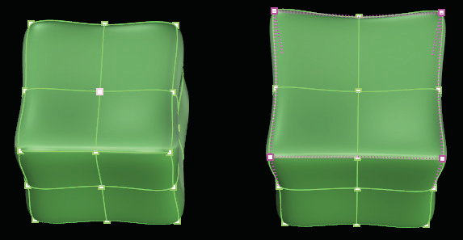

# Pull 

- Source PDF: Matrix 8 Instruction Manual Book 2 (matrix_8_book_2.pdf)
- Page range: 84-84
- Section title: Pull 
- Section id: m8book2-099-pull
- Note: boundary page(s) are shared with a neighbouring section (two-column layout); text/images may include neighbour content.

---
<!-- section m8book2-099-pull | Pull  | m8book2 pages 84-84 -->

<!-- page 84 -->

## Weight
## Pull
‘tsPull’
Pull a T-Spline surface to an existing Matrix model,
wrapping the T-Spline around the Matrix model.
‘tsWeight’
The T-Splines Weight Points command assigns
a weight to selected control points. At default,
each point has a weight value of one. Changing
the value of the weight will change the amount of
tension on its surface.
Where is this Command:
Access this command from T-Spline>Pull
Steps:
Where is this Command:
Access this command from T-Spline>Weight
Steps:
• Select Pull from the T-Spline menu.
• Select the T-Spline control points to pull to a target
surface.
• Press Enter when done.
• Select the object to pull the T-Spline control points
to.
• Select Weight from the T-Splines menu.
• Select a control point(s) for Weight editing.
• Type in a new Weight amount in the Command
Line.
• Press Enter when done.
Example below: Start with a Matrix Box  with a TS
Quadball surrounding it. Run the Pull command
selecting all Verts (points) on the Quadball. The
Matrix Box is the object to Pull to.
The four corner Vertices were selected and the
Weight value changed from 1 to 2. Object before
(left) and object after (right) using Weight.
## Selection Sets
The result shows the
Quadball pulled to
the Box surrounding it
completely.
‘tsSelSet’
Allows you to save selection groups of vertices,
edges and faces.
Where is this Command:
You can access this command from
T-Splines>Selection Sets
### Options:
Steps:
PullType:
SurfacePoints: This option pulls every point on
the surface of the T-Spline.
Control Points: This option pulls every control
polygon vertex on the T-Spline.
• Select Selection Sets command from the T-Spline
menu.
• A T-Splines Selection Sets dialog opens.
• Select a group of vertices, edges or faces.
• Click on the ‘Record’ (red sphere) button to save
the selection.
• Enter a custom name in the provided box if
desired.
• Click on the ‘Play’ (arrow) button to select the
saved group again.

---

## Images

-  page 84 (shared page)
-  page 84 (shared page)
-  page 84 (shared page)
-  page 84 (shared page)
