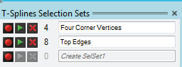
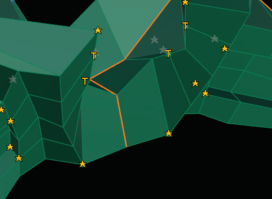

# Selection Sets 

- Source PDF: Matrix 8 Instruction Manual Book 2 (matrix_8_book_2.pdf)
- Page range: 84-85
- Section title: Selection Sets 
- Section id: m8book2-101-selection-sets
- Note: boundary page(s) are shared with a neighbouring section (two-column layout); text/images may include neighbour content.

---
<!-- section m8book2-101-selection-sets | Selection Sets  | m8book2 pages 84-85 -->

<!-- page 84 -->

## Weight
## Pull
‘tsPull’
Pull a T-Spline surface to an existing Matrix model,
wrapping the T-Spline around the Matrix model.
‘tsWeight’
The T-Splines Weight Points command assigns
a weight to selected control points. At default,
each point has a weight value of one. Changing
the value of the weight will change the amount of
tension on its surface.
Where is this Command:
Access this command from T-Spline>Pull
Steps:
Where is this Command:
Access this command from T-Spline>Weight
Steps:
• Select Pull from the T-Spline menu.
• Select the T-Spline control points to pull to a target
surface.
• Press Enter when done.
• Select the object to pull the T-Spline control points
to.
• Select Weight from the T-Splines menu.
• Select a control point(s) for Weight editing.
• Type in a new Weight amount in the Command
Line.
• Press Enter when done.
Example below: Start with a Matrix Box  with a TS
Quadball surrounding it. Run the Pull command
selecting all Verts (points) on the Quadball. The
Matrix Box is the object to Pull to.
The four corner Vertices were selected and the
Weight value changed from 1 to 2. Object before
(left) and object after (right) using Weight.
## Selection Sets
The result shows the
Quadball pulled to
the Box surrounding it
completely.
‘tsSelSet’
Allows you to save selection groups of vertices,
edges and faces.
Where is this Command:
You can access this command from
T-Splines>Selection Sets
### Options:
Steps:
PullType:
SurfacePoints: This option pulls every point on
the surface of the T-Spline.
Control Points: This option pulls every control
polygon vertex on the T-Spline.
• Select Selection Sets command from the T-Spline
menu.
• A T-Splines Selection Sets dialog opens.
• Select a group of vertices, edges or faces.
• Click on the ‘Record’ (red sphere) button to save
the selection.
• Enter a custom name in the provided box if
desired.
• Click on the ‘Play’ (arrow) button to select the
saved group again.

<!-- page 85 -->

Note: Not all Star Points can be turned to T-Points. A
Star Point can be changed to a T-Point if the vertex’s
valence is less than 4 and if the resulting face into
which the T-Point will point is a four-sided face.
Selection Sets dialog box
### Options:
Record: Save a selection. While you have
your desired T-Splines grips selected, press the
record icon and a new selection group will be
saved. You can name this new selection.
Play: Selects the saved group.
Delete: Deletes the current selection group.
Inside the T-Splines Layout command, Star Points,
T-Points L-Points will appear as Star, T, and L icons,
respectively.
An error Star Point shows in the Layout display as a
red star. This occurs when a point is simultaneously a
T-Point and a Star Point.
Rename the group by clicking in the name box. A
number to the left of the name dictates how many
grips are included in that set.
### Command Line Options:
## Edit Layout
ShowTPoints Yes/No: When set to ‘Yes’ all
T-Points are displayed as letter ‘T’. When set to
‘No’, T-Points are not displayed.
ShowLPoints Yes/No: An L-Point is a special
type of T-Point that occurs where two edges
running perpendicularly meet, forming an ‘L’
shape. When set to ‘Yes’ all L-Points are displayed
as letter ‘L’. When set to ‘No’, L-Points are not
displayed.
‘tsLayout’
Allows you to fix errors that prevent our model
from displaying as a smooth T-Spline. This
command also allows you to optimize the
smoothness and isocurve flow of your model by
changing T-Points to Star Points and vice versa.
Understanding the basic layout properties of
a T-Spline will improve your success with the
program. See Understanding T-Points and Star
Points below to begin.
ShowStars Yes/No: When set to ‘Yes’ all Star
Points are displayed as yellow star icons. When set
to ‘No’, Star Points are not displayed.
Where is this Command:
Access this command from T-Spline>Edit
Layout
Steps:
ShowErrorStars Yes/No: When set to ‘Yes’
all Star Points with errors are displayed as red
star icons. When set to ‘No’, Star Points are not
displayed.
• Select Edit Layout from the T-Spline menu.
• Select T-Spline to edit T-Points and Star Points.
• Select a Vertex. To switch a T-Point to a Star
Point, click on it and the icon will change. Also,
select a T-Point to change which direction it
points.

---

## Images

-  page 84 (shared page)
-  page 84 (shared page)
-  page 84 (shared page)
-  page 84 (shared page)
-  page 85 (shared page)
-  page 85 (shared page)
