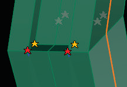

# T-Splines Library 

- Source PDF: Matrix 8 Instruction Manual Book 2 (matrix_8_book_2.pdf)
- Page range: 86-87
- Section title: T-Splines Library 
- Section id: m8book2-103-t-splines-library
- Note: boundary page(s) are shared with a neighbouring section (two-column layout); text/images may include neighbour content.

---
<!-- section m8book2-103-t-splines-library | T-Splines Library  | m8book2 pages 86-87 -->

<!-- page 86 -->

Error Star Point
displays as a red
star.
ShowSeashells Yes/No: Seashells are T-Points
with errors. When set to ‘Yes’ all error Seashells are
displayed as red. When set to ‘No’, Seashells are
not displayed.
non-rectangular. Star points can occur when
using commands like Extrude and Delete Faces.
It can be difficult to control to topology of the
surface near a Star Point. Avoid using Star Points
in general, but especially in areas around crease
or near the surface edge. Improper placement
of Star Points can cause the surface to switch
to Box Mode, unable to shade in Smooth Mode.
When converting to T-spline to NURBS, each
location where a Star Point is present will split into
separate surfaces. Star Points can have 3,5,6, 7,8,....
edges (Valence) and Tangent continuous (G1)
smoothness.
AutoRepair: This option automatically switches
all T-Points to Star Points necessary to display the
smooth surface. It also converts all Seashells to
Star Points.
Ordinary Control Point:
Valence (number of edges) = 4 (can be 2,3 or 4 on
the border)
Smoothness = Curvature continuous (C2)
### Understanding T-Points and Star
### Points:
T-Splines have four types of vertices (or control
points): T-Points, Star Points, Tangency Handles,
and Ordinary Control Points.
These vertex types are distinguished by their
valence (how many edges are attached to the
point) and their smoothness. Understanding basic
properties of these vertices will increase your
ability to successfully model with T-Splines.
Tangency Handle:
Tangency Handles control the tangency of the
T-Spline surface at a crease or the edge of the
surface. They always exist in the surface for all
creases and edges; however, the default visibility
is set to Display Moved and only displays those
Tangency Handles which have been purposefully
edited by the user. Tangency Handles have
a Valence of  1, 2, or 3 and the Smoothness is
Controls tangency at a crease or edge of surface.
(C0)
## T-Splines Library
‘gvTSplinesLibrary’
A wide variety of pre-built T-Spline designs are
available within the T-Splines Library. Begin
designing from one of the many Starting Point
inventory models or add to an existing design.
Where is this Command:
Access this command from T-Spline>T-Splines
Library
Steps:
T-Point: T-Points are a fork in the T-Splines road
and are unique to the T-Splines program. Unlike
NURBS surfaces where the U and V normals run
perpendicular to one another in straight lines,
T-Splines can come to an abrupt ending part way
through the design and can be started up again
with no problem. T-Splines can have a partial row
of control points that end in a T-Point. T-Points
typically occur when Edges are deleted, during
such commands as Insert Edge, Merge Edges and
Weld. T-Points will react just like regular control
points and maintain a smooth surface without
any kinking or stretching. T-Points can have 3 or 2
edges (Valence) and Curvature continuous (C2)
smoothness.
Star Point: Star Points usually occur on the
corner of objects and allow for a T-Spline to be
• Open the T-Splines Library from the T-Spline
menu.
• Click once on a thumbnail to select a model from
the browser to load into Matrix. (Be sure the
appropriate layer color is turned on in the Layers
menu.)

<!-- page 87 -->

Steps:
Browser Thumbnail Size: Change the size of
the browser thumbnail by moving the slider to the
right to increase the thumbnail size or moving it to
the left to decrease the thumbnail size.
• Select the Extract Wireframe command from the
T-Spline menu.
• Select T-Spline object(s).
• Press Enter when done.
Note: Similar to the Extract Wireframe command
in Matrix’s curve menu, the T-Splines Extract
Wireframe command draws a Matrix Curve along
every T-Spline edge. Depending on the complexity
of the model, this can be a lot of curves, so it is
highly recommended to change color layers prior to
running this command to make it easier to identify
and select the curves. Join up the desired curves and
discard the rest. This new curve can be used with all
of your matrix tools to layout gems or to add Milgrain
to a design.
T-Splines Library Browser. Click once to load a
design into Matrix.
Gems are placed
on the joined
curve segments
obtained
from Extract
Wireframe.
A Claddagh design from the T-Splines Library.
## Extract Wireframe
## Bevel
‘gvtsExtractWireframe’
Extracts a wireframe of a T-Spline as a series of
curve segments. This command draws a Matrix
Curve along every T-Spline edge.
‘tsBevel’
Replaces selected edges with a series of faces.
Use in Box Mode to create objects with a Beveled
edge look.
Where is this Command:
Access this command from T-Spline>Extract
Wireframe

---

## Images

-  page 86 (shared page)
-  page 87 (shared page)
-  page 87 (shared page)
-  page 87 (shared page)
-  page 87 (shared page)
