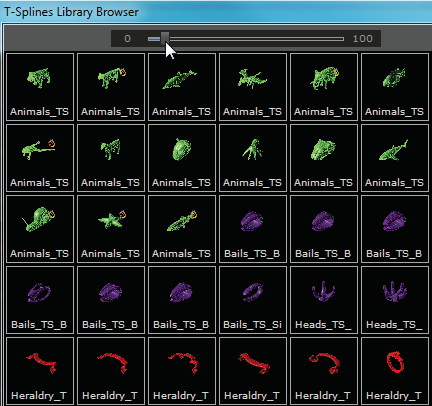
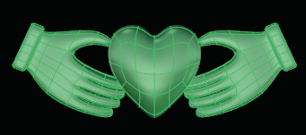
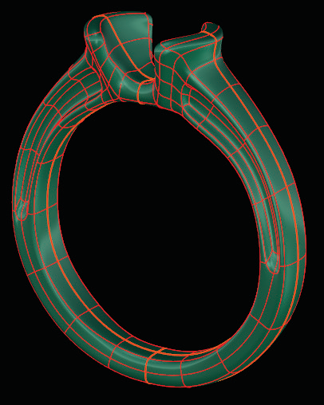
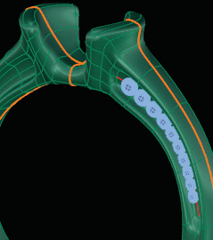
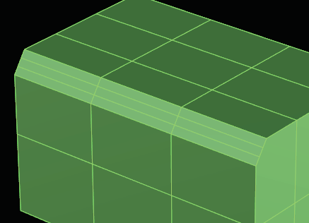
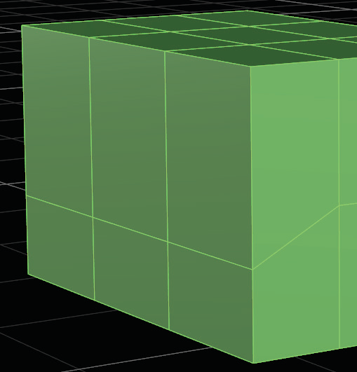

# Bevel 

- Source PDF: Matrix 8 Instruction Manual Book 2 (matrix_8_book_2.pdf)
- Page range: 87-88
- Section title: Bevel 
- Section id: m8book2-105-bevel
- Note: boundary page(s) are shared with a neighbouring section (two-column layout); text/images may include neighbour content.

---
<!-- section m8book2-105-bevel | Bevel  | m8book2 pages 87-88 -->

<!-- page 87 -->

Steps:
Browser Thumbnail Size: Change the size of
the browser thumbnail by moving the slider to the
right to increase the thumbnail size or moving it to
the left to decrease the thumbnail size.
• Select the Extract Wireframe command from the
T-Spline menu.
• Select T-Spline object(s).
• Press Enter when done.
Note: Similar to the Extract Wireframe command
in Matrix’s curve menu, the T-Splines Extract
Wireframe command draws a Matrix Curve along
every T-Spline edge. Depending on the complexity
of the model, this can be a lot of curves, so it is
highly recommended to change color layers prior to
running this command to make it easier to identify
and select the curves. Join up the desired curves and
discard the rest. This new curve can be used with all
of your matrix tools to layout gems or to add Milgrain
to a design.
T-Splines Library Browser. Click once to load a
design into Matrix.
Gems are placed
on the joined
curve segments
obtained
from Extract
Wireframe.
A Claddagh design from the T-Splines Library.
## Extract Wireframe
## Bevel
‘gvtsExtractWireframe’
Extracts a wireframe of a T-Spline as a series of
curve segments. This command draws a Matrix
Curve along every T-Spline edge.
‘tsBevel’
Replaces selected edges with a series of faces.
Use in Box Mode to create objects with a Beveled
edge look.
Where is this Command:
Access this command from T-Spline>Extract
Wireframe

<!-- page 88 -->

Where is this Command:
Access this command from T-Spline>Bevel
Steps:
Roundness: This option appears when
KeepOnFace is set to ‘No’ only. Also, it works only
when two or more Segments are used.
It determines how round or flat the Bevel is for
multiple Segments. Enter a value between 0.0
and 1.0. If an Edge on a corner is being beveled,
then a roundness of 0 will create a flat Bevel, and
a roundness of 1 will create a rounded Bevel.
• Select Bevel from the T-Spline menu.
• Select Edges to Bevel. (Select a loop of edges for
the best results.
• Set a Bevel percentage. Enter an amount between
0.0 - 1.0.
• Press Enter when done.
Note: Results are only visible in Box Mode.
### Command Line Options:
Bevel created
with three
Segments and
Roundness set
to 0.5.
Segments: The number of rows of faces created.
RetopoSnap=Yes/No: Turns On and Off
RetopoSnap.
RetopoOffset: When RetopoSnap is ‘On”, select
a value. Set the Offset distance from the mesh
that each point will snap to. If set to zero, the
control points will snap right on the mesh.
## Slide
A Bevel is created with 3 segments on each Edge.
Object before (left) and after (right) using Bevel.
.
Positioning = Percentage (default): The
Bevel will be contained to this percentage of
the faces neighboring the selected edge. The
Percentage is entered as a fraction between 0.0
and 1.0.
‘tsSlide’
This command slides selected Edges along
neighboring Edges.
Where is this Command:
Access this command from T-Spline>Slide
Steps:
Positioning = Distance: The Bevel will be
constrained to this distance away from the
selected edge. Set the Bevel by picking a point
along the T-Spline edge.
KeepOnFace: The outcome is based on the
number of Segments selected; two or more
Segments must be used. If on, the new faces will
be created on the faces of the old model.
• Select Slide from the T-Spline menu.
• Select Edges to Slide.
• Press Enter when done.
• Set Slide distance. Enter a percentage between
0.0 - 1.0.
• Press Enter when done.
Slide is used to move
the edges of faces.
KeepOnFace = ‘No’ with 2 Segments (left) and
KeepOnFace = ‘Yes’ with 2 Segments (right).

---

## Images

-  page 87 (shared page)
-  page 87 (shared page)
-  page 87 (shared page)
-  page 87 (shared page)
-  page 88 (shared page)
-  page 88 (shared page)
-  page 88 (shared page)
-  page 88 (shared page)
-  page 88 (shared page)
-  page 88 (shared page)
