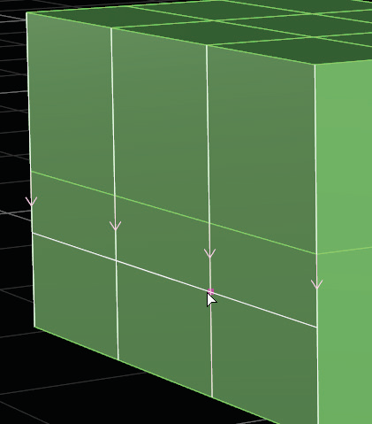
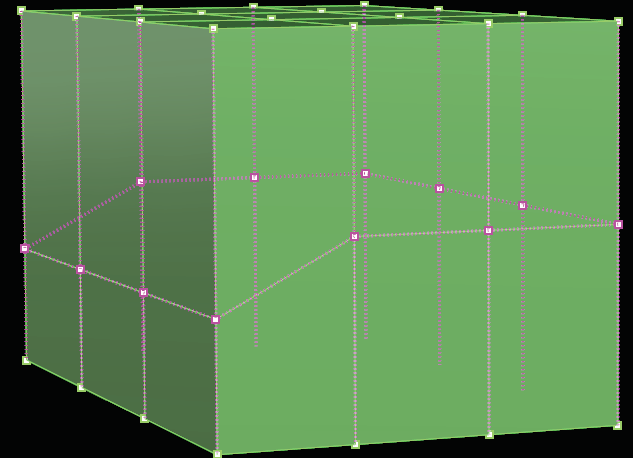
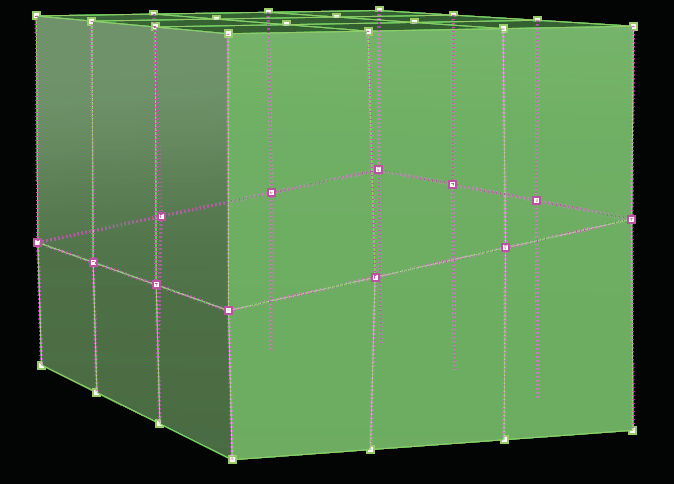
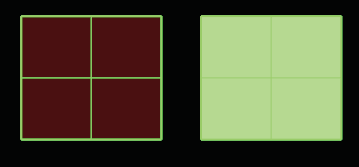
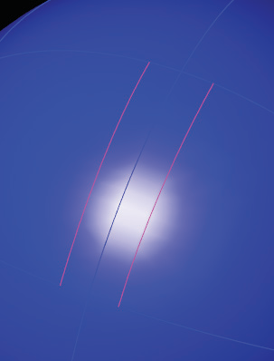
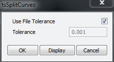

# Flip Normals 

- Source PDF: Matrix 8 Instruction Manual Book 2 (matrix_8_book_2.pdf)
- Page range: 89-90
- Section title: Flip Normals 
- Section id: m8book2-108-flip-normals
- Note: boundary page(s) are shared with a neighbouring section (two-column layout); text/images may include neighbour content.

---
<!-- section m8book2-108-flip-normals | Flip Normals  | m8book2 pages 89-90 -->

<!-- page 89 -->

### Command Line Options:
Where is this Command:
Access this command from T-Spline> Flatten
Steps:
Positioning = Percentage: The edge will slide
this far (as a percentage between 0.0 and 1.0)
toward the neighboring face, in the direction of
the arrows. To slide the other direction, type a
negative number.
• Select Flatten command from the T-Spline menu.
• Select at least 4 control points to Flatten.
• Press Enter when done.
Note: At least four vertices must be the input for the
Flatten points command to work. The command will
work on T-Spline, Nurbs and mesh control points.
Positioning = Distance: The edge will slide this
amount, as an absolute distance in mm, in the
direction of the arrows. To slide the other direction,
type a negative number.
Object with
control
points
before
Flatten.
Hint: Press the
“Alt” key to
disable O-Snaps
while selecting a
point along the
Edge.
Roundness: This option gives the ability to slide
along an arc. Enter a value from 0.0 to 1.0,
Object’s
control
points
after
Flatten.
RetopoSnap=Yes/No: Turns On and Off
RetopoSnap.
## Flip Normals
RetopOffset: When RetopoSnap is ‘On”, select a
value. Set the Offset distance from the mesh that
each point will snap to. If set to zero, the control
points will snap right on the mesh.
Note: It is easier to see what the slide command is
doing in Box mode than in Smooth mode. Use the
Smooth/Box Toggle to toggle to Box mode.
## Flatten
‘tsFlip’
Determine the direction a surface is facing using
the Flip Normals command. Every surface within
Matrix and T-Splines has what are referred to as
surface normals. You can think of surface normals
as, which way the surface thinks is up. This
command is used to avoid surfaces from pointing
inside out.
Where is this Command:
Access this command from T-Spline>Flip
Normals
Steps:
‘tsFlattenPoints’
Similar to the Rhino Set Points command, the
Flatten Points command aligns T-Splines vertices
along a single plane in space. This command is
ideal to use prior to creating Symmetry within an
object. It ensures the item you are mirroring will be
seamless and will Weld together with its neighbor
after the mirror.
• Select Flip Normals from the T-Spline menu.
• Select a T-Spline surface to Flip Normals.

<!-- page 90 -->

## Retopology Snap Options
Note: In the Display menu use the ‘Detect Backfaces’
view to display Matrix and T-Spline backfaces as red.
‘tsEditMode’ RetopoSnap
Retopology Snap will snap T-Splines control
points to the closest mesh or polysurface in the
scene for the following commands: Append,
Extrude, Insert Edge, Insert Point, Subdivide Face,
Bevel, and Slide.
Where is this Command:
Access this command from T-Spline>
Retopology Snap Options
A T-Spline surface inside out (left) and after using
Flip Normals (right) in Detect Backfaces Display
mode.
### Options:
## Extract Edge Curves
RetopologySnap=Yes/No: Toggles ‘ON’ or
‘OFF’ whether T-Splines control points will snap to
polysurfaces or meshes in the scene.
‘tsExtractEdges’
Extracts the selected edges from a T-Spline
surface. The resulting geometry is a curve. This
command works similarly to Extract Isocurve with
NURBS but on T-Spline models.
Note: The following options are only available
when Retopology Snap is set to ‘Yes’.
Snapin: Controls how the T-Spline control
points will snap to an object based on the World
coordinates or the active View.
Where is this Command:
Access this command from T-Spline>Extract
Edge Curves
Steps:
RetopoOffset: The offset distance from the
mesh that each point will snap to. If 0, the control
points will snap right on the mesh.
## Split Curves
• Select Extract Edge Curves from the T-Spline
menu.
• Select the Edge curve you wish to extract from the
T-Spline object.
• Press Enter when done.
### Options:
‘tsSplitCurves’
Splits a network of intersecting curves into curve
segments.
Offset: Pick a point along a perpendicular edge
to select an offset curve. Or, enter a percentage
between -1.0 and 1.0. Press Enter when done.
Where is this Command:
Access this command from T-Spline>Split
Curves
Steps:
BothSides: This option is available when Offset
is chosen. This will offset a curve equal distance
on both sides of the original T-Spline edge.
• Select Split Curves from the T-Splines menu.
• Select curves to Split.
• Use File Tolerance or uncheck and enter a custom
value. See below.
• Press ‘OK’ when
done.
Extract Edge Curve is used
with Offset and Both Sides to
produce two curves from one
edge.

---

## Images

-  page 89 (shared page)
-  page 89 (shared page)
-  page 89 (shared page)
-  page 90 (shared page)
-  page 90 (shared page)
-  page 90 (shared page)
