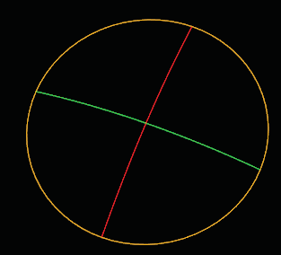
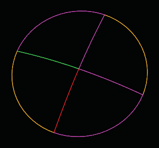
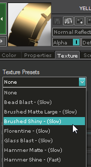
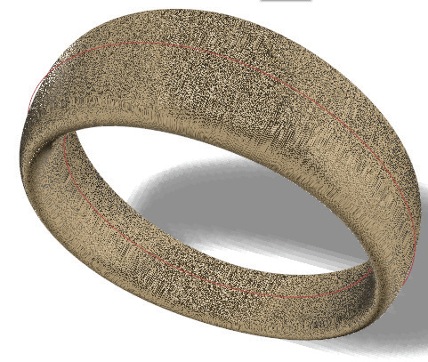
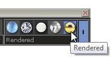
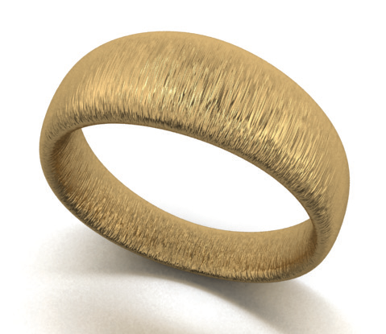
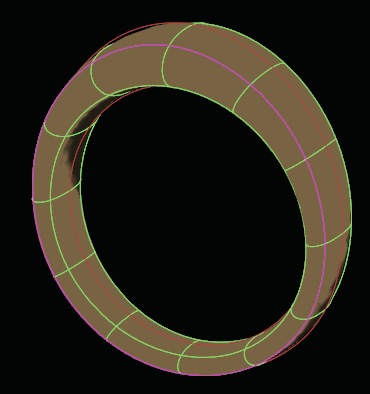
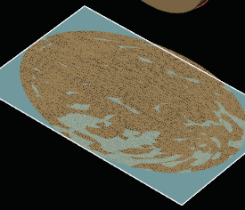
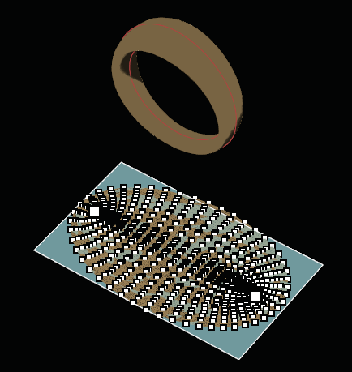

# Edit UVs 

- Source PDF: Matrix 8 Instruction Manual Book 2 (matrix_8_book_2.pdf)
- Page range: 91-93
- Section title: Edit UVs 
- Section id: m8book2-112-edit-uvs
- Note: boundary page(s) are shared with a neighbouring section (two-column layout); text/images may include neighbour content.

---
<!-- section m8book2-112-edit-uvs | Edit UVs  | m8book2 pages 91-93 -->

<!-- page 91 -->

### Options:
Use File Tolerance = On/Off: The Split Curves
command has a tolerance built in to help create a
split between curves that do not actually intersect.
Split Curves uses Rhino Properties Units settings
when defaulted to ‘ON’’ . If you wish to select your
own tolerance turn Off the File Tolerance and
enter a value in the provided box.
This overrides Rhino Properties unit tolerance and
uses the value entered.
Tolerance Value: When File Tolerance is turned
‘Off” (unchecked) enter a tolerance value to be
used during this instance of the Skin command.
Set the Display to
‘Rendered’ to view the
applied texture on the
T-Splines object in the
viewport. Or, render the
T-Splines object to get
the full effect.
Split Curves before (left) and after (right). Curves are
split at every intersection.
## Edit UVs
Rendered T-Spline object with applied texture
material.
Note: It’s always a good idea to save your design
before editing. So, place your design in a job bag
before beginning the next steps.
Edit UVs has three operations:
‘tsUVEditor’
Edit the UV layout of textures applied to T-Splines
and T-Spline render meshes. The Editor gives
control over how the texture wraps across the
whole T-Spline model instead of just being
repeated like a checkerboard.
• Set Texture Seams
• Create Texture Mesh
• Texture Mesh Live Points On
Where is this Command:
Access this command from T-Spline>Edit UVs
### Set Texture Seams:
Before Using Edit UVs:
A texture must be applied first to a T-Spline object
before using the Edit UVs command.
This operation lets you select T-Spline edges to
set the texture seams. This is where the texture
mesh will be “cut” so it can lay flat on the texture.
There is a ‘FromExisting’ option. If your model
already has a nice UV layout (for instance, if
you laid out the UVs/texture seams in another
program, or if you converted from a NURBS,
Open VRay Styles (Render Menu>VRay Styles),
go to Material Editor>Metal Materials>Texture. Use
the drop down arrow under ‘Texture Presets” to
select a Texture render material. Apply this to your
T-Spline object. (See Render Menu>VRay Styles
for detailed information.)

<!-- page 92 -->

• Select T-Spline to unwrap.
• Press Enter when done.
• Select the first corner of the rectangle.
• Select the other corner or length.
• Continue with ‘TextureMeshLivePointsOn’. See
next.
which has a nice rectangular UV layout, you can
click this “FromExisting” option. Otherwise, just
click the edges you will cut. (Control click will
deselect.)
There’s not just one right answer as to how to cut
the edges, this is more of an art than a science.
For example, if you have a tsBox, you could make
cuts to make a common cross pattern on the box,
so that each of the sides unfolds to form a cross
graphic
Use the ‘SetTextureSeams’ option to select
the seams where the model will be cut when it
unfolds.
Steps:
UnwrapRenderMesh: This option will first make
a mesh copy of the T-Spline surface, then unwrap
that mesh. The mesh copy (not the T-Spline
model) is the object whose texture you are editing
in this option. This is useful if you want to have
more points to edit in your texture mesh than
you have in your T-Spline model. By meshing at a
higher density, you can have more mesh points to
control how the texture lays on the model, while
leaving the T-Spline model with its original number
of control points.
Steps:
• Select Edit UVs from the T-Spline menu.
• Select ‘SetTextureSeams’ in the Command Line.
• Select T-Spline to set texture seams.
• Click on the T-Spline edges to set as edges of the
texture.
• Press Enter when done.
• Continue with ‘Create Texture Mesh’. See below.
• Select ‘CreateTextureMesh’ in the Command Line.
• Select ‘UnwrapRenderMesh’.
• Select T-Spline to mesh.
• Follow the prompt to draw a rectangle.
Selecting the
T-Spline edges to
set as edges of the
texture.
### Create Texture Mesh:
Unwrap Render Mesh from a ring made from
Tube From Curves.
This operation will unwrap the T-Spline model at
the texture seams to make a flat texture mesh.
Options:
UnwrapTSpline: This option will unwrap your
T-Spline and attempt to minimize face distortion.
Steps:
• Select ‘‘CreateTextureMesh’ in the Command Line.
• Select texture mesh creation method.
• Select ‘UnwrapTSpline’.
FromExistingTSplineUVs: This option will
unwrap your T-Spline based on the preexisting
UV pattern. For instance, if you unwrap a torus,
you will get very different results from the
‘UnwrapTSpline’ option. Also, if you had previously
created and edited a texture mesh for this object,
then deleted it, you can use this option to bring
back that edited texture mesh instead of needing
to start editing from scratch.

<!-- page 93 -->

Steps:
• Select ‘CreateTextureMesh’ in the Command Line.
• Select a creation method from the three choices
above.
• Press Enter when done.
• Follow the prompt to draw a rectangle.
This rectangle will contain the texture map image.
The command will then unwrap the flat texture
mesh on top of this rectangle.
### Texture Mesh Live Points On:
Texture mesh with live points on.
Once the texture mesh is on top of the rectangle,
you can move the points of the mesh around
to edit which texture mesh points (the UVs)
correspond to which parts of the image. This will
then change the projection of the image onto
your T-Spline model.
## Mesh	 T-Spline
‘tsMesh’
The T-Splines Mesh command allows you to mesh
a T-Splines directly from the T-Splines work flow,
as opposed to first converting it to a NURBS
surface.
The texture mesh is just that – a mesh. You can
move the mesh points around just by using the
Control Points On (Top 11 Commands menu)
command and moving them like you would any
other mesh point. The projection of the image
on the T-Spline model will update. However, the
TextureMeshLivePointsOn option provides an
option for moving them in a cool way.
Where is this Command:
Access this command from T-Spline>Mesh
T-Spline
Steps:
The way the LivePoints work is that there are
some larger points that are the “pinned points.”
Anytime you move a point, then the pinned points
stay in place, but all the other points in the model
can move to get a nice flow to the object. You
can move any point, whether it is pinned or not.
Each time you move a point, it in turn becomes a
pinned point. If you want to turn a pinned point
back into a non-pinned point, just select it and hit
the Delete key, and it will become small again as a
movable, non-pinned point.
• Select Mesh T-Spline from the T-Spline menu.
• Select T-Spline object to Mesh.
• Press Enter when done.
• Select the T-spline meshing options in the
Command Line.
• Press Enter when done.
• A mesh is created in the same space as the
T-Splines object. Use Layer colors to turn off one
or the other.
Steps:
Note: Mesh T-Spline usually exports a more
optimized mesh for a T-spline than the Rhino Mesh
command since tsMesh recognizes T-points. tsMesh
can also be used on NURBS and polysurfaces.
• Select ‘TextureMeshLivePointsOn’ in the Command
Line.
• Select texture mesh to enable live points.
• Press Enter when done.

---

## Images

-  page 91 (shared page)
-  page 91 (shared page)
-  page 91 (shared page)
-  page 91 (shared page)
-  page 91 (shared page)
-  page 91 (shared page)
-  page 92
-  page 92
-  page 93 (shared page)
