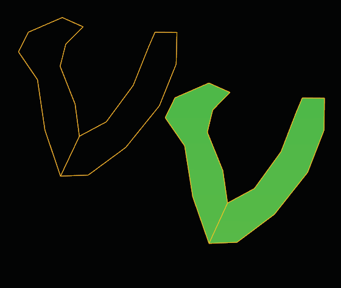

# From Lines 

- Source PDF: Matrix 8 Instruction Manual Book 2 (matrix_8_book_2.pdf)
- Page range: 94-95
- Section title: From Lines 
- Section id: m8book2-114-from-lines
- Note: boundary page(s) are shared with a neighbouring section (two-column layout); text/images may include neighbour content.

---
<!-- section m8book2-114-from-lines | From Lines  | m8book2 pages 94-95 -->

<!-- page 94 -->

Hints for Drawing Lines:
A mesh is made from a T-Splines object with the
Tolerance set to 0.2 (left) and 1.0 (right).
• Use Polyline or Single Line tool in the Curve menu
to draw the lines.
• If Interp Curve was used to draw a line, just rebuild
the curve (Curve Menu>Rebuild) and set the
Degree from Degree 3 to Degree 1.
• Only one degree, simple polylines are used.
• More control points on a line will create a surface
with tighter curvature.
• Less control points on the line will create a simpler,
looser surface.
• A closed line within a closed line will create a hole.
• Use ‘Split Curves’ command to split all the lines
where they may intersect.
### Options:
UseToleance = Yes/No: Determines whether to
use a specified number of divisions per face, or fit
to a tolerance.
Tolerance: If UseTolerance=Yes, the Tolerance
value determines the Mesh output as a mesh
dense enough to be within this distance of the
T-Spline surface at every point. An smaller amount
yields a more exact mesh (0.01) and a larger
amount yields a smaller file size (0.20).
Creating a T-Spline surface using From Lines.
DivisionsPerFace: If UseTolerance=No, each
face will be divided exactly this many times and
no more, even if significant detail is missing. This is
the number of divisions per T-Spline face.
Using From Lines:
## From Lines
tsFromLines’
Creates a T-Spline surface from a network of lines.
This command provides a way to make complex
surfaces with predictable results. It can also be
used to create custom primitives that are closer to
the desired final shape than the default primitives.
It can generate a closed or an open single surface,
rectangular or not, with holes and all kinds of
different topologies.
Where is this Command:
Access this command from T-Spline>From
Lines
• Select one or more networks of lines or polylines
and press Enter to create a preview mesh of faces.
This preview is the best guess of the command
at what your desired layout is, and is determined
according to the MaxAutoFace option.
• If the preview includes faces that you do not want
to include in your final model, select (click-on)
faces to remove them from the preview mesh.
• Click on edges to add faces to the preview mesh.
A pop-up box of possible faces will appear; just
select the desired face. You can control how many
faces will display in the pop-up box using the
‘MaxManualFace’ option.
• Edges which are not connected to any faces are
highlighted in red. Vertices which will result in a
non-manifold mesh are also highlighted in red.
Non-manifold vertices are automatically repaired,
but may not give you the result you’re expecting.

<!-- page 95 -->

MaxManualFace: The maximum number of
edges that manually selected faces can have.
This controls which faces will display in the pop-
up menu for user selection. Setting this to a high
number will generate long lists of possible faces.
Simple border faces such as those on the ends
of a cylinder will display automatically without the
need to set this to a high number.
Smooth: Yes-the output will be in Smooth mode.
No-the output will be in Box mode.
## Extrude Lines
‘tsExtrudeLines’
Use Extrude Lines command to help create a
control polygon for use with the T-Spline Skin or
From Lines commands. Extrude Lines works with
closed Curves, Polylines, Curves, single Lines or
Interp Curves.
Be sure to increase the
number of Max Auto
Face in order to
generate the surface.
Otherwise, you will see
the lines as solid red.
Where is this Command:
Access this command from T-Spline>Extrude
Lines
Steps:
### Command Line Options:
• Select Extrude Lines from the T-Spline menu.
• Select curves to Extrude.
• Press Enter when done.
• Pick an Extrusion distance. Enter a value in the
Command Line or drag the cursor up or down.
LineSnapping: Line endpoints that are within
tolerance will snap together. Colored dots display
the number of line endpoints that are snapping
together at that point, given the tolerance. Note
that lines only connect at the endpoints. If a
line endpoint is snapped to a different part of
another line, like the midpoint, ‘From Lines’ will
not recognize the intersection. If you want to
use intersecting lines that are not connected at
endpoints, you will need to split them first.
UseFileTolerance: Set the tolerance to the
default file tolerance.
Use Extrude Lines to
create a 3D control
polygon.
Tolerance:  Line endpoints closer than this
tolerance will snap together.
MaxAutoFace: The maximum number of edges
that automatically generated faces have. Set this
to zero to disable automatic face generation.

---

## Images

-  page 94 (shared page)
-  page 94 (shared page)
-  page 95 (shared page)
-  page 95 (shared page)
-  page 95 (shared page)
-  page 95 (shared page)
-  page 95 (shared page)
