# Extrude Lines 

- Source PDF: Matrix 8 Instruction Manual Book 2 (matrix_8_book_2.pdf)
- Page range: 95-96
- Section title: Extrude Lines 
- Section id: m8book2-115-extrude-lines
- Note: boundary page(s) are shared with a neighbouring section (two-column layout); text/images may include neighbour content.

---
<!-- section m8book2-115-extrude-lines | Extrude Lines  | m8book2 pages 95-96 -->

<!-- page 95 -->

MaxManualFace: The maximum number of
edges that manually selected faces can have.
This controls which faces will display in the pop-
up menu for user selection. Setting this to a high
number will generate long lists of possible faces.
Simple border faces such as those on the ends
of a cylinder will display automatically without the
need to set this to a high number.
Smooth: Yes-the output will be in Smooth mode.
No-the output will be in Box mode.
## Extrude Lines
‘tsExtrudeLines’
Use Extrude Lines command to help create a
control polygon for use with the T-Spline Skin or
From Lines commands. Extrude Lines works with
closed Curves, Polylines, Curves, single Lines or
Interp Curves.
Be sure to increase the
number of Max Auto
Face in order to
generate the surface.
Otherwise, you will see
the lines as solid red.
Where is this Command:
Access this command from T-Spline>Extrude
Lines
Steps:
### Command Line Options:
• Select Extrude Lines from the T-Spline menu.
• Select curves to Extrude.
• Press Enter when done.
• Pick an Extrusion distance. Enter a value in the
Command Line or drag the cursor up or down.
LineSnapping: Line endpoints that are within
tolerance will snap together. Colored dots display
the number of line endpoints that are snapping
together at that point, given the tolerance. Note
that lines only connect at the endpoints. If a
line endpoint is snapped to a different part of
another line, like the midpoint, ‘From Lines’ will
not recognize the intersection. If you want to
use intersecting lines that are not connected at
endpoints, you will need to split them first.
UseFileTolerance: Set the tolerance to the
default file tolerance.
Use Extrude Lines to
create a 3D control
polygon.
Tolerance:  Line endpoints closer than this
tolerance will snap together.
MaxAutoFace: The maximum number of edges
that automatically generated faces have. Set this
to zero to disable automatic face generation.

<!-- page 96 -->

Steps:
### Options:
Distance: Specify the distance of the extrusion.
a positive value will draw the control polygon up
and on top of the lines. A negative value will draw
the polygon down or under the input lines.
• Select vertices, edges or surfaces on a T-Spline
object.
• Select Grow from the T-Spline menu.
• The current selection will grow by one in each
direction
Direction: Define the direction of the extrusion
using 2 points in space.
The direction of the extrusion was made choosing
two points in space in the Through Finger viewport.
Select faces, edges or verts and choose Grow.
Before Grow (left) and after Grow (right).
BothSides=Yes/No: Controls whether the
extrusion extends in one direction from the
original curve or an equal distance on both sides
of the original curve.
## Shrink
Solid=Yes/No: If the profile curve is closed and
planar, both ends of the extruded object are filled.
DeleteInput=Yes/No: Input curves are deleted
or not.
‘tsSelection’ ShrinkSelection
Decrease the size of your selection of faces, edges,
and verts by one in each direction.
ToBoundary: Extrudes the object to a boundary
surface.
Where is this Command:
Access this command from T-Spline>Shrink
Steps:
SplitAtTangents: Specifies whether resulting
surfaces will be one surface or a polysurface
when the input curves are joined, tangent, curves.
Surfaces in the resulting polysurface object
correspond to the tangent sub-curves in the input
curves.
• Select vertices, edges or surfaces on a T-Spline
object.
• Select Shrink from the T-Spline menu.
• The current selection will decrease by one in each
direction.
SetBasePoint: Select a point in space as a
marker for the base point.
Note: Shrink works in the opposite way of Grow by
decreasing the number of items selected.
## Grow
‘tsSelection’ GrowSelection
Increases the size of your selection by one in each
direction. This works with faces, edges or verts.
Where is this Command:
Access this command from T-Spline>Grow
Selected Verts before Shrink (left) and after Shrink
(right).

---

## Images

- 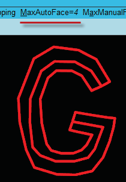 page 95 (shared page)
- 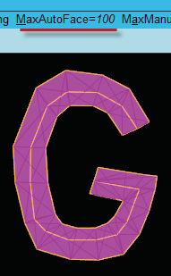 page 95 (shared page)
- 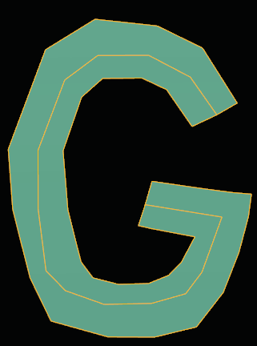 page 95 (shared page)
- 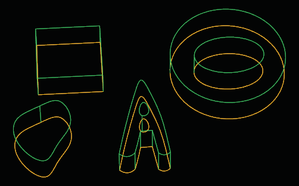 page 95 (shared page)
- 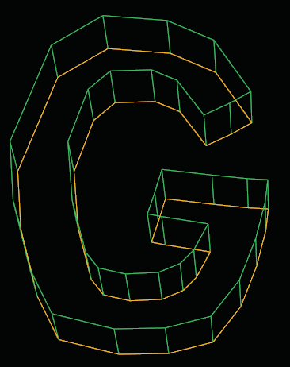 page 95 (shared page)
- 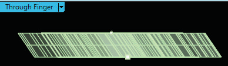 page 96 (shared page)
- 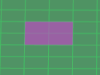 page 96 (shared page)
-  page 96 (shared page)
- 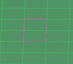 page 96 (shared page)
- 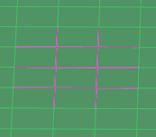 page 96 (shared page)
- 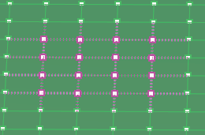 page 96 (shared page)
- 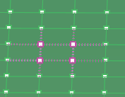 page 96 (shared page)
